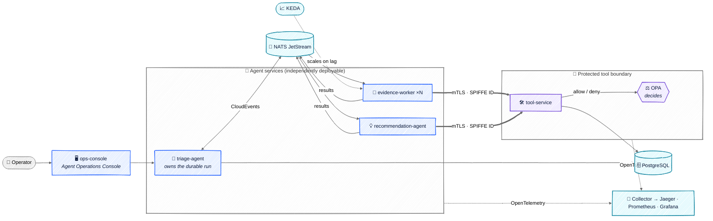

# Many Agents, One Platform

[](https://github.com/danieloh30/many-agents-one-platform/actions/workflows/pages.yml)

A reference demonstration of **operationally maintainable Java multi-agent services** on
Kubernetes and OpenShift, built from CNCF building blocks. An incident assistant investigates
increased checkout errors after a release — and the interesting part is everything around the
model calls: durable workflow state, asynchronous work with bounded retries, verified workload
identity, runtime policy enforcement, connected telemetry, and demand-driven scaling.

> **Status:** implemented and verified end to end on a local stack, with both the deterministic and a live model.
> Cluster deployment (`./demo.sh up`) is automated but has not yet been run against a live cluster. See
> [Verification status](#verification-status). This is a demonstration, not a production system.

## What it demonstrates

| Scenario | What you see |
| --- | --- |
| Successful run | Triage, evidence, and recommendation agents — separate services — complete a durable run; one trace connects every hop. |
| Policy denial | An agent attempts a simulated remediation without approval; the tool service verifies its identity and policy denies the call before anything executes. |
| Queue burst | A bounded burst of evidence work raises queue lag; evidence workers scale out and back. |
| Redelivery (optional) | A worker abandons a task after its tool call commits; the task is redelivered and the effect is still recorded once. |

Tool data is synthetic and remediation is simulated — the system cannot change a real cluster.
Model calls are real by default; a deterministic substitute exists for tests and is always labelled.

## Architecture at a glance



The diagram uses Mermaid's hand-drawn look. Renderers that don't support it, including older
Mermaid versions, show the same diagram in the classic style.

| Building block | Role |
| --- | --- |
| Java 25, Quarkus, Quarkus LangChain4j | Agent services with structured model outputs |
| React, TypeScript, Vite | Agent Operations Console |
| PostgreSQL | Durable run records, audit, outbox/inbox |
| NATS JetStream + CloudEvents | Durable asynchronous work and events |
| OpenTelemetry, Collector, Jaeger, Prometheus, Grafana | Traces, metrics, dashboards |
| SPIFFE/SPIRE | Workload identity on the mTLS connection to the tool service |
| Open Policy Agent | Runtime authorization at the tool service |
| KEDA | Scaling evidence workers on queue lag |
| Kubernetes, OpenShift | Deployment targets |

## Documentation

| Document | Contents |
| --- | --- |
| [docs/architecture.md](docs/architecture.md) | Services, ownership, run state machine, reliability model, sequence diagrams |
| [docs/contracts.md](docs/contracts.md) | Versioned REST and event contracts |
| [docs/security.md](docs/security.md) | Identity, authorization, enforcement flow, hardening |
| [docs/deployment.md](docs/deployment.md) | Manifests, kind and OpenShift profiles, prerequisites |
| [docs/ui-design.md](docs/ui-design.md) | Console design |
| [docs/demo-runbook.md](docs/demo-runbook.md) | Step-by-step live demonstration |
| [docs/dependency-maintenance.md](docs/dependency-maintenance.md) | Automated upgrades and compatibility gates |
| [docs/versions.md](docs/versions.md) | Pinned version set |
| [docs/decisions/](docs/decisions/README.md) | Architecture decision records |
| [IMPLEMENTATION_HANDOFF.md](IMPLEMENTATION_HANDOFF.md) | Ordered implementation backlog with acceptance criteria |

## Requirements

- JDK 25 or newer (Maven Wrapper included), Node.js 24 LTS or newer
- For OpenShift: `oc` logged in as a cluster administrator, `helm`; images are built in-cluster (no Docker Desktop)
- For other Kubernetes clusters: `kubectl`, `helm`, podman or docker, and a registry the cluster can pull from
- For the local stack: podman or docker, `openssl`, `jq`, `curl`
- An OpenAI-compatible model endpoint. Credentials stay server-side.

## Configuration

Copy `.env.example` to the git-ignored `.env.local`. Variables already in the environment take precedence.

| Variable | Default | Purpose |
| --- | --- | --- |
| `MAOP_MODEL_MODE` | `live` | `live` or `deterministic` (scripted, always labelled in the console) |
| `MAOP_MODEL_BASE_URL` | `https://api.openai.com/v1/` | OpenAI-compatible endpoint |
| `MAOP_MODEL_NAME` | `gpt-4o-mini` | Model name |
| `MAOP_MODEL_API_KEY` | value of `OPENAI_API_KEY` | Secret; stored only in the `model-credentials` Secret |
| `MAOP_NAMESPACE` | `maop` | Dedicated namespace |
| `MAOP_EVIDENCE_MAX_REPLICAS` | `6` | KEDA ceiling for evidence workers (respect model rate limits) |
| `MAOP_SPIRE_TRUST_DOMAIN` | detected / cluster apps domain | Needed with an existing SPIRE whose trust domain cannot be detected |
| `MAOP_EXPOSE_OBSERVABILITY` | `true` | Routes/Ingresses for Jaeger and Grafana |
| `MAOP_REGISTRY` | — | `--platform kubernetes` only |

See `.env.example` for the remaining optional variables.

## OpenShift

```bash
./demo.sh doctor
```

```bash
./demo.sh up --platform openshift --profile summit --install-platform-components
```

```bash
./demo.sh verify
```

```bash
./demo.sh open
```

Other commands: `./demo.sh build`, `status`, `logs [service]`, `token` (prints the presenter token), `reset`
(demonstration state only), `down` (keeps PVCs and Secrets unless `--delete-data`; removes project-installed
platform components only with `--uninstall-platform-components`). Without `--install-platform-components`,
`up` reuses existing KEDA/SPIRE (or the Custom Metrics Autoscaler) and fails with an actionable message if they
are missing. Details: [docs/deployment.md](docs/deployment.md).

## Local stack (no cluster)

```bash
./mvnw -B package -DskipTests && (cd web && npm ci && npm run build) && ./mvnw -B -pl ops-console package -DskipTests
```

```bash
scripts/local/stack.sh up
```

```bash
scripts/local/stack.sh e2e
```

The console is at http://localhost:8080 and Jaeger at http://localhost:16686. The presenter token is written to
`.maop/local/presenter-token`. The model is deterministic by default here; run `MAOP_MODEL_MODE=live
scripts/local/stack.sh up` to use the configured live model.

## Tests

```bash
./mvnw -B verify
```

```bash
cd web && npm ci && npm run typecheck && npm run lint && npm test && npm run build
```

Backend tests use real PostgreSQL, NATS and OPA containers (Testcontainers) and a deterministic model.
Live-model tests are separate: `./mvnw -B verify -Plive-model` or the `live-model-check` workflow.

## Verification status

| Area | Status |
| --- | --- |
| Java build and tests (JDK 25) | Pass locally |
| SPA typecheck, lint, tests, build | Pass locally |
| OPA policy tests | Pass locally, 100 % coverage |
| Local end-to-end (5 services, real NATS/PostgreSQL/OPA/Jaeger, mTLS) | Pass with the deterministic model and with live `gpt-4o-mini` |
| KEDA scale-out, SPIRE-issued SVIDs, OpenShift Routes/builds/SCCs | **Unverified**: requires running `./demo.sh up` on a cluster |
| GitHub Actions workflows | Checked with actionlint locally; first GitHub run reported in the commit history |

## Safety notes

- No real remediation: remediation tools write a simulated record only.
- No fabricated operational data: the console shows "Unavailable" when a source cannot be read.
- No hidden reasoning: only structured decisions and concise explanations are stored or displayed.
