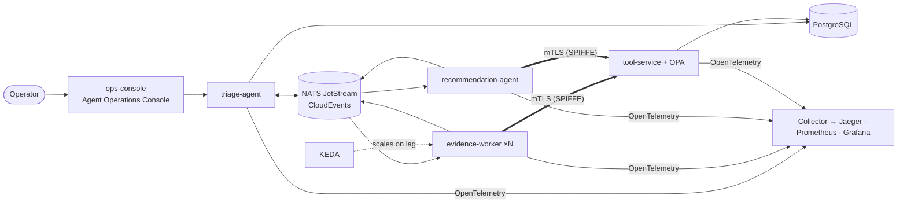

# Many Agents, One Platform

A reference demonstration of **operationally maintainable Java multi-agent services** on
Kubernetes and OpenShift, built from CNCF building blocks. An incident assistant investigates
increased checkout errors after a release — and the interesting part is everything around the
model calls: durable workflow state, asynchronous work with bounded retries, verified workload
identity, runtime policy enforcement, connected telemetry, and demand-driven scaling.

> **Status: design complete, implementation not started.** This repository currently contains the
> architecture and design documents. Start with [IMPLEMENTATION_HANDOFF.md](IMPLEMENTATION_HANDOFF.md).

## What it demonstrates

| Scenario | What you see |
| --- | --- |
| Successful run | Triage, evidence, and recommendation agents — separate services — complete a durable run; one trace connects every hop. |
| Policy denial | An agent attempts a simulated remediation without approval; the tool service verifies its identity and policy denies the call before anything executes. |
| Queue burst | A bounded burst of evidence work raises queue lag; evidence workers scale out and back. |
| Redelivery (optional) | A worker abandons a task after its tool call commits; the task is redelivered and the effect is still recorded once. |

Tool data is synthetic and remediation is simulated — the system cannot change a real cluster.
Model calls are real by default; a deterministic substitute exists for tests and is always labelled.

## Architecture at a glance



| Building block | Role |
| --- | --- |
| Java 25, Quarkus, Quarkus LangChain4j | Agent services with structured model outputs |
| React, TypeScript, Vite | Agent Operations Console |
| PostgreSQL | Durable run records, audit, outbox/inbox |
| NATS JetStream + CloudEvents | Durable asynchronous work and events |
| OpenTelemetry, Collector, Jaeger, Prometheus, Grafana | Traces, metrics, dashboards |
| SPIFFE/SPIRE | Workload identity on the mTLS connection to the tool service |
| Open Policy Agent | Runtime authorization at the tool service |
| KEDA | Scaling evidence workers on queue lag |
| Kubernetes, OpenShift | Deployment targets |

## Documentation

| Document | Contents |
| --- | --- |
| [docs/architecture.md](docs/architecture.md) | Services, ownership, run state machine, reliability model, sequence diagrams |
| [docs/contracts.md](docs/contracts.md) | Versioned REST and event contracts |
| [docs/security.md](docs/security.md) | Identity, authorization, enforcement flow, hardening |
| [docs/deployment.md](docs/deployment.md) | Manifests, kind and OpenShift profiles, prerequisites |
| [docs/ui-design.md](docs/ui-design.md) | Console design |
| [docs/demo-runbook.md](docs/demo-runbook.md) | Step-by-step live demonstration |
| [docs/dependency-maintenance.md](docs/dependency-maintenance.md) | Automated upgrades and compatibility gates |
| [docs/versions.md](docs/versions.md) | Pinned version set |
| [docs/decisions/](docs/decisions/README.md) | Architecture decision records |
| [IMPLEMENTATION_HANDOFF.md](IMPLEMENTATION_HANDOFF.md) | Ordered implementation backlog with acceptance criteria |

## Requirements (once implemented)

- JDK 25 or newer, Node.js 24 LTS, `kubectl` or `oc`, `helm`, a container engine
- kind for local use, or OpenShift 4.21+ with cluster-admin access
- An OpenAI-compatible model endpoint and API key (kept server-side)

## Planned quick start (kind)

These commands describe the designed workflow; they do not exist until the implementation lands.

```bash
make preflight      # read-only checks
make platform       # KEDA and SPIRE from pinned Helm charts
make build          # services, console, images
make deploy         # namespace, secrets, manifests
make smoke          # end-to-end verification
```

Configuration is supplied through a git-ignored `.env.local`:

```bash
MAOP_MODEL_BASE_URL=https://<your-openai-compatible-endpoint>/v1/
MAOP_MODEL_NAME=<model-name>
MAOP_MODEL_API_KEY=<key>
```

## Safety notes

- No real remediation: remediation tools write a simulated record only.
- No fabricated operational data: the console shows "Unavailable" when a source cannot be read.
- No hidden reasoning: only structured decisions and concise explanations are stored or displayed.
