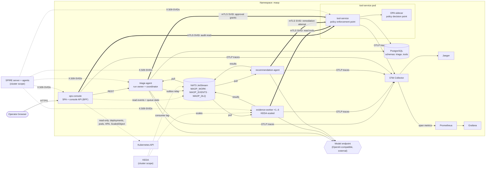
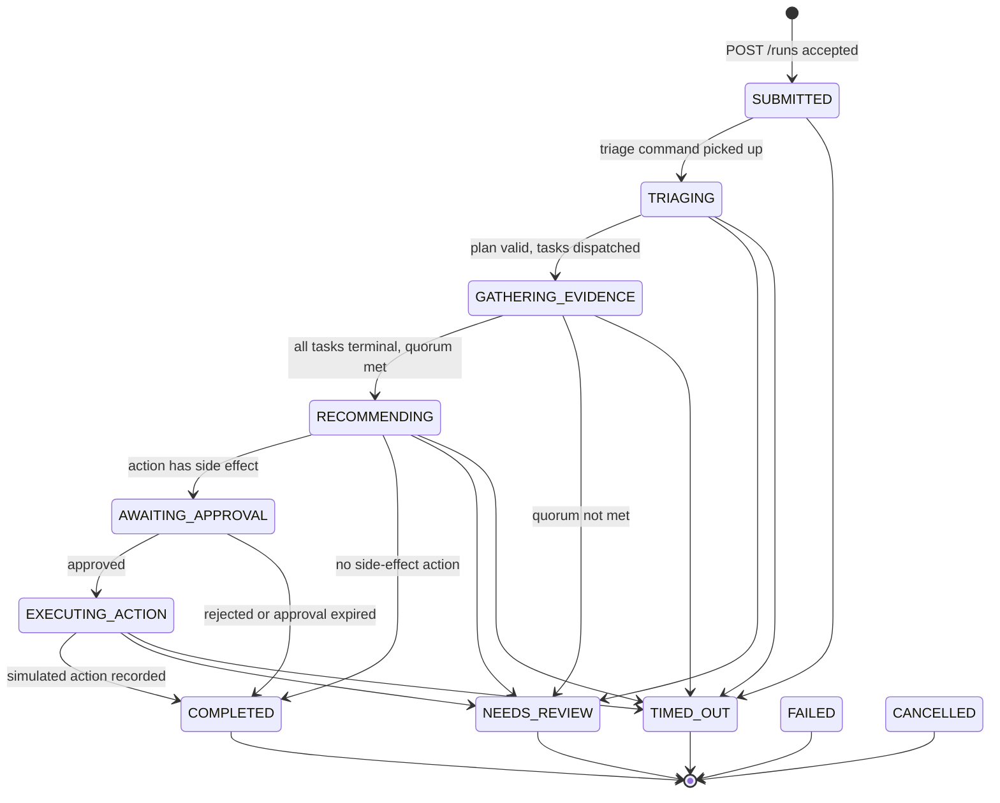
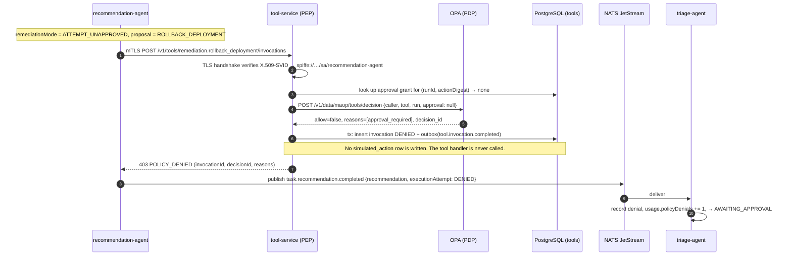
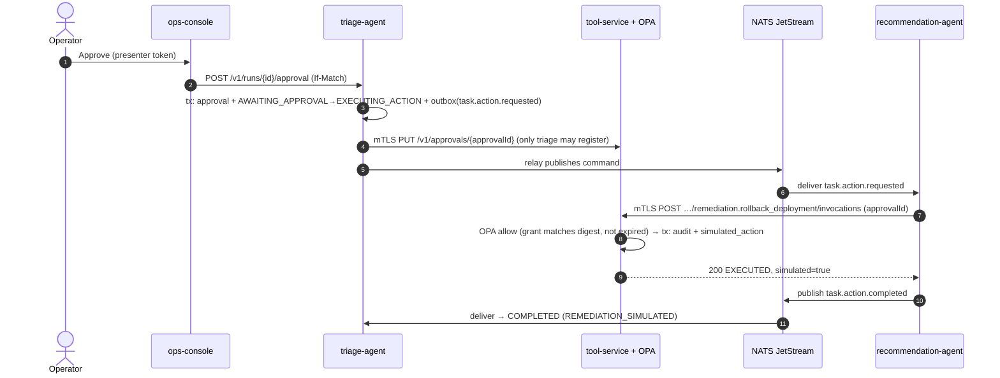
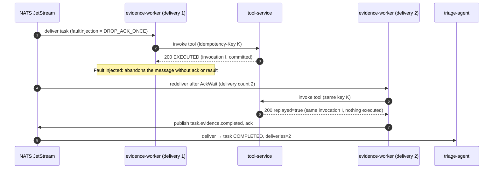

# Architecture

An incident assistant investigates increased checkout errors after a release. The point of the
system is not the model calls; it is everything around them that makes multi-agent work
operable: durable state, bounded retries, verified identity, policy enforcement, connected
telemetry, and demand-driven scaling.

Related documents: [contracts.md](contracts.md) (REST and events), [security.md](security.md)
(identity and policy), [deployment.md](deployment.md) (Kubernetes and OpenShift),
[versions.md](versions.md) (the pinned version set), [decisions/](decisions/) (why).

## 1. System overview



Solid arrows are plain in-namespace calls, thick arrows are SPIFFE mTLS, dotted arrows are
control-plane or read-only observation.

## 2. Service boundaries and ownership

Each service is its own Maven module, container image, Deployment, ServiceAccount, and SPIFFE
identity. A service owns its data exclusively; no service reads another service's schema.

| Service | Owns | Does | Never does |
| --- | --- | --- | --- |
| **ops-console** | Nothing durable. An in-memory replay buffer of recent events. | Serves the SPA; exposes the console API and SSE; aggregates runtime snapshots from NATS and the Kubernetes API; proxies run commands to triage and audit reads to tool-service; enforces the presenter token. | Call a model. Decide workflow state. Hold write access to any cluster resource. |
| **triage-agent** | `triage` schema: runs, tasks, timeline, approvals, outbox, inbox, idempotency keys. | Classifies the incident (model call → `TriagePlan`); is the **only** writer of run state; dispatches commands; folds results; enforces deadlines and budgets; registers approval grants. | Call investigation or remediation tools. |
| **evidence-worker** | Nothing durable (stateless, horizontally scaled). | Consumes evidence tasks; uses a model with read tools to gather facts through tool-service; publishes a structured `EvidenceItem`. | Write to a database. Delegate further work. Call remediation tools (policy would deny). |
| **recommendation-agent** | Nothing durable (stateless). | Produces a `Recommendation` grounded in evidence; in `ATTEMPT_UNAPPROVED` mode or after approval, requests the simulated remediation from tool-service. | Decide whether the action is allowed. Persist run state. |
| **tool-service** | `tools` schema: invocations (audit + idempotency), approval grants, simulated actions, synthetic catalogue/deployment data, outbox. | Authenticates the caller's SVID, asks OPA, records the decision, executes the simulated tool at most once per idempotency key. | Call a model. Call any cluster or external API. Trust identity from a header. |
| **OPA** (sidecar) | Policy bundle (from Git via ConfigMap). | Answers allow/deny with reasons and a decision ID. | Hold business state. |

Agents share one library module, `maop-common`: CloudEvents envelope mapping, contract records,
the JetStream adapter, trace-context propagation, and outbox/inbox helpers. It contains no
business logic and no service-specific configuration.

Why workers are stateless and correctness still holds: every effect a worker causes commits
somewhere durable and idempotent — tool executions in tool-service keyed by idempotency key,
task results in triage keyed by event ID. A worker can crash at any point and be redelivered.

## 3. Business state versus runtime snapshots

Two kinds of information are kept strictly apart.

| | Business workflow state | Runtime snapshot |
| --- | --- | --- |
| Examples | Run state, tasks, evidence, recommendation, approvals, tool audit, usage | Queue depth, queue age, in-flight count, pod list, replica counts, scaler status, component health |
| Source of truth | PostgreSQL (`triage`, `tools`) | NATS server, Kubernetes API, health endpoints — read at observation time |
| Lifetime | Durable; survives every restart | Ephemeral; valid only at `observedAt` |
| Written by | The owning service inside a transaction | Nobody — it is read, never stored |
| API | `/api/v1/runs…`, `/api/v1/audit…` | `/api/v1/ops/snapshot`, `ops-snapshot` SSE events |
| Failure rendering | Request error | Field is `null` with `status: UNAVAILABLE` |

Consequences: a run never contains replica counts; the snapshot never contains run decisions;
observation events on `MAOP_EVENTS` (`task.started`, `worker.heartbeat`, …) may be lost or
replayed without affecting any run; nothing in the workflow reads the snapshot to make a decision.

## 4. Durable run state machine

`triage-agent` is the single writer. State is a column on `triage.run` guarded by an optimistic
`version`.



`FAILED` and `CANCELLED` are reachable from every non-terminal state (omitted from the diagram
for legibility).

### 4.1 Permitted transitions

| From | To | Trigger | Guard |
| --- | --- | --- | --- |
| — | `SUBMITTED` | `POST /v1/runs` | Admission limits pass; idempotency key new. |
| `SUBMITTED` | `TRIAGING` | `run.triage.requested` delivered | Deadline not passed. |
| `TRIAGING` | `GATHERING_EVIDENCE` | `TriagePlan` validated | 1 ≤ tasks ≤ `maxEvidenceTasks`; topics unique. |
| `GATHERING_EVIDENCE` | `RECOMMENDING` | Last task becomes terminal | ≥ 1 `EvidenceItem` completed (quorum). Completeness recorded as `COMPLETE` or `PARTIAL`. |
| `RECOMMENDING` | `AWAITING_APPROVAL` | `task.recommendation.completed` | `proposedAction.sideEffect = true`. A denied `executionAttempt` is recorded and counted, and still lands here. |
| `RECOMMENDING` | `COMPLETED` (`NO_ACTION_REQUIRED`) | `task.recommendation.completed` | `sideEffect = false`. |
| `AWAITING_APPROVAL` | `EXECUTING_ACTION` | `POST …/approval` `APPROVE` | `actionDigest` matches; approval deadline not passed; `If-Match` version current. |
| `AWAITING_APPROVAL` | `COMPLETED` (`ACTION_REJECTED` / `APPROVAL_EXPIRED`) | `REJECT`, or sweeper | — |
| `EXECUTING_ACTION` | `COMPLETED` (`REMEDIATION_SIMULATED`) | `task.action.completed` | — |
| any non-terminal | `NEEDS_REVIEW` | `task.dead_lettered`, non-retryable `task.failed` on a required task, invalid model output after one repair attempt, budget exhausted | — |
| any non-terminal except `AWAITING_APPROVAL` | `TIMED_OUT` | Deadline sweeper | `now > deadline`. |
| any non-terminal | `CANCELLED` | `POST …/cancel` | — |
| any non-terminal | `FAILED` | Unrecoverable internal invariant violation | — |

Anything not in this table is rejected. Terminal states never change. Events arriving for a
terminal run are acknowledged, recorded in the timeline as `IGNORED_LATE`, and have no effect.

`outcome` (set only on terminal states): `NO_ACTION_REQUIRED`, `ACTION_REJECTED`,
`APPROVAL_EXPIRED`, `REMEDIATION_SIMULATED`, `EVIDENCE_ONLY` (burst runs), plus the failure reason
for `NEEDS_REVIEW` / `FAILED` / `TIMED_OUT`.

Task states (`triage.run_task`): `DISPATCHED → COMPLETED | FAILED | DEAD_LETTERED | EXPIRED`.
Delivery attempts and `startedAt` are observations copied from events for display only.

### 4.2 Deadlines

- **Run deadline**: absolute instant = `createdAt + 120 s` (configurable, max 300 s). It travels in
  every command as `maopdeadline`. Each hop checks it before spending money or causing effects:
  before a model call, before a tool call, and in tool-service before execution.
- **Per-call timeouts** are derived: `min(configured timeout, deadline − now − 2 s)`. A call is not
  started with less than 3 s remaining; the task fails with `DEADLINE_EXCEEDED` instead.
- **Approval deadline**: `10 min` after entering `AWAITING_APPROVAL`; the run deadline is suspended
  while waiting for a human and a fresh 60 s execution deadline starts on approval.
- **Sweeper**: a scheduled job in triage (every 5 s) selects overdue runs with
  `FOR UPDATE SKIP LOCKED` and moves them to `TIMED_OUT` or `COMPLETED (APPROVAL_EXPIRED)`.
  It is the backstop for every lost-message case.

### 4.3 Delegation budgets

A budget is fixed at submission, stored on the run, and sliced into each command. Usage is
reported in every result event and accumulated transactionally by triage.

| Limit | Default | Hard cap | Enforced by |
| --- | --- | --- | --- |
| Evidence tasks per run | 4 | 6 | triage (plan is truncated, truncation recorded) |
| Delegation depth | 1 | 1 | Contract: workers have no dispatch capability |
| Model calls per run | 12 | 20 | triage before each dispatch; workers per task slice |
| Model calls per evidence task | 2 | 3 | evidence-worker |
| Tool calls per task | 4 | 6 | Worker (`quarkus.langchain4j.ai-service.max-tool-executions`) and counted |
| Output tokens per model call | 800 | 1500 | Provider `max-tokens` setting |
| Total tokens per run | 24 000 | 40 000 | triage; exceeding → `NEEDS_REVIEW (BUDGET_EXHAUSTED)` |

## 5. Scenario sequences

### 5.1 Successful run with one connected trace

```mermaid
sequenceDiagram
  autonumber
  actor Op as Operator
  participant C as ops-console
  participant T as triage-agent
  participant DB as PostgreSQL (triage)
  participant N as NATS JetStream
  participant E as evidence-worker
  participant TS as tool-service + OPA
  participant R as recommendation-agent
  participant M as Model endpoint

  Op->>C: POST /api/v1/runs (Idempotency-Key)
  C->>T: POST /v1/runs
  T->>DB: tx: insert run SUBMITTED + outbox(run.triage.requested)
  T-->>C: 202 Run (runId, traceId)
  T->>N: relay publishes outbox rows (Nats-Msg-Id = event id, traceparent)
  N->>T: deliver run.triage.requested
  T->>M: classify → TriagePlan (structured)
  T->>DB: tx: inbox + TRIAGING→GATHERING_EVIDENCE + tasks + outbox(evidence.requested ×N)
  T->>N: relay publishes N commands
  par each evidence task
    N->>E: deliver task.evidence.requested
    E->>M: plan tool use
    E->>TS: mTLS POST /v1/tools/{tool}/invocations (Idempotency-Key)
    TS->>TS: verify SVID → OPA allow → tx: audit + execute
    TS-->>E: 200 result (invocationId, decisionId)
    E->>M: summarise → EvidenceItem
    E->>N: publish task.evidence.completed (deterministic id), then ack
  end
  N->>T: deliver results
  T->>DB: tx per result: inbox + task update; last one → RECOMMENDING + outbox(recommendation.requested)
  N->>R: deliver task.recommendation.requested
  R->>M: recommend → Recommendation (citations validated)
  R->>N: publish task.recommendation.completed, then ack
  N->>T: deliver result
  T->>DB: tx: inbox + RECOMMENDING→AWAITING_APPROVAL
  Note over C,Op: SSE shows each step live. The trace opened at step 1 spans every hop.
```

### 5.2 Unapproved remediation denied before execution



### 5.3 Approved simulated execution (extends 5.1 or 5.2)



The grant is registered before the command is relayed: the `PUT` is idempotent and is retried by
the same outbox relay entry (an outbox row of kind `HTTP_APPROVAL_GRANT` ordered ahead of the
command row), so neither step can be lost.

### 5.4 Redelivery without a duplicate effect (optional)



### 5.5 Bounded queue burst and scale-out

```mermaid
sequenceDiagram
  autonumber
  actor Op as Operator
  participant C as ops-console
  participant T as triage-agent
  participant N as NATS JetStream
  participant K as KEDA + HPA
  participant D as Deployment evidence-worker

  Op->>C: POST /api/v1/bursts
  C->>T: POST /v1/bursts (clamped to cap)
  T->>T: tx: create K runs with planSource=PRESET, outbox ×(K·3)
  T->>N: relay publishes ~36 evidence commands
  loop every pollingInterval
    K->>N: read consumer evidence-workers lag
  end
  K->>D: scale 1 → up to 6 (lag / lagThreshold)
  D->>N: new pods pull work
  Note over N,D: Queue drains; after cooldown KEDA returns to minReplicaCount
```

Burst runs skip the triage model call (their plan is a visible preset, `planSource: PRESET`) so
the queue fills immediately, and they stop after evidence (`outcome: EVIDENCE_ONLY`). The
evidence work itself is real: real model calls, real tool calls, real policy checks.

## 6. Messaging reliability

### 6.1 Transactional outbox (triage-agent, tool-service)

- Table `outbox_event(id, kind, subject, type, headers jsonb, payload jsonb, traceparent, created_at, published_at, attempts, last_error)`.
- State change and outbox insert commit in **one** local transaction. Nothing is published inside
  a request or message-handler transaction.
- A relay in the same service polls every 250 ms: `SELECT … WHERE published_at IS NULL ORDER BY id
  LIMIT 50 FOR UPDATE SKIP LOCKED`, publishes each row to JetStream with `Nats-Msg-Id = id`, waits
  for the publish acknowledgement, then sets `published_at`. `SKIP LOCKED` makes multiple replicas safe.
- Relay failure leaves rows unpublished; they are retried forever with capped exponential backoff
  and exposed as the metric `maop_outbox_pending` and `maop_outbox_oldest_age_seconds` (alerting,
  not dropping). Published rows are deleted after 24 h.
- Per-run ordering is preserved because rows are relayed in `id` order (UUIDv7) and consumers
  tolerate reordering anyway (state guards, §4.1).

Change-data-capture (Debezium) is deliberately not used; see ADR-0004.

### 6.2 Durable deduplication (inbox)

- Table `inbox_event(consumer, event_id, received_at, PRIMARY KEY (consumer, event_id))`.
- A handler runs: begin → insert inbox row → apply state change → insert outbox rows → commit →
  **then** ack. A unique-key violation means "already processed": rollback, ack, done.
- Inbox rows are retained 7 days, far longer than any redelivery or stream max-age.

### 6.3 Concurrency control

- `run.version` is a JPA `@Version` column. Parallel result handlers for the same run race
  safely: the loser gets an optimistic-lock failure, its transaction (including the inbox row)
  rolls back, and the message is negatively acknowledged with a short delay and retried.
- The "last task finished" decision is taken inside that same versioned transaction, so the
  recommendation command is dispatched exactly once.
- REST writes that depend on current state (`approval`) require `If-Match`.
- `POST /v1/runs` idempotency: table `idempotency_key(key, request_hash, run_id, created_at)` with
  a unique key, inserted in the run-creation transaction.

### 6.4 Idempotent simulated tool execution

In tool-service, one transaction per request:

1. `INSERT INTO tool_invocation (idempotency_key, args_digest, …) ON CONFLICT DO NOTHING`.
2. If the row already existed: same `args_digest` → return the stored response with
   `replayed: true`; different digest → `409`.
3. Otherwise evaluate policy; write the decision; if allowed run the handler (which only reads
   seed data or inserts a `simulated_action` row) and store the result; insert the outbox
   observation event; commit.

A concurrent duplicate blocks on the unique index until the first transaction commits, then takes
branch 2. Denials are stored the same way, so a retried denied request does not re-evaluate and
cannot flip to allowed without a new, approved request (which carries an `approvalId` and
therefore a different idempotency key).

### 6.5 Retries, timeouts, and the review path

| Layer | Policy |
| --- | --- |
| Model client | Timeout 20 s; **1** client-level retry on transport errors; rate-limit responses are not retried in-process — the message is negatively acknowledged with delay. |
| Tool client | Connect 2 s, read 5 s; 2 retries with jitter for `503`/timeouts only (safe because of the idempotency key); never retries `403`/`409`/`422`. |
| OPA query | 500 ms timeout, no retry; failure → `503 POLICY_UNAVAILABLE`, fail closed. |
| Message consumer | `MaxDeliver` 3; `AckWait` 20–30 s with an in-progress acknowledgement every `AckWait / 3` while working; no `BackOff` list (it would replace `AckWait`). A crashed worker's message is redelivered after `AckWait`. |
| Classification of failures | **Retryable** (nak with delay 2 s, then 5 s): model/tool unavailable, rate limited, optimistic-lock conflict. **Non-retryable** (publish `task.failed`, then ack): invalid command, deadline exceeded, budget exhausted, policy denial of a required call, model output invalid after one repair prompt. |
| Final delivery | On the last permitted delivery a worker that still cannot finish publishes `task.dead_lettered`, copies the original message with failure metadata to `maop.dlq.v1.<kind>`, and then **acknowledges** the original so the work-queue stream deletes it. |
| Crash on every delivery | A message that exhausts `MaxDeliver` without any handler finishing stays in a work-queue stream. triage-agent subscribes to `$JS.EVENT.ADVISORY.CONSUMER.MAX_DELIVERIES.MAOP_WORK.*`, copies the referenced message to the DLQ, deletes it from the stream, and marks the task `DEAD_LETTERED`. |
| Review | The run moves to `NEEDS_REVIEW` with the reason; the console lists it with the DLQ subject. Nothing is retried automatically after that. |
| Backstop | The deadline sweeper (§4.2) resolves any run whose messages were lost entirely. |

Worst-case model attempts per task = 3 deliveries × 2 calls × (1 + 1 retry) = 12, bounded
additionally by the run's model-call and token budgets.

## 7. Model usage and concurrency limits

- **Configuration** (server-side only; the browser never sees credentials):
  `quarkus.langchain4j.openai.base-url`, `quarkus.langchain4j.openai.api-key`,
  `quarkus.langchain4j.openai.chat-model.model-name`, supplied from a Kubernetes Secret /
  ConfigMap as `MAOP_MODEL_BASE_URL`, `MAOP_MODEL_API_KEY`, `MAOP_MODEL_NAME`. Any
  OpenAI-compatible endpoint works.
- **Per-pod concurrency**: a fair semaphore (`maop.model.max-concurrent`, default 2 for
  evidence-worker and triage, 1 for recommendation). A task that cannot get a permit within 10 s
  is negatively acknowledged with delay. Cluster-wide ceiling for evidence = `2 × maxReplicaCount`
  = 12 concurrent calls; the KEDA maximum is chosen with the provider's rate limit in mind.
- **Admission control** in triage: at most `maop.limits.max-active-runs` (25) non-terminal runs
  and `maop.limits.max-runs-per-hour` (120); beyond that `429` with `Retry-After`. Bursts are
  capped at `maop.burst.max-runs` (12) and one active burst.
- **Budgets**: §4.3. Token usage is taken from provider responses via a `ChatModelListener`,
  attached to result events, stored on the run, and exported as metrics.
- **Model mode**: `maop.model.mode = live` (default) or `deterministic`. Deterministic mode swaps
  in an explicit `ScriptedChatModel` and is stamped on every event (`maopmodelmode`), every stored
  result, every span (`maop.model.mode`), and the console top bar. There is **no automatic
  fallback** from live to deterministic: a failing model produces a failed or reviewable run.
- **Structured output**: AI services return records; outputs are schema-validated and
  domain-validated. One repair attempt is allowed (counts against the budget); then
  `MODEL_OUTPUT_INVALID`.
- Prompts and completions are not logged and not attached to spans
  (`quarkus.langchain4j.tracing.include-prompt=false`, `include-completion=false`).

## 8. Observability

- **Traces**: every service exports OTLP to the Collector, which forwards to Jaeger. One run = one
  trace. Context crosses process boundaries three ways:
  1. HTTP: automatic W3C `traceparent` (REST server and REST client instrumentation).
  2. Messages: the adapter injects `traceparent`/`tracestate` into NATS headers on publish and
     extracts them on receive, starting a `CONSUMER` span named `<subject> process` as a child of
     the producer's context.
  3. Outbox: the current `traceparent` is stored on the outbox row at insert and re-injected by
     the relay, so the asynchronous hop does not break the trace. The run stores its root
     `trace_id`; later steps (approval, execution) attach to it by restoring the stored context.
- **Span attributes**: `maop.run.id`, `maop.task.id`, `maop.model.mode`, `messaging.*`,
  `maop.tool.name`, `maop.policy.decision`, `maop.policy.decision_id`, `maop.caller.spiffe_id`,
  `maop.delivery.attempt`. No prompt text, no tool result bodies.
- **Metrics**: Micrometer with the Prometheus registry, scraped by Prometheus (stable path).
  Application metrics: `maop_runs_total{state,outcome}`, `maop_run_duration_seconds`,
  `maop_tasks_total{kind,result}`, `maop_task_deliveries`, `maop_tool_invocations_total{tool,decision}`,
  `maop_policy_denials_total{reason}`, `maop_outbox_pending`, `maop_outbox_oldest_age_seconds`,
  `maop_model_permits_in_use`, plus the extension-provided `gen_ai.client.token.usage` and
  `langchain4j.aiservices.*`. The Collector's span-metrics connector adds request/error/duration
  series per service from traces. NATS, KEDA, and OPA expose their own Prometheus endpoints.
- **Logs**: JSON to stdout with `traceId`, `spanId`, `runId`, `taskId`. Log aggregation is out of
  scope.
- **Dashboards** (provisioned in Grafana): *Run overview*, *Queue and scaling* (lag, queue age,
  replicas, deliveries), *Policy and tools* (decisions by caller and tool), *Model usage*.
- **Console links**: `GET /api/v1/config` returns externally reachable Jaeger and Grafana base
  URLs; the console builds `<jaeger>/trace/<traceId>` and dashboard links.

Queue numbers shown in the console come straight from the JetStream consumer info
(`num_pending`, `num_ack_pending`, `num_redelivered`); queue age is `now − timestamp` of the
oldest message still stored for the work subject (a work-queue stream deletes acknowledged
messages, so the first remaining message for the subject is the oldest unacknowledged one).

## 9. Scaling

- Only `evidence-worker` is autoscaled. KEDA's NATS JetStream scaler reads the lag of consumer
  `evidence-workers` and drives a `ScaledObject` → HPA → Deployment replicas between 1 and 6.
- `triage-agent` may run 1–2 replicas (outbox relay and sweeper are `SKIP LOCKED`-safe);
  `recommendation-agent`, `tool-service`, and `ops-console` run 1 replica in the demo and are
  stateless enough to run more.
- Graceful scale-in: on `SIGTERM` a worker stops pulling, finishes or negatively acknowledges
  in-flight tasks within `terminationGracePeriodSeconds` (60 s); anything cut off is redelivered
  and is safe by §6.

## 10. Technology choices in brief

| Concern | Choice | Rationale (details in ADRs) |
| --- | --- | --- |
| Language/runtime | Java 25, JVM mode, no preview features | Baseline requirement; virtual threads for blocking consumers; records and sealed types for contracts. |
| Framework | Quarkus LTS platform BOM | Stability across future reuse of the demo. |
| Agents | Quarkus LangChain4j AI services from the **platform member BOM** | Guaranteed compatible with the platform; orchestration is explicit and durable, not an in-process agent graph. |
| Messaging | `jnats` client behind a thin adapter | Full control of pull consumers, ack/nak/in-progress, headers; avoids a fast-moving connector outside the BOM. |
| Envelope | CloudEvents SDK core + Jackson format, hand-mapped NATS binary binding | The SDK has no NATS binding module. |
| Persistence | Hibernate ORM with Panache, Flyway, PostgreSQL | Transactions, `@Version`, migrations. |
| Workload identity | SPIRE + `spiffe-helper` sidecar → PEM files → Quarkus TLS registry with reload | Standard Quarkus properties; no extra gRPC stack in the application. |
| Authorization | OPA sidecar queried over localhost REST | No SDK dependency; fail-closed PEP in tool-service. |
| Autoscaling | KEDA `nats-jetstream` scaler | Scales on real consumer lag. |
| Frontend | React, TypeScript, Vite; served by `ops-console` | One origin, no CORS, one fewer deployable. |

## 11. Optional future integration: Agent Substrate

Documented in [decisions/0012-agent-substrate-optional-future.md](decisions/0012-agent-substrate-optional-future.md).
It is not part of the core demo, nothing in the core depends on it, and KEDA scaling in this
design applies to the `evidence-worker` Deployment only.

## 12. Assumptions and risks

| # | Item | Type | Mitigation / verification |
| --- | --- | --- | --- |
| A1 | An OpenAI-compatible model endpoint with a tool-calling-capable model is reachable from the cluster. | Assumption | Preflight check; deterministic mode is the explicit, labelled alternative. |
| A2 | The console has no end-user login; a presenter token protects mutations. | Assumption | Documented gap; production would front it with OIDC. |
| R1 | Selecting live vs deterministic model at runtime with `@RegisterAiService` must be confirmed on the pinned extension version. | Compatibility risk | Backlog item B-03 is a spike with a defined fallback. |
| R2 | Model non-determinism could yield a no-side-effect proposal in the denial scenario. | Demo risk | Synthetic data strongly implicates the release; runbook has a rerun step; deterministic mode available. |
| R3 | KEDA reaction time (poll + HPA sync + pod start) must fit the demo slot. | Demo risk | Tuned intervals, pre-pulled image, rehearsed timings in the runbook; needs cluster verification. |
| R4 | SVID rotation relies on TLS registry reload picking up rewritten PEM files. | Compatibility risk | Integration test rotates certificates; `reload-period` 30 s with SVID TTL 1 h. |
| R5 | Provider rate limits under burst. | Operational risk | Per-pod permits × max replicas ≤ provider limit; nak-with-delay on `429`. |
