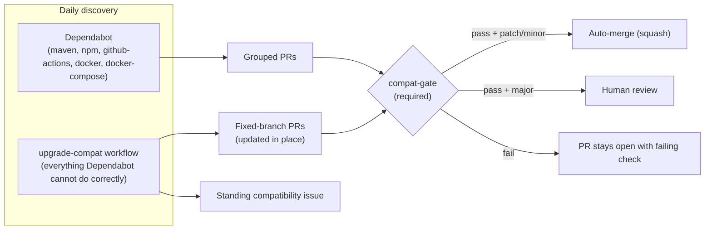

# Dependency maintenance

The demo is reused across events, so it has to stay current without manual effort and without
breaking a rehearsed setup. This document defines how versions are discovered, grouped, verified,
and merged.

## 1. Policy

| Change | Result |
| --- | --- |
| Patch and minor updates | Merged automatically, **only** after the compatibility gate (§4) passes on the exact commit. |
| Major updates and migrations (Quarkus major, JDK, React/Vite/TypeScript major, KEDA/SPIRE chart major, PostgreSQL major, Kubernetes minor of the test cluster) | A reviewable pull request. Never auto-merged. |
| Security updates | Same rules; grouped separately so they are not delayed by other changes. |
| Anything the automation cannot express as a PR | One standing issue, updated in place (§5.4). |

Invariants: Java never goes below 25. Quarkus follows **LTS streams** only. The Quarkus
LangChain4j version always comes from the platform member BOM of the same platform version.

## 2. One coordinated mechanism, two engines, disjoint ownership

Every version in the repository has exactly one owner. That is what prevents duplicate pull requests.



| Owner | Owns | Why |
| --- | --- | --- |
| **Dependabot** | Maven dependencies and plugins (including Quarkus **patch** releases within the current stream); npm; GitHub Actions; image tags in Dockerfiles, Kubernetes manifests under `deploy/base/**`, and `compose.dev.yaml` | Native support, grouped PRs, security advisories. |
| **`upgrade-compat` workflow** | Quarkus **stream** changes (minor/major, e.g. 3.40 → next LTS); Helm chart pins in `deploy/platform/versions.env` (KEDA, SPIRE); Maven Wrapper; JDK/Node version consistency across files; `docs/versions.md` refresh | Needs migration recipes, files Dependabot does not parse, or cross-file coordination. |

Ownership is enforced, not just documented:

- `.github/upgrade-ownership.yml` lists what the workflow owns.
- Each such item has a matching `ignore` rule in `.github/dependabot.yml`.
- CI job `ownership-check` fails if the two files disagree, or if a version appears in a file that
  neither engine covers (it scans for image references and version properties outside known locations).
- The workflow always pushes to a **fixed branch per concern** (`upgrade/quarkus-stream`,
  `upgrade/platform-charts`, `upgrade/maven-wrapper`, `upgrade/toolchain`) and updates the existing
  PR in place, so a second run can never open a second PR for the same concern.

## 3. Dependabot configuration (design)

Schedule: daily. A short explicit `cooldown` is kept as a supply-chain delay (a freshly published
release is not adopted on its first day). The sketch below uses only documented keys; the final
file must be validated by GitHub when implemented.

```yaml
version: 2
updates:
  - package-ecosystem: "maven"
    directory: "/"
    schedule: { interval: "daily", time: "04:00", timezone: "Etc/UTC" }
    open-pull-requests-limit: 10
    cooldown: { semver-patch-days: 1, semver-minor-days: 3, semver-major-days: 7 }
    groups:
      quarkus-platform:            # BOM + plugin + platform member BOMs move together
        patterns: ["io.quarkus.platform:*", "io.quarkus:*"]
        update-types: ["patch"]
      maven-minor-patch:
        patterns: ["*"]
        exclude-patterns: ["io.quarkus.platform:*", "io.quarkus:*"]
        update-types: ["minor", "patch"]
      maven-security:
        applies-to: security-updates
        patterns: ["*"]
    ignore:
      # Stream changes are owned by the upgrade-compat workflow.
      - dependency-name: "io.quarkus.platform:*"
        update-types: ["version-update:semver-minor", "version-update:semver-major"]
      - dependency-name: "io.quarkus:*"
        update-types: ["version-update:semver-minor", "version-update:semver-major"]

  - package-ecosystem: "npm"
    directory: "/web"
    schedule: { interval: "daily", time: "04:15", timezone: "Etc/UTC" }
    cooldown: { semver-patch-days: 1, semver-minor-days: 3, semver-major-days: 7 }
    groups:
      web-production: { patterns: ["*"], dependency-type: "production",  update-types: ["minor", "patch"] }
      web-development: { patterns: ["*"], dependency-type: "development", update-types: ["minor", "patch"] }
      web-security: { applies-to: security-updates, patterns: ["*"] }
    ignore:
      - dependency-name: "typescript"       # blocked by typescript-eslint peer range; see versions.md V3
        update-types: ["version-update:semver-major"]

  - package-ecosystem: "github-actions"
    directory: "/"
    schedule: { interval: "daily" }
    groups: { actions: { patterns: ["*"], update-types: ["minor", "patch"] } }

  - package-ecosystem: "docker"            # Dockerfiles and Kubernetes manifests with image: fields
    directories:
      - "/triage-agent/src/main/docker"
      - "/evidence-worker/src/main/docker"
      - "/recommendation-agent/src/main/docker"
      - "/tool-service/src/main/docker"
      - "/ops-console/src/main/docker"
      - "/deploy/base/nats"
      - "/deploy/base/postgres"
      - "/deploy/base/observability/otel-collector"
      - "/deploy/base/observability/jaeger"
      - "/deploy/base/observability/prometheus"
      - "/deploy/base/observability/grafana"
      - "/deploy/base/apps/tool-service"   # OPA sidecar
      - "/deploy/base/identity"            # spiffe-helper
    schedule: { interval: "daily" }
    groups: { images: { patterns: ["*"], update-types: ["minor", "patch"] } }

  - package-ecosystem: "docker-compose"
    directory: "/"
    schedule: { interval: "daily" }
```

### 3.1 How the Quarkus platform stays consistent

- The parent POM has **one** property, `quarkus.platform.version`, used by
  `io.quarkus.platform:quarkus-bom`, `io.quarkus.platform:quarkus-langchain4j-bom`, and
  `io.quarkus.platform:quarkus-maven-plugin`.
- Dependabot edits a shared property once and moves every artifact using it together; it does so
  only when all of them have published the target version. Result: BOM, member BOM, and plugin
  can never diverge, and a lagging member delays the update instead of breaking it.
- Anything versioned independently of the platform (`jnats.version`, `cloudevents.version`, and
  any future Quarkiverse extension that is **not** a platform member) has **its own property** and
  must never reuse the platform property.
- Manifests reference images directly in `image:` fields (not through Kustomize `images:`
  transformers) so the `docker` ecosystem can see them.

## 4. Compatibility gate

A single required status, `compat-gate`, aggregates the jobs below. It runs on every PR that
touches anything but `docs/**` and `*.md`.

| Job | Proves |
| --- | --- |
| `java` | `./mvnw -B verify` on JDK 25: unit tests, contract golden-file tests, integration tests with real PostgreSQL, NATS, and OPA containers (outbox, inbox, redelivery, idempotency, mTLS with rotating test certificates). |
| `web` | `npm ci`, typecheck, lint, unit tests, production build. |
| `contracts` | OpenAPI/JSON Schema lint and backward-compatibility diff against `main`. |
| `policy` | `opa fmt`, `opa check --strict`, `opa test` with coverage threshold. |
| `manifests` | `kustomize build` for every overlay, schema validation, `helm template` of the pinned KEDA and SPIRE charts with the project values. |
| `images` | All service images build on the pinned base image. |
| `e2e-kind` | A kind cluster at the pinned Kubernetes version with the pinned KEDA and SPIRE charts; deterministic model mode; runs the smoke suite: success run with a complete trace, policy denial, queue burst reaching > 1 replica, redelivery with one execution. |
| `ownership-check` | §2 ownership invariants. |

`e2e-kind` is the gate that makes auto-merge safe: an update merges only if the whole platform
still demonstrates all scenarios. Live-model behaviour is covered by a separate nightly job that
is **not** a merge gate (it depends on an external service) and reports to the standing issue.

## 5. Automation workflows

### 5.1 `ci.yml`

Runs the gate jobs on `pull_request` and on `push` to `main`. Dependabot-triggered runs use only
Dependabot-scoped secrets; no job in the gate needs a secret (deterministic model).

### 5.2 `automerge.yml`

Two steps, designed to work **with or without** branch protection (branch protection, rulesets,
and native auto-merge are not available to private repositories on the free plan):

1. **Classify** (`on: pull_request`, minimal `permissions`): for PRs authored by `dependabot[bot]`
   or by the upgrade bot, read `dependabot/fetch-metadata` outputs (`update-type`,
   `dependency-group`, `package-ecosystem`) or the upgrade PR's declared level, and apply exactly
   one label: `automerge:eligible` (highest bump is patch or minor) or `needs-review` (major, or
   unclassifiable).
2. **Merge** (`on: workflow_run` of `ci.yml`, `conclusion == success`): find the PR for the run's
   head SHA; require label `automerge:eligible`, author in the allow-list, no `hold` label, and
   every gate job green on that SHA; then `gh pr merge --squash --match-head-commit <sha>`.

When the repository plan supports it (public repository or a paid plan), additionally enable a
ruleset on `main` requiring `compat-gate`, and step 2 becomes `gh pr merge --auto --squash`. The
labelling logic is unchanged.

Because a four-part Quarkus platform version may not be classified reliably, a Quarkus platform
PR from Dependabot is `automerge:eligible` only if the stream (`major.minor`) is unchanged — the
classifier checks this itself from `previous-version` and `new-version`.

### 5.3 `upgrade-compat.yml` (scheduled daily, and on demand)

| Concern | Discovery | Action |
| --- | --- | --- |
| Quarkus stream | `https://registry.quarkus.io/client/platforms` → `current-stream-id`, `streams[].lts`, latest release per stream | If a newer **LTS** stream exists: run the Quarkus update tooling (`quarkus-maven-plugin:update` with `-Dstream=<id>` and rewrite enabled, non-interactive), commit the result to `upgrade/quarkus-stream`, open or update the PR with the migration-guide link. Same major → labelled as minor (auto-merge eligible if the gate passes). New major → `needs-review`. A newer non-LTS stream is only reported. |
| Platform member lag | Compare the platform's `quarkus-langchain4j` version with the latest standalone release | Report only (informational; the design intentionally follows the platform). |
| Helm charts | Chart repository indexes for `keda`, `spire`, `spire-crds` | Update `deploy/platform/versions.env` on `upgrade/platform-charts`; PR level derived from the chart version bump; also checks the chart's supported Kubernetes range against versions.md §5. |
| Maven Wrapper | Latest Maven 3.9.x | `mvn wrapper:wrapper` on `upgrade/maven-wrapper`. |
| Toolchain consistency | JDK in `pom.xml`, Dockerfiles, CI, `.sdkmanrc`; Node in `.nvmrc`, `package.json` `engines`, CI | Fix drift on `upgrade/toolchain`. A newer JDK LTS or Node LTS is reported, never applied automatically. |
| Cluster compatibility | KEDA's tested Kubernetes range vs the kind node image and target OpenShift version | Report. |
| Dependabot blind spots | `ownership-check` scan results | Report. |
| Docs | Regenerate the tables in `docs/versions.md` from the source files | Included in whichever PR changes the versions. |

PRs from this workflow are created with a dedicated token (GitHub App installation token or a
fine-grained PAT stored as `UPGRADE_BOT_TOKEN`), because PRs created with the default
`GITHUB_TOKEN` do not trigger CI. **Prerequisite for the repository owner**; until it exists the
workflow runs in report-only mode.

### 5.4 Standing issue

One issue titled "Dependency compatibility report", found by label and edited in place each day:
what is pending, what was auto-merged, what needs a human, nightly live-model result, and anything
that needs cluster verification after an upgrade (for example a KEDA chart bump before the next demo).

## 6. Merge and attribution rules for automation

- Squash merge, linear history.
- Automation commits are authored by their real bot identities (`dependabot[bot]`,
  `github-actions[bot]` or the upgrade app). No workflow sets a human's name or email, and no
  workflow adds an AI co-author trailer.
- Automation never force-pushes `main` and never rewrites existing history.

## 7. After an upgrade, before a demo

An auto-merged upgrade is proven on kind, not on the demo cluster. Before any event: `make
preflight && make platform && make deploy && make smoke` on the target cluster, then the rehearsal
in the [runbook](demo-runbook.md). Tag the rehearsed commit (`demo-YYYYMMDD`) and deploy that tag.

## 8. Known limits

| # | Limit | Handling |
| --- | --- | --- |
| M1 | Dependabot does not understand Quarkus platform compatibility of independently versioned extensions. | None are used today; if one is added it gets its own property and the gate decides. |
| M2 | Property-based Maven updates are all-or-nothing and skip silently when a platform member lags. | The daily report shows the lag. |
| M3 | Maven Wrapper and `versions.env` are invisible to Dependabot. | Owned by the workflow. |
| M4 | Auto-merge without branch protection relies on the workflow's own checks. | Enable a ruleset when the plan allows; `--match-head-commit` prevents merging an unverified commit. |
| M5 | The Quarkus update tooling automates only part of a migration. | Stream PRs carry the migration guide link and fail the gate visibly if incomplete. |
| M6 | Dependabot's default behaviour and limits change over time. | Re-validate this configuration when the report flags a Dependabot configuration warning. |
