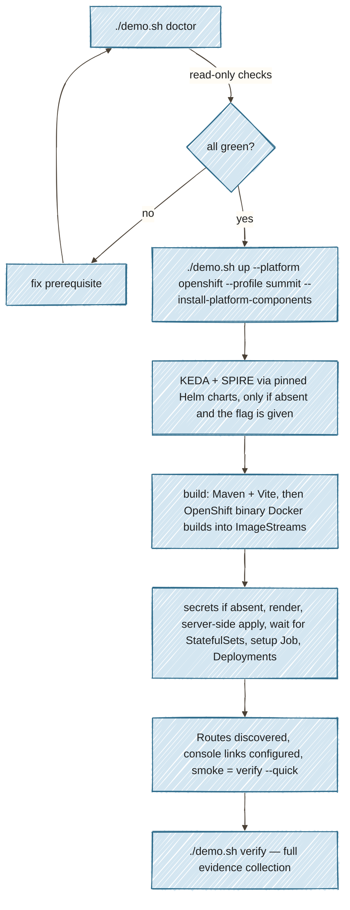

# Deployment

Two profiles from one set of manifests: **kind** (local Kubernetes) and **OpenShift**. Setup is
scripted and idempotent. Nothing in this document was applied to a cluster during the design
phase; every item marked **verify on cluster** is an explicit acceptance step in the backlog.

Versions are in [versions.md](versions.md).

## 1. Layout

```
demo.sh                      # the operator CLI: doctor | build | up | status | verify | open | logs | reset | token | down | render
.env.example                 # configuration variable names (copy to the git-ignored .env.local)
scripts/
  lib/        common.sh (logging, safe .env.local loader, confirmations), cluster.sh (read-only KEDA/CMA/SPIRE detection)
  deploy/     render.sh doctor.sh platform.sh build.sh up.sh console.sh verify.sh ops.sh
  local/      stack.sh       # cluster-free full stack (podman/docker + local JVMs) and end-to-end checks
  maintenance/               # dependency automation used by GitHub Actions
deploy/
  base/                      # Kustomize base for the application namespace
    apps/{triage-agent,evidence-agent,recommendation-agent,tool-service,ops-console}/
    config/  nats/  postgres/ (StatefulSet + setup Job)  observability/{otel-collector,jaeger,prometheus,grafana}/
    scaling/                 # KEDA ScaledObject for evidence-agent
    network/                 # default-deny NetworkPolicies plus one allow per edge
    identity/                # ClusterSPIFFEID (rendered separately: it is cluster-scoped)
  components/
    spiffe/                  # spiffe-helper native sidecar + CSI socket volume for all five Deployments
    profile-dev/             # smaller resources
  overlays/
    openshift/               # Routes, router NetworkPolicy, build/ (ImageStreams + BuildConfigs)
    openshift-cma/           # Custom Metrics Autoscaler variant (prometheus trigger)
    kubernetes/              # Ingresses, non-root UID patch, external registry images
  platform/
    versions.env             # pinned chart versions and repos for KEDA and SPIRE
    keda/values.yaml  spire/values.yaml  spire/values-openshift.yaml
```

`demo.sh` renders into the git-ignored `.maop/render/<namespace>/`: it sets the namespace, image references
(by build digest), deploy-time ConfigMap values, the ScaledObject bounds, and generates the OPA policy
ConfigMap from `policy/maop/` (content-hashed, so a policy change rolls tool-service). Tracked files are never
edited by the CLI. `oc kustomize deploy/overlays/<overlay>` still renders valid defaults for namespace `maop`.

Decisions:

- **Kustomize** for everything in the application namespace (hand-written manifests, reviewable,
  image tags maintained by Dependabot). Generated manifests from Quarkus extensions are not used.
- **Helm** only for the two cluster-scoped platforms that publish maintained charts: KEDA and SPIRE.
- In-namespace Jaeger, Prometheus, Grafana, and the OTel Collector are plain Deployments, identical
  on both profiles, so the demo does not depend on which monitoring operators a cluster has.

## 2. Workloads

| Workload | Kind | Replicas | Ports | Storage | Sidecars |
| --- | --- | --- | --- | --- | --- |
| ops-console | Deployment | 1 | 8080 http, 9000 management | — | spiffe-helper |
| triage-agent | Deployment | 1 | 8080 http, 9000 management | — | spiffe-helper |
| evidence-agent | Deployment | 1–6 (KEDA) | 9000 management | — | spiffe-helper |
| recommendation-agent | Deployment | 1 | 9000 management | — | spiffe-helper |
| tool-service | Deployment | 1 | 8443 https (mTLS), 9000 management | — | spiffe-helper, OPA |
| nats | StatefulSet | 1 | 4222 client, 8222 monitoring, 7777 exporter | PVC 2 Gi (JetStream file store) | prometheus-nats-exporter |
| postgres | StatefulSet | 1 | 5432 | PVC 5 Gi | — |
| otel-collector | Deployment | 1 | 4317, 4318 OTLP, 8889 metrics | — | — |
| jaeger | Deployment | 1 | 16686 UI, 4317 OTLP | In-memory trace store (bounded) | — |
| prometheus | Deployment | 1 | 9090 | emptyDir (retention 6 h) | — |
| grafana | Deployment | 1 | 3000 | emptyDir; dashboards and datasources provisioned from ConfigMaps | — |
| postgres-setup | Job | — | — | — | Creates the `triage` and `tools` roles and schemas idempotently (re-run on every `up`) |

Common pod settings: resource requests and limits on every container; `startupProbe`,
`readinessProbe`, `livenessProbe` on `/q/health/*` (management port 9000);
`terminationGracePeriodSeconds: 60` for consumers; `topologySpreadConstraints` for
evidence-agent; `imagePullPolicy: IfNotPresent` with digest-pinned images.

Quarkus services read configuration from environment variables set by ConfigMaps and Secrets
(`MAOP_*`, `QUARKUS_*`). Database schema migration runs with Flyway at service start
(`quarkus.flyway.migrate-at-start=true`), one schema and one role per owning service.

### 2.1 Observability wiring

- Services: `quarkus.otel.exporter.otlp.endpoint=http://otel-collector:4317` (traces only;
  `quarkus.otel.metrics.enabled` and `quarkus.otel.logs.enabled` stay at their `false` default).
  Metrics are exposed by Micrometer's Prometheus registry on the management port.
- Collector pipeline: `otlp` receiver → `k8sattributes`, `batch` processors → `otlp` exporter to
  Jaeger; `spanmetrics` connector → `prometheus` exporter on 8889.
- Jaeger v2 with `jaeger_storage` memory backend (`max_traces` bounded), `jaeger_query` UI.
- Prometheus scrape targets (static `kubernetes_sd` within `maop` via a namespaced Role):
  the five services, collector 8889, nats exporter 7777 (started with `-jsz=consumers`), OPA
  (through tool-service's management proxy), and KEDA's metrics where reachable.
- Grafana: provisioned Prometheus and Jaeger datasources; four dashboards from
  `deploy/base/observability/grafana/dashboards/*.json`; anonymous Viewer.

### 2.2 Scaling

`ScaledObject` `evidence-agent` (`keda.sh/v1alpha1`):

| Field | Value | Reason |
| --- | --- | --- |
| `scaleTargetRef` | Deployment `evidence-agent` | The only autoscaled workload. |
| `minReplicaCount` / `maxReplicaCount` | 1 / 6 | Warm baseline for the demo; bounded by model rate limits. |
| `pollingInterval` | 5 | Fast reaction on stage. |
| `cooldownPeriod` | 60 | Applies to scale-to-zero only; kept for clarity. |
| trigger `type` | `nats-jetstream` | |
| trigger `metadata` | `natsServerMonitoringEndpoint: nats.maop.svc.cluster.local:8222`, `account: $G`, `stream: MAOP_WORK`, `consumer: evidence-agents`, `lagThreshold: "4"`, `activationLagThreshold: "0"` | Lag = pending + in-flight, so in-flight work keeps replicas up until acknowledged. |
| `advanced.horizontalPodAutoscalerConfig.behavior` | scale up: no stabilization, up to 4 pods per 15 s; scale down: 60 s stabilization, 2 pods per 30 s | Visible scale-out within the demo slot; calm scale-in. **Verify on cluster.** |

With a burst of ~36 tasks, lag/threshold exceeds the maximum, so replicas go to 6 and return to 1
about one to two minutes after the queue drains.

## 3. Storage

| Data | Where | Class | Loss impact |
| --- | --- | --- | --- |
| Run records, audit, outbox/inbox | PostgreSQL PVC (5 Gi, RWO, default StorageClass) | Durable | Demo history lost; `./demo.sh reset` clears it; synthetic data is static. |
| JetStream streams | NATS PVC (2 Gi, RWO) | Durable | In-flight work lost; sweeper times runs out. |
| Traces | Jaeger memory | Ephemeral | Old traces gone after restart. |
| Metrics | Prometheus emptyDir | Ephemeral | Dashboards restart empty. |
| SVIDs | `emptyDir` with `medium: Memory` | Ephemeral | Re-fetched on start. |

Both StatefulSets use the cluster's default StorageClass; the preflight fails if there is none.
Single replicas are a demo choice; the production note is NATS R3 and a managed/HA PostgreSQL.

## 4. Networking

| Exposure | kind | OpenShift |
| --- | --- | --- |
| Console (`ops-console:8080`) | Ingress `console.127.0.0.1.nip.io` (ingress-nginx) | Route, `edge` termination, redirect insecure |
| Jaeger UI | Ingress | Route (`edge`) when `EXPOSE_OBSERVABILITY=true` |
| Grafana | Ingress | Route (`edge`) when `EXPOSE_OBSERVABILITY=true` |
| Prometheus UI (read-only: no admin or lifecycle API) | Ingress | Route (`edge`) when `EXPOSE_OBSERVABILITY=true` |
| Everything else | ClusterIP only | ClusterIP only |

- **SSE through the OpenShift router**: the console Route carries
  `haproxy.router.openshift.io/timeout: 1h`; the server sends a heartbeat every 15 s and disables
  response buffering. **Verify on cluster.**
- ops-console is told the external Jaeger/Grafana URLs by the deploy script, which reads the
  created Route/Ingress hosts and writes them into the `ops-console-config` ConfigMap. If
  observability is not exposed, the console disables the links.
- NetworkPolicies implement the edges of the architecture diagram with default deny
  ([security.md](security.md) §8). On OpenShift an additional policy allows ingress from the
  router namespace (`policy-group.network.openshift.io/ingress` label selector).
- Model egress: agents need HTTPS egress to the configured model host. If the cluster uses an
  egress proxy, the standard `HTTPS_PROXY`/`NO_PROXY` variables are passed through. **Verify on cluster.**

## 5. OpenShift profile

Target: OpenShift 4.22 (minimum 4.21), operated by an authenticated cluster administrator.

### 5.1 KEDA

Decision: install **upstream KEDA from its Helm chart** into the `keda` namespace with the
OpenShift values file. Reason: the demo scales on the `nats-jetstream` trigger, which the
OpenShift Custom Metrics Autoscaler (CMA) operator does not list among its supported triggers.

Upstream KEDA and CMA cannot coexist on a cluster (both own the same CRDs and the external
metrics API service). The preflight therefore checks for the CMA operator and existing
`keda.sh` CRDs:

| Cluster state | Action |
| --- | --- |
| No KEDA, no CMA | Install upstream KEDA chart (default path). |
| Upstream KEDA already present at a compatible version | Reuse it; install nothing. |
| Upstream KEDA installed earlier by this project (recorded in `maop-installed-components`) at another version than the pin | With `--install-platform-components`, upgrade it in place to the pin (`helm upgrade`). The same applies to the SPIRE releases; installs made by anyone else are only reused. |
| CMA present | Do **not** install upstream KEDA. Deploy the `openshift-cma` overlay, whose `ScaledObject` uses a `prometheus` trigger on `maop_queue_pending` + `maop_queue_ack_pending` for `consumer="evidence-agents"` (exported by ops-console from JetStream consumer info) served by the in-namespace Prometheus. The console shows the scaler kind it actually finds. |

**Verify on cluster**: which state applies; KEDA operator pods run under `restricted-v2`; the
metric name prefix from the NATS exporter (confirm with a live scrape before relying on the CMA variant).

### 5.2 SPIRE

Decision: install the **upstream SPIRE hardened Helm charts** (`spire-crds`, then `spire`) with
`global.openshift=true` into `spire-system`/`spire-server` as the chart lays out, with
`global.spire.trustDomain` and `global.spire.clusterName` set by the script. The chart ships the
SecurityContextConstraints needed by the agent and the CSI driver (the CSI driver container is
privileged; the agent needs host access for attestation).

| Cluster state | Action |
| --- | --- |
| No SPIRE, no `csi.spiffe.io` driver | Install the charts (default path). |
| SPIRE already present (upstream chart or the Zero Trust Workload Identity Manager operator) | Do not install a second one. Run with `SPIRE_MODE=existing`: apply only the `ClusterSPIFFEID` and set `SPIRE_TRUST_DOMAIN` to the existing trust domain. |

**Verify on cluster**:

1. The admin accepts privileged SCCs for the SPIRE agent and CSI driver.
2. Pods in `maop` running under `restricted-v2` may mount the `csi.spiffe.io` inline volume. If
   admission rejects it, the `CSIDriver` object must carry the label
   `security.openshift.io/csi-ephemeral-volume-profile: restricted` (set through chart values or a
   documented one-line patch in `platform-install.sh`).
3. With `SPIRE_MODE=existing`, the existing controller manager's class name and selectors accept
   the demo's `ClusterSPIFFEID`.

### 5.3 Builds and images

Decision: **in-cluster binary Docker builds** into the internal registry.

- The developer machine (or CI) runs `./mvnw -B package` and `npm ci && npm run build`; the SPA
  bundle is copied into ops-console's static resources before packaging.
- For each service the overlay defines an `ImageStream` and a `BuildConfig` (Docker strategy,
  binary source, `Dockerfile` = `src/main/docker/Dockerfile.jvm` on the UBI OpenJDK runtime image).
- `scripts/build-images.sh openshift` runs `oc start-build <svc> --from-dir=<module> --follow`.
- Deployments reference the ImageStream through the `image.openshift.io/triggers` annotation, so a
  finished build rolls the Deployment.

Why: no external registry, no pull secret, works with a private Git repository, and the build is
visible in the cluster. kind uses `docker build` + `kind load docker-image` with the same Dockerfiles.

Third-party images are pulled from their public registries by digest. For restricted or
disconnected clusters, `scripts/mirror-images.sh` (listed in the backlog as optional) mirrors them
to the internal registry. **Verify on cluster**: Docker Hub pull limits; pre-pull before a demo.

### 5.4 Security contexts

- No application workload requests a custom SCC. Manifests set `runAsNonRoot: true` and **do not
  set `runAsUser`/`fsGroup`** in the OpenShift overlay, so the namespace's assigned UID range applies.
- Images chosen to run with an arbitrary UID in group 0: UBI OpenJDK runtime, sclorg PostgreSQL,
  Grafana (GID 0, writable `/var/lib/grafana` emptyDir), Jaeger, Prometheus, OPA `-static`,
  NATS (`/data` on the PVC, config from a ConfigMap), OTel Collector.
- **Verify on cluster**: NATS, Prometheus, and the spiffe-helper image start cleanly under
  `restricted-v2` with a random UID and a read-only root filesystem.

### 5.4.1 Topology view

The `openshift` overlay groups the workloads into Topology applications through the workload-level
`app.kubernetes.io/part-of` label: `operations-console` (ops-console), `agent-services` (triage-agent,
evidence-agent, recommendation-agent), `tool-boundary` (tool-service with its OPA sidecar),
`messaging-and-state` (NATS, PostgreSQL) and `observability` (OTel Collector, Jaeger, Prometheus, Grafana).
Pod templates keep `part-of: maop`, which the NetworkPolicies select on, and `demo.sh status/down` find workloads
by `app.kubernetes.io/managed-by`. `app.openshift.io/runtime` sets the icons (`quarkus`, `postgresql`, and `golang`
for the Go-based components, which have no dedicated console icon) and `app.openshift.io/connects-to` draws the
arrows.

### 5.5 Prerequisites checked by `./demo.sh doctor`

| Check | Failure message points to |
| --- | --- |
| `oc whoami` succeeds and the user can `create` cluster-scoped resources (`oc auth can-i`) | Log in as cluster-admin |
| Server version within the supported range | versions.md §5 |
| Default StorageClass exists | §3 |
| KEDA/CMA state | §5.1 |
| SPIRE/CSI driver state | §5.2 |
| Namespace `maop` absent or labelled as managed by this project | Refuses to touch a foreign namespace |
| Local tools: JDK, Node.js, `oc`/`kubectl`, `helm` | README |
| Model endpoint reachable with the provided key (one minimal request from the workstation) | README configuration |

The preflight is read-only. `platform-install.sh` and `deploy.sh` are the only scripts that change
a cluster; both print the target context and require `--yes` or an interactive confirmation.

## 6. Setup flow



`up` steps: doctor checks → platform plan (reuse compatible KEDA/CMA/SPIRE; install only with
`--install-platform-components`, recording what it installed in ConfigMap `maop-installed-components`, and upgrade
those recorded releases when `deploy/platform/versions.env` pins a newer chart) →
namespace with ownership and pod-security labels → Secrets created only when absent (model credentials refreshed
from `.env.local` or an exported `OPENAI_API_KEY`) → build (skippable with `--skip-build`) → render and
`apply --server-side` → wait for `postgres`, `nats`, the `postgres-setup` Job, then Deployments → external
Route hosts written into the console configuration → smoke checks.

`./demo.sh verify` collects real evidence into `artifacts/verify-<timestamp>/` (raw JSON plus a PASS/FAIL
summary): a successful run, its Jaeger trace and the services in it, a policy denial with no side effect,
TLS refusal of a certificate-less client from inside the cluster, KEDA scale-out of evidence-agent under a
burst, and a redelivery with one execution. `--quick` runs the first four.

`./demo.sh reset` deletes demonstration state only (runs, audit, simulated actions, queued messages) through the
console API. `./demo.sh down` removes owned application resources, keeps PVCs and Secrets unless
`--delete-data`, deletes the namespace only with `--delete-namespace`, and removes project-installed platform
components only with `--uninstall-platform-components`.

## 7. Local development (no cluster)

`scripts/local/stack.sh up` runs PostgreSQL, NATS, OPA, Jaeger, Prometheus and Grafana in containers (podman or
docker; same pinned images, datasources and dashboards as the cluster) and the five services as local JVMs. A local CA issues certificates in the exact spiffe-helper layout with single
`spiffe://maop.local/...` URI SANs, so the mTLS and SPIFFE-ID checks are the production code paths; the console
labels this identity mode `DEV_STATIC`. `scripts/local/stack.sh e2e` runs the scenario checks and writes evidence
to `.maop/local/e2e-<timestamp>/`. `npm run dev` in `web/` proxies `/api` to the console on port 8080.

Quarkus Dev Services are for single-service work (`quarkus:dev`): PostgreSQL and the Grafana LGTM stack start per
application. They are not used for the five-service stack, because each application would start its own Grafana,
and the Kubernetes Dev Service defaults to an API server without pods. A fully local run including KEDA scale-out
and SPIRE uses a local Kubernetes cluster (for example kind) with `./demo.sh up --platform kubernetes`.

## 8. Items that require cluster verification (summary)

**Scenario 5 (sandboxed analysis), added later.** `./demo.sh verify` check 7 passed on OpenShift with live
`gpt-4o-mini` in the smoke test of `./demo.sh up` (checks 1 to 4 and 7): one `EXECUTED` `analysis.run_script` call
for `evidence-agent`, sandbox mode `SIMULATED`, `LOG_ANALYSIS` evidence recorded, run in `AWAITING_APPROVAL`. The
full `./demo.sh verify` (with checks 5 and 6) has not been re-run since.

**Verified on OpenShift 4.22** (cluster admin, `./demo.sh up --platform openshift --profile summit
--install-platform-components`, then `./demo.sh verify`, all six checks PASS): C1 (no CMA present; upstream KEDA
2.21.0 installed and scaled evidence-agent 1 → 6; upgraded in place to 2.21.1, 1 → 6 again), C3 and C4 (SPIRE 0.30.4,
upgraded in place to chart 0.31.0 / SPIRE 1.16.0 with the trust domain kept, with the chart's SCCs; restricted
pods mount `csi.spiffe.io`, after the CSIDriver-ordering retry in `platform.sh`), C5 (all images run with
OpenShift-assigned UIDs), C7 (scale-out within the runbook target), C8 (live model reachable from the agents),
C9 (OVN-Kubernetes enforced the NetworkPolicies; OpenShift build pods needed their own egress policy, `deploy/overlays/openshift/network-builds.yaml`, found on the second deployment), C10 (public images pulled). C2 is
not exercised (CMA path) and C6 (SSE through the router for 30 min) was not measured.

On kind (`scripts/local/kind.sh`), all six verify checks also pass, with `MAOP_NETWORK_POLICIES=false`: with
kindnet's NetworkPolicy enforcement the application pods could not resolve DNS (root cause not identified).


| # | Item | Section |
| --- | --- | --- |
| C1 | KEDA vs CMA state and resulting overlay | §5.1 |
| C2 | NATS exporter metric names for the CMA variant | §5.1 |
| C3 | SPIRE install mode, privileged SCC acceptance | §5.2 |
| C4 | `restricted-v2` pods mounting the SPIFFE CSI volume | §5.2 |
| C5 | Every image starts under `restricted-v2` with a random UID | §5.4 |
| C6 | SSE stays open through the router for ≥ 30 min | §4 |
| C7 | Scale-out latency meets the runbook timing with the chosen HPA behaviour | §2.2 |
| C8 | Model endpoint egress from the cluster and provider rate limit ≥ 12 concurrent calls | §4 |
| C9 | NetworkPolicy set does not block router, DNS, SPIRE, or KEDA traffic | §4 |
| C10 | Image pulls from public registries (rate limits, mirroring) | §5.3 |
