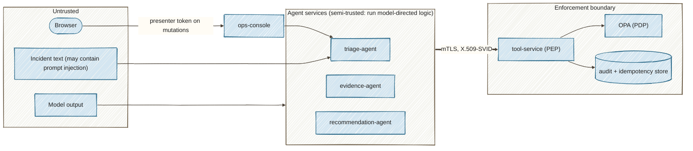
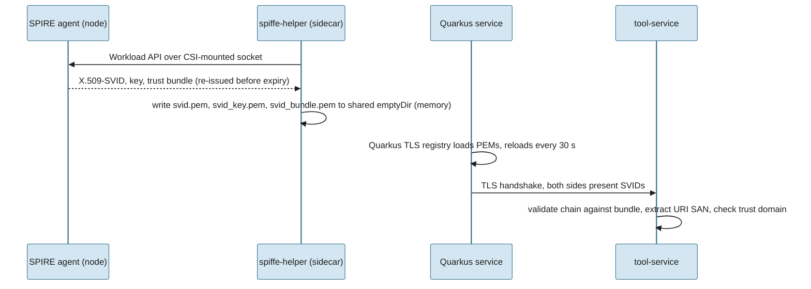

# Security

Scope: workload identity, authorization of tool execution, secrets, and the limits of what this
demo protects. Versions are in [versions.md](versions.md).

## 1. Security goals

1. A tool executes only after the **caller's identity is cryptographically verified** and a
   **policy decision** allows it. Both happen before any side effect.
2. An agent cannot grant itself permission: not by asserting an identity, not by asserting an
   approval, not by rewording a request.
3. Every decision — allow and deny — leaves an audit record that names the verified caller, the
   policy revision, and the decision ID.
4. Model output is untrusted input. It is validated and can only request actions from a closed set.
5. Nothing in the system can change a real cluster.

## 2. Trust boundaries



The agents are deliberately treated as semi-trusted: they are the components whose behaviour a
model influences. The enforcement boundary is a different process, with a different identity and
its own data, and contains no model.

## 3. Workload identity (SPIFFE/SPIRE)

### 3.1 Identities

Trust domain: `maop.example` on kind; on OpenShift the value chosen at install
(`SPIRE_TRUST_DOMAIN`, default: the cluster's apps domain as the SPIRE chart derives it).

| Workload | SPIFFE ID |
| --- | --- |
| triage-agent | `spiffe://<td>/ns/maop/sa/triage-agent` |
| evidence-agent | `spiffe://<td>/ns/maop/sa/evidence-agent` |
| recommendation-agent | `spiffe://<td>/ns/maop/sa/recommendation-agent` |
| ops-console | `spiffe://<td>/ns/maop/sa/ops-console` |
| tool-service | `spiffe://<td>/ns/maop/sa/tool-service` |

Registration is declarative: one `ClusterSPIFFEID` (`spire.spiffe.io/v1alpha1`) with
`spiffeIDTemplate: spiffe://{{ .TrustDomain }}/ns/{{ .PodMeta.Namespace }}/sa/{{ .PodSpec.ServiceAccountName }}`,
a `namespaceSelector` for the `maop` namespace, a `podSelector` on `maop.io/spiffe: enabled`, and
`dnsNameTemplates` for the tool-service's in-cluster DNS name. Each service has its own
ServiceAccount; identity is attested by SPIRE from the Kubernetes node and pod, not configured in
the application.

### 3.2 The authenticated connection

Every call to `tool-service` is HTTPS with **mutual TLS using X.509-SVIDs**. This is the real
authenticated connection in the demo: evidence-agent, recommendation-agent, triage-agent, and
ops-console all reach the tool API this way, and there is no plaintext port for it.



Mechanics, using only documented names:

- The SPIFFE CSI driver (`csi.spiffe.io`) mounts the agent socket read-only into the pod.
- `spiffe-helper` runs as a native sidecar (an init container with `restartPolicy: Always`, so it
  starts and is ready before the application) with `daemon_mode = true`, `agent_address`, `cert_dir`,
  `svid_file_name`, `svid_key_file_name`, `svid_bundle_file_name`. It needs no signal to the
  application; Quarkus re-reads the files.
- Quarkus TLS registry, named configuration `spiffe`:
  `quarkus.tls.spiffe.key-store.pem.0.cert`, `quarkus.tls.spiffe.key-store.pem.0.key`,
  `quarkus.tls.spiffe.trust-store.pem.certs`, `quarkus.tls.spiffe.reload-period=30S`.
- Server (tool-service): `quarkus.http.tls-configuration-name=spiffe`,
  `quarkus.http.ssl.client-auth=required`, `quarkus.http.insecure-requests=disabled` on the tool
  listener. Health and metrics are served on the separate management interface.
- Clients: `SpiffeHttpClient` (JDK `HttpClient`) loads the same PEM files and rebuilds its TLS context when
  spiffe-helper rotates them. Hostname verification is replaced by SPIFFE ID verification: an
  `X509ExtendedTrustManager` validates the chain against the trust bundle and requires the server's single URI
  SAN to equal `MAOP_TOOL_SERVICE_SPIFFE_ID` (ADR-0016 item 5).
- Server-side identity extraction: a `SecurityIdentityAugmentor` reads the peer certificate from
  `CertificateCredential`, takes the single URI SAN, requires the `spiffe://<td>/` prefix of the
  configured trust domain, and exposes it as the principal. A certificate with zero or more than
  one URI SAN is rejected. (`quarkus.http.auth.certificate-role-properties` is not used: it maps
  the common name, not the URI SAN.)
- SVID TTL: 1 hour (`ttl` on the `ClusterSPIFFEID`), so rotation happens during a rehearsal and is
  covered by an integration test.

The verified SPIFFE ID, certificate serial number, and expiry are written to the audit record and
shown in the console. Request headers and bodies are never a source of caller identity.

### 3.3 What is not covered by SVID mTLS

| Connection | Protection in the demo | Production recommendation |
| --- | --- | --- |
| Browser → ops-console | TLS at the Route/Ingress; presenter token on mutations | OIDC login, per-user approvals |
| ops-console → triage-agent | In-namespace HTTP, NetworkPolicy allows only ops-console | Same SVID mTLS pattern |
| Services → NATS | Per-service NATS user with subject-level publish/subscribe permissions; NetworkPolicy | NATS TLS with client certificates |
| Services → PostgreSQL | Per-service database role limited to its own schema; NetworkPolicy | TLS, credential rotation |
| Services → model endpoint | Provider TLS + API key from a Secret | Egress gateway, per-service keys |
| tool-service → OPA | Localhost inside the pod | Same |

This scoping is deliberate (ADR-0008): one connection class is protected end to end and explained
well, instead of every hop being protected thinly.

## 4. Authorization (OPA)

### 4.1 Enforcement flow in tool-service

For every tool invocation, approval registration, and audit read:

1. TLS handshake completes → verified SPIFFE ID available. No SVID → no connection.
2. Request is parsed and validated against the tool's JSON Schema (`422` on failure).
3. Idempotency lookup. A committed result or denial is returned as-is.
4. Deadline check (`DEADLINE_EXCEEDED` if past).
5. Trusted context is assembled **by tool-service** (never copied from the request): caller
   identity from the connection; tool metadata from the catalogue; approval grant from the `tools`
   database; current time.
6. `POST http://127.0.0.1:8181/v1/data/maop/tools/decision` with `{"input": …}`, timeout 500 ms.
7. Any error, timeout, or undefined result → deny with `503 POLICY_UNAVAILABLE`. Fail closed.
8. The decision is written to `tool_invocation` in the same transaction as (if allowed) the tool
   effect. A denied request never reaches the tool handler.

### 4.2 Policy input

```json
{
  "caller":   { "spiffe_id": "spiffe://<td>/ns/maop/sa/recommendation-agent", "trust_domain": "<td>" },
  "action":   "tool.invoke",
  "tool":     { "name": "remediation.rollback_deployment", "class": "REMEDIATION", "simulated": true },
  "run":      { "id": "…", "deadline": "…" },
  "request":  { "action_digest": "sha256:…", "args_digest": "sha256:…" },
  "approval": null,
  "now":      "2026-01-01T14:11:05Z"
}
```

`approval`, when present, is the stored grant: `{id, run_id, action_digest, approver, expires_at}`.

### 4.3 Policy rules (Rego v1, package `maop.tools`)

`decision` is an object `{allow: bool, reasons: [string]}`; `default allow := false`.

| Rule | Allows | Deny reason when not met |
| --- | --- | --- |
| Trust domain | Caller's trust domain equals the configured one | `untrusted_domain` |
| Read tools | `tool.class == "READ"` for `evidence-agent` and `recommendation-agent` | `caller_not_permitted` |
| Remediation tools | `tool.class == "REMEDIATION"` only for `recommendation-agent`, **and** `tool.simulated == true`, **and** an approval exists whose `run_id` and `action_digest` match the request and whose `expires_at` is in the future | `caller_not_permitted`, `not_simulated`, `approval_required`, `approval_mismatch`, `approval_expired` |
| Sandboxed tools | `tool.class == "SANDBOXED"` only for callers that hold `tool.sandbox` (`evidence-agent`). No approval is involved: the tool has no effect outside the sandbox ([ADR-0018](decisions/0018-sandboxed-tool-class.md)) | `caller_not_permitted` |
| Approval registration | `action == "approval.register"` only for `triage-agent` | `caller_not_permitted` |
| Audit read | `action == "audit.read"` only for `ops-console` | `caller_not_permitted` |

Caller-to-permission mapping is data (`data.maop.callers`), keyed by SPIFFE ID path, so policy
logic and assignments change independently.

Why an agent cannot bypass the approval rule: the approval in the input is read from the
tool-service database, which only `triage-agent` (verified by SVID) can write through
`PUT /v1/approvals/{id}`; triage writes it only after a human approval is recorded on the run;
and the digest is recomputed by tool-service from the actual request arguments, so an approval for
one action cannot authorize another.

### 4.4 Policy lifecycle

- Source: `policy/maop/tools.rego`, `policy/maop/data.json`, tests in `policy/maop/tools_test.rego`.
- CI: `opa fmt --fail`, `opa check --strict`, `opa test policy/ --coverage` with a required
  threshold; a decision-table test enumerates every caller × tool-class × approval combination.
- Delivery: `demo.sh` generates the `opa-policy` ConfigMap from `policy/maop/` at render time (content-hashed
  name, so a policy change rolls the pod) and fills `trust_domain` in the rendered `data.json` with the
  deployment's trust domain; OPA runs `opa run --server --addr=127.0.0.1:8181 --config-file=… --ignore=.* /policy`.
- `policyRevision` in audit records is the content hash of the bundle.
- OPA config: `decision_logs.console: true` (decisions in pod logs, correlated by `decision_id`),
  `distributed_tracing` to the Collector, `status.prometheus: true`.
- The OPA sidecar has no ServiceAccount token, no network egress, and listens on localhost only.

## 5. Agent and model safety

| Threat | Control |
| --- | --- |
| Prompt injection in incident text or tool output steering an agent to a harmful action | The action set is closed (`actionType` enum); remediation requires a human approval enforced outside the agent; evidence agents hold no remediation permission at all. |
| Fabricated evidence or citations | Every fact must reference an `invocationId` returned to that task; every citation must reference an existing `evidenceId`; violations fail validation. |
| Runaway cost or loops | Delegation depth 1, per-run budgets, per-pod model concurrency, tool-call caps, deadlines (architecture §4.2–4.3, §7). |
| Leaking prompts, secrets, or chain-of-thought | Prompts and completions are not logged or traced; only structured outputs and concise explanations are stored; no reasoning traces requested. |
| Confusing a test double with a real model | `maop.model.mode` is stamped on events, records, spans, and the UI; no automatic fallback. |
| Real remediation | No code path calls a cluster or cloud API for remediation. Remediation tools are inserts into `tools.simulated_action`. OPA additionally denies any tool not flagged `simulated`. The only Kubernetes API access in the system is read-only, held by ops-console. |

## 6. Console access

- The console is a demo operator surface without user login (assumption A2).
- **Presenter token (optional, off by default):** with `MAOP_PRESENTER_AUTH=true`, every mutating console
  endpoint (run, approval, cancel, burst start/stop, reset) requires `Authorization: Bearer <token>`. The token is
  a random 256-bit value generated at deploy time into the Secret `ops-console-presenter`, compared in constant
  time, never returned by any API, entered once in the UI and kept in `sessionStorage`; without it the console
  is read-only. With the default `false`, anyone who can reach the console can drive the demonstration:
  `/api/v1/config` reports `auth.presenterTokenRequired: false` and the UI enables its controls. Turn the token on
  for shared or internet-reachable clusters.
- Mutations are bounded either way by triage admission control (active runs, runs per hour, one burst with a cap).
- Security headers from ops-console: strict `Content-Security-Policy` (self only; no inline script;
  `connect-src 'self'`), `X-Content-Type-Options: nosniff`, `Referrer-Policy: no-referrer`,
  `frame-ancestors 'none'`. Jaeger and Grafana are opened as links in a new tab, not embedded.
- Grafana runs with anonymous **Viewer** access and a random admin password; Jaeger is read-only by nature.
  Prometheus, exposed with them when `EXPOSE_OBSERVABILITY=true`, runs without `--web.enable-admin-api` and
  `--web.enable-lifecycle`, so its UI and API can query metrics but not delete data or shut it down.

## 7. Secrets and configuration

| Secret | Consumers | Created by |
| --- | --- | --- |
| `model-credentials` (`MAOP_MODEL_API_KEY`) | triage-agent, evidence-agent, recommendation-agent | Operator, from a local env file, via the setup script. Never committed. |
| `postgres-*` (one role per schema) | triage-agent, tool-service | Generated at deploy. |
| `nats-auth` (one user per service) | all services, KEDA not required (it reads the monitoring endpoint) | Generated at deploy. |
| `ops-console-presenter` | ops-console | Generated at deploy; printed once to the operator's terminal on request. |

Rules: no secret in Git, images, ConfigMaps, logs, traces, or API responses. `.env*` files are
git-ignored and a secret-scanning step runs in CI. The model base URL and model name are
non-secret configuration (ConfigMap `model-config`).

## 8. Kubernetes hardening

- Pod security: every workload in `maop` runs as non-root with `allowPrivilegeEscalation: false`,
  all capabilities dropped, `seccompProfile: RuntimeDefault`, read-only root filesystem (writable
  `emptyDir` only where needed). On OpenShift this fits the `restricted-v2` SCC; no custom SCC is
  requested for application workloads. The namespace is labelled
  `pod-security.kubernetes.io/enforce: restricted`. CSI volumes for the SPIFFE socket are
  permitted for this namespace as described in [deployment.md](deployment.md) §5.2.
- ServiceAccounts: one per workload, `automountServiceAccountToken: false` everywhere except
  ops-console, whose Role allows `get/list/watch` on `deployments`, `pods`,
  `horizontalpodautoscalers`, and `scaledobjects.keda.sh` in `maop` only.
- NetworkPolicy: default deny ingress and egress in `maop`; explicit allows per edge of the
  architecture diagram; DNS allowed; model egress allowed only from the three agents.
- Images: pinned by digest, built from a minimal UBI OpenJDK runtime base, scanned in CI.

## 9. Residual risks and items needing cluster verification

| # | Item |
| --- | --- |
| S1 | The demo console has no per-user authentication; approvals are attributed to `demo-operator`. |
| S2 | SPIRE agent and CSI driver need privileged node access; installing them is a cluster-admin action and must be accepted by the cluster owner. **Cluster verification.** |
| S3 | `restricted-v2` plus a `csi.spiffe.io` volume: OpenShift restricts CSI drivers usable by restricted pods; the namespace must be allowed to use the driver. **Cluster verification** (deployment.md §5.2). |
| S4 | TLS registry reload on rotated PEMs must be shown to work for both server and client sides on the pinned Quarkus version. Covered by backlog item B-12. |
| S5 | NetworkPolicy enforcement depends on the cluster network plugin (present on OpenShift; kind's default CNI does not enforce policies). |
| S6 | Incident text is sent to an external model provider; the demo uses synthetic incidents only. |
