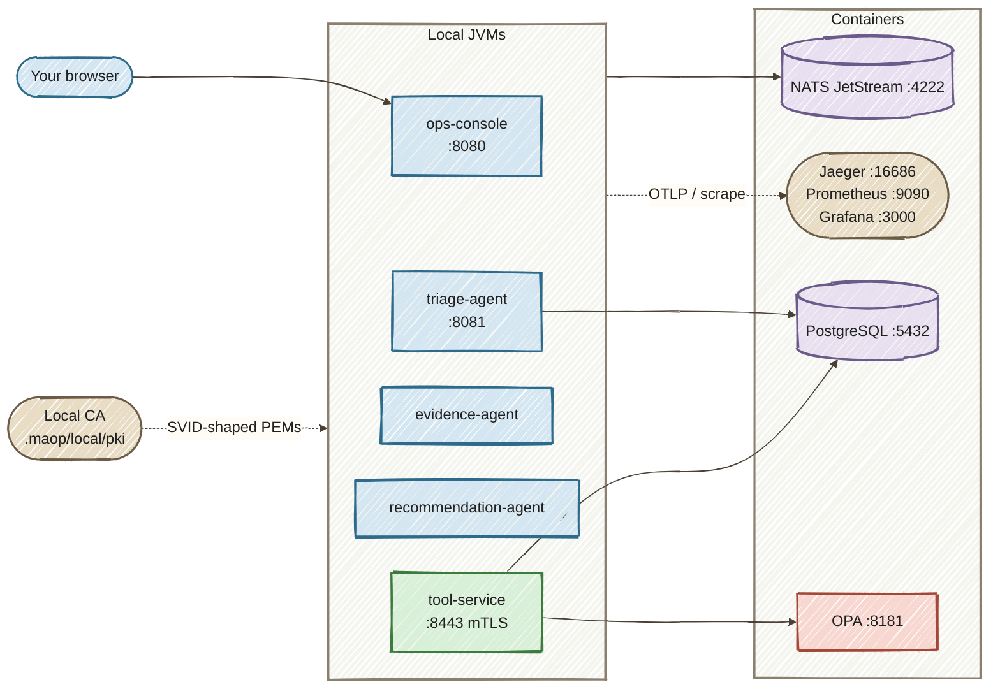

# 01 · Run it locally

## Goal

Build the five services and the console, start the full stack on your workstation without a
cluster, run the end-to-end checks, and find your way around the Agent Operations Console,
Jaeger, Grafana and Prometheus.

## What runs where

`scripts/local/stack.sh up` starts the infrastructure in containers (podman or docker) and the five
Quarkus services as local JVMs. A local CA issues certificates in exactly the file layout that
`spiffe-helper` produces, each with a single `spiffe://maop.local/...` URI SAN. The mTLS and SPIFFE ID
checks therefore run the production code paths. Only the issuer differs, and the console labels
this identity mode `DEV_STATIC`.



## Steps

### 1. Build the services and the console

The SPA bundle is built first and then packaged into `ops-console`, which serves it.

```bash
./mvnw -B package -DskipTests && (cd web && npm ci && npm run build) && ./mvnw -B -pl ops-console package -DskipTests
```

### 2. Start the stack

```bash
scripts/local/stack.sh up
```

The script issues fresh local certificates (SVIDs), starts
PostgreSQL, NATS, OPA, Jaeger, Prometheus and Grafana, launches the five JVMs, and waits until every
service reports ready on its management port. Logs go to `.maop/local/logs/`.

### 3. Run the end-to-end checks

```bash
scripts/local/stack.sh e2e
```

The checks drive the console API exactly as the UI does and save their evidence (raw JSON and a
`summary.txt`) to `.maop/local/e2e-<timestamp>/`.

### 4. Open the console

Open <http://localhost:8080>. You can run scenarios, approve actions and reset straight away: the local stack
needs no presenter token. (To require one, for example on a shared screen, start the stack with
`MAOP_PRESENTER_AUTH=true scripts/local/stack.sh up`; the token is then in `.maop/local/presenter-token`.)

### 5. Stop the stack

```bash
scripts/local/stack.sh down
```

## What you should see

The end-to-end run prints one line per check. All nine pass with the deterministic model and also
with live `gpt-4o-mini`:

| # | Check |
| --- | --- |
| 1 | The successful run reaches `AWAITING_APPROVAL` |
| 2 | The approved simulated action completes (`REMEDIATION_SIMULATED`) |
| 3 | One Jaeger trace spans all five services |
| 4 | The remediation is denied by policy before execution (`approval_required`, no side effect) |
| 5 | Audit callers are verified SPIFFE IDs |
| 6 | The tool API refuses a client without an SVID, and a forged identity header is ignored |
| 7 | A redelivered task replayed its tool call (`requests >= 2`, `executions = 1`) |
| 8 | The burst raised the evidence queue depth |
| 9 | All 12 burst runs drained to `EVIDENCE_ONLY` |

### Console tour

| Area | What it shows |
| --- | --- |
| **Top bar** | Product name, the model badge (`LIVE <model>` or an amber `DETERMINISTIC`), `SYNTHETIC DATA`, stream status, **Reset** (clears runs, audit and queued messages to start the demo over), the **Light / Dark** theme switch, presenter mode and full screen. |
| **Left rail** | The four scenario presets with the exact request each one sends, a *New incident* form, and recent runs. |
| **Topology** (main stage) | A fixed-layout graph of the services and queues. Edges pulse only when a real event arrives. mTLS calls show the verified caller's SPIFFE ID on hover, and a denied call is drawn in red. |
| **Timeline** (`T` toggles) | The durable state rail, a deadline bar, and task lanes where each delivery attempt is a segment, so a redelivery shows up as `delivery 2`. |
| **Inspector** (right) | Tabs for the selected run: *Summary*, *Evidence*, *Policy & identity*, *Tool audit* and *Usage*. |
| **Operations strip** | Queue depth, in-flight work, queue age, replicas (ready, desired, minimum to maximum), worker activity and platform health. Values that cannot be read show **Unavailable**. |
| **Presenter mode** (`P`) | Larger type and a guide bar for the scenario steps. A checklist item ticks only when the matching real event arrives. `Shift+1…4` runs a scenario, `F` toggles full screen, `?` lists the shortcuts. |

### Other UIs

| UI | URL | Notes |
| --- | --- | --- |
| Agent Operations Console | <http://localhost:8080> | Run scenarios, approve and reset; no token needed |
| Jaeger | <http://localhost:16686> | One trace per run |
| Grafana | <http://localhost:3000> | Project dashboards, anonymous viewer |
| Prometheus | <http://localhost:9090> | Scrapes the services' metrics |

Locally, the replica tiles read **Unavailable**: there is no Kubernetes API and no KEDA. Identity
shows `DEV_STATIC`.

## Deterministic or live model

| Setting | Behaviour |
| --- | --- |
| `MAOP_MODEL_MODE=deterministic` | A scripted model substitute. This is the local stack's default, so no credentials are needed. It is stamped on every event, stored result and span, and shown in the console top bar. |
| `MAOP_MODEL_MODE=live` | The configured OpenAI-compatible endpoint. This is the default for cluster deployments. |
| `MAOP_MODEL_NAME` | `gpt-4o-mini` by default |
| `MAOP_MODEL_BASE_URL` | `https://api.openai.com/v1/` by default |
| `MAOP_MODEL_API_KEY` | If unset, the services use an exported `OPENAI_API_KEY` |

To run the local stack against a live model, export the key in your shell. `stack.sh` passes your
environment to the services, and `up` stops a stack that is already running first:

```bash
export OPENAI_API_KEY=...   # your key; it is never written to the repository
MAOP_MODEL_MODE=live scripts/local/stack.sh up
```

Put `MAOP_MODEL_MODE=live` on the same line as the command (or `export` it): on a line of its own it is not passed
to `stack.sh`, and the stack starts deterministic. The console's model badge shows which mode is running. A full
`stack.sh e2e` in live mode makes many real model calls (the burst alone runs 12 incidents).

There is **no automatic fallback** from live to deterministic. A failing model produces a failed run
or one that needs review, with the reason visible.

## Key takeaways

- The local stack exercises the real code paths: real NATS, PostgreSQL, OPA and Jaeger, plus mTLS
  with SPIFFE-shaped certificates. It covers four scenarios and records the evidence on disk.
- Provenance is always labelled: deterministic mode, synthetic data and simulated remediation.
- Not available without a cluster: KEDA scale-out, SPIRE-issued SVIDs, and OpenShift Routes and
  builds.

## Learn more

- [README: Local stack](../../README.md#local-stack-no-cluster)
- [Deployment §7: Local development](../deployment.md#7-local-development-no-cluster)
- [UI design](../ui-design.md)
- Source: [`scripts/local/stack.sh`](https://github.com/danieloh30/many-agents-one-platform/blob/main/scripts/local/stack.sh), [`.env.example`](https://github.com/danieloh30/many-agents-one-platform/blob/main/.env.example), [`web/src/app/TopBar.tsx`](https://github.com/danieloh30/many-agents-one-platform/blob/main/web/src/app/TopBar.tsx)
