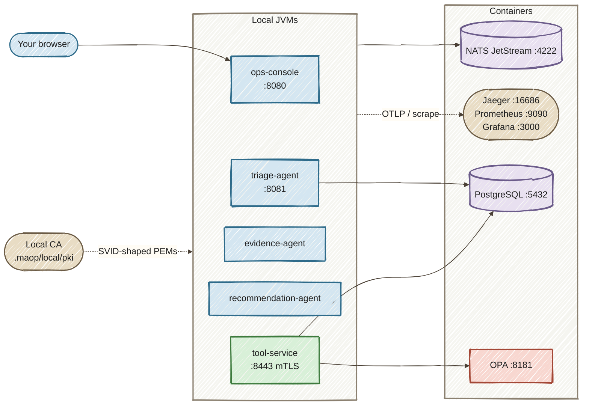

# 01 · Run it locally

## Goal

Build the five services and the console, start the full stack on your workstation without a
cluster, run the end-to-end checks, and find your way around the Agent Operations Console,
Jaeger, Grafana and Prometheus.

## What runs where

`scripts/local/stack.sh up` starts the infrastructure in containers (podman or docker) and the five
Quarkus services as local JVMs. A local CA issues certificates in exactly the file layout that
`spiffe-helper` produces, each with a single `spiffe://maop.local/...` URI SAN. The mTLS and SPIFFE ID
checks therefore run the production code paths. Only the issuer differs, and the console labels
this identity mode `DEV_STATIC`.



## Steps

### 1. Build the services and the console

The SPA bundle is built first and then packaged into `ops-console`, which serves it.

```bash
./mvnw -B package -DskipTests && (cd web && npm ci && npm run build) && ./mvnw -B -pl ops-console package -DskipTests
```

### 2. Start the stack

```bash
scripts/local/stack.sh up
```

The script issues fresh local certificates (SVIDs), starts
PostgreSQL, NATS, OPA, Jaeger, Prometheus and Grafana, launches the five JVMs, and waits until every
service reports ready on its management port. Logs go to `.maop/local/logs/`.

### 3. Run the end-to-end checks

```bash
scripts/local/stack.sh e2e
```

The checks drive the console API exactly as the UI does and save their evidence (raw JSON and a
`summary.txt`) to `.maop/local/e2e-<timestamp>/`.

### 4. Open the console

Open <http://localhost:8080>. You can run scenarios, approve actions and reset straight away: the local stack
needs no presenter token. (To require one, for example on a shared screen, start the stack with
`MAOP_PRESENTER_AUTH=true scripts/local/stack.sh up`; the token is then in `.maop/local/presenter-token`.)

To walk through the demo yourself, run the first four scenarios in order and end each one as listed in
[the five scenarios](index.md#the-five-scenarios): approve the first, second and fourth, and let the
burst finish. While a run waits for you, an amber **Your decision is needed** bar shows its remaining time;
**Review & decide** jumps to Approve and Reject on the run's **Timeline** tab. **Reset** in the top bar starts over.
A fifth, optional scenario (sandboxed analysis) is covered in
[tutorial 10](10-production-blueprint-agent-substrate.md#try-it-scenario-5).

### 5. Stop the stack

```bash
scripts/local/stack.sh down
```

## What you should see

The end-to-end run prints one line per check. All nine pass with the deterministic model and also
with live `gpt-4o-mini`:

| # | Check |
| --- | --- |
| 1 | The successful run reaches `AWAITING_APPROVAL` |
| 2 | The approved simulated action completes (`REMEDIATION_SIMULATED`) |
| 3 | One Jaeger trace spans all five services |
| 4 | The remediation is denied by policy before execution (`approval_required`, no side effect) |
| 5 | Audit callers are verified SPIFFE IDs |
| 6 | The tool API refuses a client without an SVID, and a forged identity header is ignored |
| 7 | A redelivered task replayed its tool call (`requests >= 2`, `executions = 1`) |
| 8 | The burst raised the evidence queue depth |
| 9 | All 12 burst runs drained to `EVIDENCE_ONLY` |

Two more checks cover the optional scenario 5 ([tutorial 10](10-production-blueprint-agent-substrate.md#try-it-scenario-5)).
They were added later and are not part of the recorded result above:

| # | Check |
| --- | --- |
| 10 | The sandboxed tool call is allowed for the evidence agent only, and reports its sandbox mode |
| 11 | The log analysis evidence is recorded and the run awaits approval |

### Console tour

| Area | What it shows |
| --- | --- |
| **Top bar** | Product name, a status group (the model badge, `LIVE <model>` or an amber `DETERMINISTIC`; `SYNTHETIC DATA`; stream status), **Reset** (clears runs, audit and queued messages to start the demo over), the **Light / Dark** theme switch, presenter mode and full screen. |
| **Left rail** | The five scenarios as one-line rows with a **Run** button; click a title to unfold its description, how to end the run, its shortcut and the exact request it sends. Below: a *New incident* form and recent runs, listed by scenario, where a burst's runs fold into one entry and runs made by `./demo.sh verify` carry a **smoke test** tag. Hide the rail with the button at the left of the stage tabs, or `L`. |
| **Topology** (main stage) | A fixed-layout graph of the services and queues. Edges pulse only when a real event arrives. mTLS calls show the verified caller's SPIFFE ID on hover, and a denied call is drawn in red. |
| **Timeline** (`T` toggles) | The durable state rail, a deadline bar, and task lanes where each delivery attempt is a segment, so a redelivery shows up as `delivery 2` with a **Redelivered** tag and its tool calls' request and execution counts. |
| **Inspector** (right) | Tabs for the selected run: *Summary*, *Evidence*, *Policy* (caller identity and policy decision), *Tool audit* and *Usage*. With no run selected, it says what to do next. Next to the Timeline it opens on *Tool audit* (*Policy* for a denial run), since the Timeline already shows state and evidence. Hide it with the button at the right of the stage tabs, or `I`; hiding both side panels gives the topology the full width. |
| **Operations strip** | One summary line by default; **Show details** opens queue depth, in-flight work, queue age, replicas (ready, desired, minimum to maximum), worker activity and platform health. It opens on its own when a burst starts. Values that cannot be read show **Unavailable**; Kubernetes-only facts on this local stack show a grey **Not on local stack**. |
| **Presenter mode** (`P`) | Larger type and a guide bar: one chip per scenario step and the selected step in full, folded with `G`; it follows the run you select. A checklist item ticks only when the matching real event arrives. `Shift+1…4` runs a scenario, `F` toggles full screen, `?` lists the shortcuts. |

### What "SYNTHETIC DATA" means

The `SYNTHETIC DATA` badge in the top bar is always on. It says that the *facts* the agents investigate are made
up, while everything that handles those facts is real.

| Synthetic (made up, safe to show) | Real (actually happens on every run) |
| --- | --- |
| The incident: the `checkout` service's error rate rising after a release | The model calls, in `LIVE` mode: the triage plan, each finding and the recommendation |
| What the read tools return: deployment history, config diff, error summary and service catalogue, from a fixed scenario file in the tool service ([`scenario.json`](https://github.com/danieloh30/many-agents-one-platform/blob/main/tool-service/src/main/resources/synthetic/scenario.json)), with times shown relative to now | The tool calls themselves: mTLS with a SPIFFE identity, an OPA decision, idempotency keys and an audit record |
| Remediation: an approved rollback only writes a `simulated_action` row; nothing touches a cluster | Messaging, redelivery, durable state in PostgreSQL, traces, metrics and, on a cluster, KEDA scaling |

So a finding such as "the latest release lowered the payment client timeout" is the model's real reading of
synthetic tool output. Every tool result carries `dataOrigin: "SYNTHETIC"`, and the console tags evidence cards and
tool calls with the same label. The point is that the demo can run anywhere, repeatably, without access to a real
production system, and that no code path can change one: the tool service has no Kubernetes or cloud client.

The scenario is written so that the rollback is a sound call, and the evidence says why:

- **Cause:** release `2.14.0` cut the payment client timeout from 2000 ms to 300 ms and turned off retries, while the
  payment gateway's p99 latency is 880 ms, the same as its baseline. Slow payments that used to succeed now time out.
- **Last good version:** `2.13.2` ran for about 26 hours at 0.2% errors on `POST /checkout`.
- **Reversible:** the release has no database migrations and the `2.13.2` image is still available.
- **Trade-off:** rolling back also turns off the new checkout flow, which the recommendation lists as a risk.

### Other UIs

| UI | URL | Notes |
| --- | --- | --- |
| Agent Operations Console | <http://localhost:8080> | Run scenarios, approve and reset; no token needed |
| Jaeger | <http://localhost:16686> | One trace per run |
| Grafana | <http://localhost:3000> | Project dashboards, anonymous viewer |
| Prometheus | <http://localhost:9090> | Scrapes the services' metrics |

Locally, the replica and scaler facts read **Not on local stack** and the agent nodes **Local process**: there is
no Kubernetes API and no KEDA. Identity shows `DEV_STATIC`.

## Deterministic or live model

| Setting | Behaviour |
| --- | --- |
| `MAOP_MODEL_MODE=deterministic` | A scripted model substitute. This is the local stack's default, so no credentials are needed. It is stamped on every event, stored result and span, and shown in the console top bar. |
| `MAOP_MODEL_MODE=live` | The configured OpenAI-compatible endpoint. This is the default for cluster deployments. |
| `MAOP_MODEL_NAME` | `gpt-4o-mini` by default |
| `MAOP_MODEL_BASE_URL` | `https://api.openai.com/v1/` by default |
| `MAOP_MODEL_API_KEY` | If unset, the services use an exported `OPENAI_API_KEY` |

To run the local stack against a live model, export the key in your shell. `stack.sh` passes your
environment to the services, and `up` stops a stack that is already running first:

```bash
export OPENAI_API_KEY=...   # your key; it is never written to the repository
MAOP_MODEL_MODE=live scripts/local/stack.sh up
```

Put `MAOP_MODEL_MODE=live` on the same line as the command (or `export` it): on a line of its own it is not passed
to `stack.sh`, and the stack starts deterministic. The console's model badge shows which mode is running. A full
`stack.sh e2e` in live mode makes many real model calls (the burst alone runs 12 incidents).

There is **no automatic fallback** from live to deterministic. A failing model produces a failed run
or one that needs review, with the reason visible.

## Key takeaways

- The local stack exercises the real code paths: real NATS, PostgreSQL, OPA and Jaeger, plus mTLS
  with SPIFFE-shaped certificates. It covers four scenarios and records the evidence on disk.
- Provenance is always labelled: deterministic mode, synthetic data and simulated remediation.
- Not available without a cluster: KEDA scale-out, SPIRE-issued SVIDs, and OpenShift Routes and
  builds.

## Learn more

- [README: Local stack](../../README.md#local-stack-no-cluster)
- [Deployment §7: Local development](../deployment.md#7-local-development-no-cluster)
- [UI design](../ui-design.md)
- Source: [`scripts/local/stack.sh`](https://github.com/danieloh30/many-agents-one-platform/blob/main/scripts/local/stack.sh), [`.env.example`](https://github.com/danieloh30/many-agents-one-platform/blob/main/.env.example), [`web/src/app/TopBar.tsx`](https://github.com/danieloh30/many-agents-one-platform/blob/main/web/src/app/TopBar.tsx)
