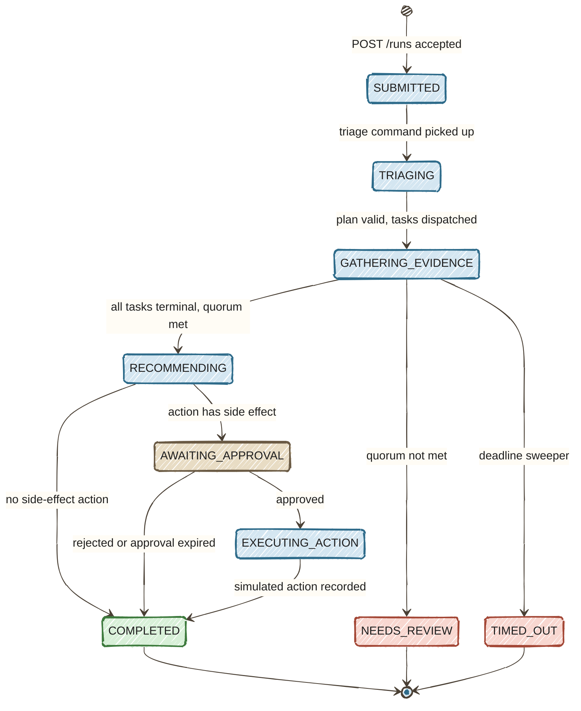

# 02 · Durable workflow state

## Goal

Understand why a run survives the restart of any service. You will look at the run state machine,
the single writer that owns it, the transactional outbox and inbox, row locks and optimistic
versions, deadlines with a sweeper, and per-run budgets. You will then find each one in the code.

## The run state machine

`triage-agent` is the **only** writer of run state. State is a column on `triage.run`, guarded by a
`version` column. Any transition not in the permitted table is rejected, terminal states never
change, and late events for a finished run are recorded as `IGNORED_LATE` with no effect.



The diagram is simplified. `NEEDS_REVIEW` (for example when the budget is exhausted or model output
is still invalid after one repair attempt) and `TIMED_OUT` can be reached from every non-terminal
state, except that `AWAITING_APPROVAL` cannot time out: it expires to `COMPLETED (APPROVAL_EXPIRED)`.
`FAILED` and `CANCELLED` are also reachable from every non-terminal state. The full transition table
is in [architecture §4.1](../architecture.md#41-permitted-transitions).

## Steps

### 1. Watch a run move through its states

With the local stack running ([tutorial 01](01-run-it-locally.md)), start a successful run from the
console (preset **Success**) and switch to the timeline with `T`. To follow it from the API instead,
use the presenter token:

```bash
TOKEN="$(cat .maop/local/presenter-token)"
REQ="$(curl -s http://localhost:8080/api/v1/scenarios | jq -c '.items[] | select(.id=="SUCCESS") | .request')"
RUN="$(curl -s -X POST http://localhost:8080/api/v1/runs \
  -H "Authorization: Bearer $TOKEN" -H 'Content-Type: application/json' \
  -H "Idempotency-Key: tutorial-$(date +%s)" -d "$REQ" | jq -r .runId)"
echo "$RUN"
```

```bash
curl -s "http://localhost:8080/api/v1/runs/$RUN/timeline" | jq -r '.items[] | "\(.kind)\t\(.message)"'
```

### 2. See that state changes and messages commit together

Open [`Workflow.java`](https://github.com/danieloh30/many-agents-one-platform/blob/main/triage-agent/src/main/java/io/github/danieloh30/maop/triage/service/Workflow.java).
Every method runs with `@Transactional(MANDATORY)`, inside the caller's transaction. `transition(...)`
checks the move against [`Transitions.java`](https://github.com/danieloh30/many-agents-one-platform/blob/main/triage-agent/src/main/java/io/github/danieloh30/maop/triage/model/Transitions.java),
updates the run, writes a timeline entry, and inserts a `run.state_changed` event into the
**outbox**, all in the same transaction. Nothing is published to NATS inside a request or message
handler transaction.

The relay in [`OutboxRelay.java`](https://github.com/danieloh30/many-agents-one-platform/blob/main/maop-outbox/src/main/java/io/github/danieloh30/maop/outbox/OutboxRelay.java)
polls every 250 ms:

```sql
-- abridged from OutboxRelay.java
select ... from outbox_event
 where published_at is null order by id limit 50 for update skip locked
```

It publishes each row with `Nats-Msg-Id` set to the event ID, waits for the JetStream acknowledgement,
then marks the row published. A failing row is retried with capped exponential backoff and shows up
as `maop_outbox_pending` and `maop_outbox_oldest_age_seconds`. `SKIP LOCKED` makes several relay
replicas safe.

### 3. See how duplicate results are absorbed

Results are folded by [`ResultFolder.java`](https://github.com/danieloh30/many-agents-one-platform/blob/main/triage-agent/src/main/java/io/github/danieloh30/maop/triage/service/ResultFolder.java).
It handles one event per transaction:

1. `inbox.firstDelivery(consumer, eventId)` inserts into `inbox_event ... on conflict do nothing`. If
   the row already exists, the event was already processed, and the folder simply acknowledges it.
2. `store.lock(runId)` takes a `select ... for update` **row lock** on the run, which serialises
   concurrent results for the same run.
3. State guards ignore late results for terminal runs or finished tasks.
4. The task is updated, usage is accumulated, and `afterTaskTerminal(...)` decides the next step.
   Only the result that completes the last evidence task dispatches the recommendation.
5. The transaction commits, and **only then** does the worker acknowledge the message.

`RunStore.update(...)` additionally checks the optimistic version
(`update run set version = version + 1 ... where run_id = ? and version = ?`). If the version moved,
the transaction rolls back, including its inbox row, and the message is retried.

### 4. See the deadlines and the sweeper

Each run gets an absolute deadline (`maop.run.deadline=120s`) that travels in every command as the
`maopdeadline` CloudEvents extension. Before a model call, a tool call, or execution in the tool
service, each hop derives its timeout as `min(configured, remaining − 2 s)` and refuses to start
with less than 3 s left
([`Deadlines.java`](https://github.com/danieloh30/many-agents-one-platform/blob/main/maop-common/src/main/java/io/github/danieloh30/maop/common/Deadlines.java)).

[`Sweeper.java`](https://github.com/danieloh30/many-agents-one-platform/blob/main/triage-agent/src/main/java/io/github/danieloh30/maop/triage/service/Sweeper.java)
runs every 5 s. It selects overdue runs with `for update skip locked` and moves them to `TIMED_OUT`,
or to `COMPLETED (APPROVAL_EXPIRED)` when no approval decision arrived within the 10-minute approval
window. It is the backstop for every case where a message was lost.

### 5. See the budgets

A budget is fixed when the run is submitted and sliced into each command (`Workflow.EVIDENCE_BUDGET`,
`RECOMMENDATION_BUDGET`). Usage comes back in every result event and is accumulated
transactionally. If a run exceeds its token budget, it moves to `NEEDS_REVIEW (BUDGET_EXHAUSTED)`.

| Limit | Default | Hard cap |
| --- | --- | --- |
| Evidence tasks per run | 4 | 6 |
| Delegation depth | 1 | 1 (workers cannot dispatch) |
| Model calls per run | 12 | 20 |
| Model calls per evidence task | 2 | 3 |
| Tool calls per task | 4 | 6 |
| Total tokens per run | 24 000 | 40 000 |

## What you should see

- The timeline lists `STATE_CHANGED` entries for `SUBMITTED → TRIAGING → GATHERING_EVIDENCE →
  RECOMMENDING → AWAITING_APPROVAL`, with `TASK_DISPATCHED`, `TASK_STARTED` and `TASK_COMPLETED`
  entries in between.
- After **Approve (simulate)**, the run moves through `EXECUTING_ACTION` to `COMPLETED` with outcome
  `REMEDIATION_SIMULATED`. This is end-to-end check 2.
- `GET /api/v1/runs/$RUN` returns the same record whenever you ask. The console rebuilds every
  screen from REST after a refresh, because run state lives in PostgreSQL, not in any agent's memory
  or in the event stream.

> Note: `scripts/local/stack.sh up` recreates the local containers, including PostgreSQL, so it
> starts with empty demonstration state. It does not restart a single service.

## Key takeaways

- **One writer, explicit transitions.** Orchestration is explicit, durable code rather than an
  in-process agent graph.
- **Outbox and inbox** keep state and messages consistent without distributed transactions: the
  outbox makes sure a state change is published, and the inbox makes sure a result is applied once.
- **Row locks plus versions** make concurrent results for the same run safe.
- **Deadlines, the sweeper and budgets** bound time and cost. Nothing waits forever.
- Implementation note: the design originally called for Hibernate ORM. The code uses plain JDBC
  inside JTA transactions, so the SQL (`SKIP LOCKED`, `ON CONFLICT`, row locks) is visible
  ([ADR-0016](../decisions/0016-implementation-adjustments.md), item 1).

## Learn more

- [Architecture §4: Durable run state machine](../architecture.md#4-durable-run-state-machine)
- [Architecture §6: Messaging reliability](../architecture.md#6-messaging-reliability)
- [ADR-0003: Explicit durable orchestration](../decisions/0003-explicit-durable-orchestration.md) · [ADR-0004: Outbox/inbox](../decisions/0004-outbox-inbox.md)
- Source: [`RunStore.java`](https://github.com/danieloh30/many-agents-one-platform/blob/main/triage-agent/src/main/java/io/github/danieloh30/maop/triage/service/RunStore.java), [`Outbox.java`](https://github.com/danieloh30/many-agents-one-platform/blob/main/maop-outbox/src/main/java/io/github/danieloh30/maop/outbox/Outbox.java), [`Inbox.java`](https://github.com/danieloh30/many-agents-one-platform/blob/main/maop-outbox/src/main/java/io/github/danieloh30/maop/outbox/Inbox.java)
