# 03 · Messaging and redelivery

## Goal

Understand how work moves between agents through NATS JetStream. The topics are the streams and
durable pull consumers, the CloudEvents binary binding on NATS headers, bounded retries with
dead-lettering, and the redelivery scenario. In that scenario a worker abandons a task after its
tool call has committed, and idempotency keys keep the effect from happening twice.

## Streams and consumers

| Stream | Subjects | Retention | Purpose |
| --- | --- | --- | --- |
| `MAOP_WORK` | `maop.work.v1.triage`, `.evidence`, `.recommendation` | WorkQueue, file, max age 1 h | Commands, with exactly one consumer per subject |
| `MAOP_EVENTS` | `maop.events.v1.>` | Limits, file, max age 24 h | Facts and progress (fan-out) |
| `MAOP_DLQ` | `maop.dlq.v1.>` | Limits, file, max age 7 d | Dead-lettered commands with failure metadata |

| Durable pull consumer | Filter | Owner | AckWait | MaxDeliver |
| --- | --- | --- | --- | --- |
| `triage-workers` | `maop.work.v1.triage` | triage-agent | 30 s | 3 |
| `evidence-workers` | `maop.work.v1.evidence` | evidence-worker | 20 s | 3 |
| `recommendation-workers` | `maop.work.v1.recommendation` | recommendation-agent | 30 s | 3 |
| `triage-results` | `maop.events.v1.task.*` results | triage-agent | 30 s | 5 |

Each service creates its streams and consumers idempotently at startup
([`Topology.java`](https://github.com/danieloh30/many-agents-one-platform/blob/main/maop-common/src/main/java/io/github/danieloh30/maop/common/messaging/Topology.java)),
so a fresh broker works whatever order the services start in.

## The redelivery path

```mermaid
%%{init: {"look":"handDrawn","theme":"base","themeVariables":{"darkMode":false,"background":"#FFFCF5","primaryColor":"#D4E6F1","primaryBorderColor":"#2E6B8A","primaryTextColor":"#1F1F1F","secondaryColor":"#D8F0D8","secondaryTextColor":"#1F1F1F","tertiaryColor":"#E8DCC4","tertiaryTextColor":"#1F1F1F","textColor":"#1F1F1F","lineColor":"#4A4035","edgeLabelBackground":"#FFFCF5","clusterBkg":"#F5F5F0","clusterBorder":"#6B5B45","fontSize":"16px"},"flowchart":{"nodeSpacing":35,"rankSpacing":55,"padding":18,"curve":"basis"}}}%%
flowchart LR
    WORK[(MAOP_WORK<br/>evidence command)] -->|delivery 1| E1[evidence-worker<br/>DROP_ACK_ONCE]
    E1 -->|Idempotency-Key K| TOOLS[tool-service]
    TOOLS -->|EXECUTED · invocation I| DB[(tools.tool_invocation)]
    E1 -.->|abandons: no ack, no result| WORK
    WORK -->|AckWait expires · delivery 2| E2[evidence-worker]
    E2 -->|same key K| TOOLS
    TOOLS -->|replayed: true · same I| E2
    E2 -->|task.evidence.completed<br/>id = UUIDv5 of taskId and type| EVENTS[(MAOP_EVENTS)]
    EVENTS --> TRIAGE[triage-agent<br/>inbox dedup]

    style WORK fill:#E8E0F0,stroke:#6B5B8A,color:#1F1F1F,stroke-width:2px
    style EVENTS fill:#E8E0F0,stroke:#6B5B8A,color:#1F1F1F,stroke-width:2px
    style DB fill:#E8E0F0,stroke:#6B5B8A,color:#1F1F1F,stroke-width:2px
    style E1 fill:#F8D7D0,stroke:#A34736,color:#1F1F1F,stroke-width:2px
    style E2 fill:#D4E6F1,stroke:#2E6B8A,color:#1F1F1F,stroke-width:2px
    style TOOLS fill:#D8F0D8,stroke:#3D7A3D,color:#1F1F1F,stroke-width:2px
    style TRIAGE fill:#D4E6F1,stroke:#2E6B8A,color:#1F1F1F,stroke-width:2px
```



## Steps

### 1. Look at an event on the wire

Messages on NATS use the **CloudEvents binary content mode**. Context attributes become NATS headers
prefixed with `ce-` (`ce-id`, `ce-source`, `ce-type`, `ce-subject`, `ce-time`, plus the extensions
`maoprunid`, `maoptaskid`, `maopdeadline` and `maopmodelmode`), and the payload is the JSON `data`.
`Nats-Msg-Id` equals `ce-id`, and `traceparent`/`tracestate` are copied without the prefix so that
standard propagators work. The codec is a small in-repo class
([`CloudEventCodec.java`](https://github.com/danieloh30/many-agents-one-platform/blob/main/maop-common/src/main/java/io/github/danieloh30/maop/common/events/CloudEventCodec.java)).
The CloudEvents SDK is not used because the Quarkus BOM pins an older `cloudevents-api`
([ADR-0016](../decisions/0016-implementation-adjustments.md), item 4).

The local NATS container exposes its monitoring port. List the consumers and their pending counts:

```bash
curl -s 'http://localhost:8222/jsz?accounts=true&streams=true&consumers=true' | jq '.account_details[].stream_detail[] | {stream: .name, consumers: [.consumer_detail[]? | {name, num_pending, num_ack_pending, num_redelivered}]}'
```

### 2. Read the worker loop

[`PullWorker.java`](https://github.com/danieloh30/many-agents-one-platform/blob/main/maop-common/src/main/java/io/github/danieloh30/maop/common/messaging/PullWorker.java)
is the pull loop that every consumer shares:

- It fetches in batches limited by a semaphore (bounded concurrency) and runs each handler on a
  virtual thread.
- While a handler runs, it sends an **in-progress acknowledgement** every `AckWait / 3`, so long
  work is not redelivered.
- A failed handler is **negatively acknowledged with a delay**: 2 s after the first delivery, 5 s
  after later ones. There is no JetStream `BackOff` list, because a `BackOff` list replaces `AckWait`
  and does not apply to naks.
- On the **final** permitted delivery, the handler's `onFinalFailure` publishes `task.dead_lettered`,
  copies the command to `maop.dlq.v1.<kind>` with `Maop-Dlq-Reason` and `Maop-Dlq-Deliveries` headers,
  and then acknowledges the original
  ([`DeadLetters.java`](https://github.com/danieloh30/many-agents-one-platform/blob/main/maop-common/src/main/java/io/github/danieloh30/maop/common/messaging/DeadLetters.java)).
- On shutdown it stops pulling, waits for in-flight work, and naks anything left so it is redelivered
  promptly.

**Advisory backstop.** If a worker crashes on every delivery, no handler ever reaches
`onFinalFailure`. The message would then stay in the work-queue stream. To handle that,
[`AdvisoryListener.java`](https://github.com/danieloh30/many-agents-one-platform/blob/main/triage-agent/src/main/java/io/github/danieloh30/maop/triage/service/AdvisoryListener.java)
subscribes to JetStream's `MAX_DELIVERIES` advisories for `MAOP_WORK`. It copies the message to the
DLQ, removes it from the work stream, and folds a `task.dead_lettered` fact into the run, which then
moves to `NEEDS_REVIEW` with the reason. After that, nothing is retried automatically.

### 3. Run the redelivery scenario

In the console, run the **Redelivery** preset (`Shift+4` in presenter mode). It sends
`faultInjection: DROP_ACK_ONCE`, which is accepted only when `maop.fault-injection.enabled=true`
(the default) and is always shown on the run. Or use the API:

```bash
TOKEN="$(cat .maop/local/presenter-token)"
REQ="$(curl -s http://localhost:8080/api/v1/scenarios | jq -c '.items[] | select(.id=="REDELIVERY") | .request')"
RUN="$(curl -s -X POST http://localhost:8080/api/v1/runs \
  -H "Authorization: Bearer $TOKEN" -H 'Content-Type: application/json' \
  -H "Idempotency-Key: tutorial-$(date +%s)" -d "$REQ" | jq -r .runId)"
```

Wait about 30 seconds, then inspect the tasks and the tool audit:

```bash
curl -s "http://localhost:8080/api/v1/runs/$RUN" | jq '.tasks[] | {kind, topic, state, deliveries}'
curl -s "http://localhost:8080/api/v1/audit/invocations?runId=$RUN" | jq '.items[] | {toolName, status, requests, executions}'
```

### 4. Follow the idempotency chain

On delivery 1, [`EvidenceHandler.java`](https://github.com/danieloh30/many-agents-one-platform/blob/main/evidence-worker/src/main/java/io/github/danieloh30/maop/evidence/service/EvidenceHandler.java)
makes its baseline tool calls, then deliberately abandons the message: no acknowledgement and no
result. After `AckWait`, JetStream redelivers it, and the second delivery repeats the same tool calls.
Three layers stop a duplicate effect:

| Layer | Key | Where |
| --- | --- | --- |
| JetStream duplicate window (best effort, 2 min) | `Nats-Msg-Id` = event ID | broker |
| Tool idempotency (durable) | `<taskId>:<toolName>:<sha256(canonical args)[0..16]>`, plus `:<approvalId>` for an approved action | `tool_invocation ... on conflict (idempotency_key) do nothing` in [`InvocationStore.java`](https://github.com/danieloh30/many-agents-one-platform/blob/main/tool-service/src/main/java/io/github/danieloh30/maop/tools/service/InvocationStore.java) |
| Result deduplication (durable) | `(consumer, event id)`, where a terminal result's ID is UUIDv5 of the task ID and event type | `inbox_event` in triage-agent |

When the key already exists with the same argument digest, tool-service returns the stored response
with `replayed: true` and runs nothing. If the arguments differ, it returns `409 IDEMPOTENCY_KEY_REUSED`.

## What you should see

- The task lanes show the fault-injected evidence task as `delivery 1`, which ends without a result,
  followed by `delivery 2` after the acknowledgement timeout (about 20 s). The run header carries the
  amber tag `Fault injected: DROP_ACK_ONCE`.
- In the API output, one evidence task has `deliveries: 2`, and its tool invocations show
  `requests: 2` and `executions: 1`. The *Tool audit* tab shows the second response as `REPLAYED`.
- The run still reaches `AWAITING_APPROVAL`. This is end-to-end check 7.

## Key takeaways

- Workers are **stateless**, and correctness still holds: every effect commits somewhere durable and
  idempotent, so a worker can crash at any point and be redelivered.
- Retries are **bounded**: at most 3 deliveries per command, with delayed naks, then the dead-letter
  queue and `NEEDS_REVIEW` with a visible reason. Nothing loops forever.
- **Deterministic event IDs** (UUIDv5) make a redelivered task produce the same result event, which
  the inbox then drops.

## Learn more

- [Contracts §3: Event contracts](../contracts.md#3-event-contracts)
- [Architecture §6.5: Retries, timeouts, and the review path](../architecture.md#65-retries-timeouts-and-the-review-path)
- [ADR-0005: jnats direct](../decisions/0005-jnats-direct.md) · [ADR-0006: CloudEvents on NATS binary](../decisions/0006-cloudevents-nats-binary.md)
- Source: [`JetStreamClient.java`](https://github.com/danieloh30/many-agents-one-platform/blob/main/maop-common/src/main/java/io/github/danieloh30/maop/common/messaging/JetStreamClient.java), [`WorkerSupport.java`](https://github.com/danieloh30/many-agents-one-platform/blob/main/maop-common/src/main/java/io/github/danieloh30/maop/common/messaging/WorkerSupport.java), [`ToolClient.java`](https://github.com/danieloh30/many-agents-one-platform/blob/main/maop-common/src/main/java/io/github/danieloh30/maop/common/tools/ToolClient.java)
