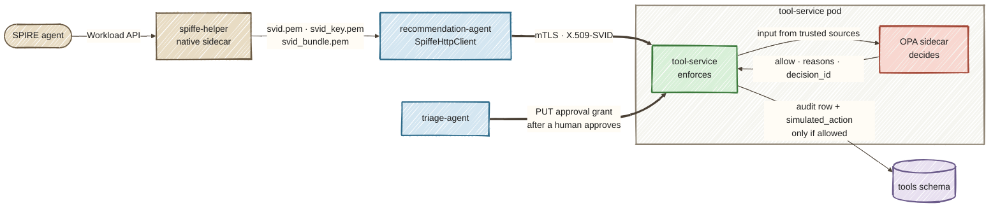

# 04 · Identity and policy

## Goal

See how the protected tool boundary works. The tool service learns **who** is calling from the
mTLS connection (a SPIFFE ID in an X.509-SVID), asks OPA **whether** the call is allowed, and fails
closed. A remediation needs a human approval bound to the exact action. You will run the
policy-denial scenario and query the policy yourself.

## The enforcement flow



> Verified on Kubernetes (Red Hat OpenShift): SPIRE (chart 0.31.0, SPIRE 1.16.0) issued SVIDs to all five workloads through the SPIFFE
> CSI volume under `restricted-v2`; every tool-service audit record carried a
> `spiffe://<apps domain>/ns/maop/sa/<service>` caller, and a client without a certificate (sending a forged
> identity header) was refused at the TLS handshake. Locally, a CA writes certificates in the same file
> layout with single `spiffe://maop.local/...` URI SANs, so everything to the right of `spiffe-helper` runs
> the same code.

## How identity works

### SPIFFE and SPIRE, and what "agent" means here

**SPIFFE** (Secure Production Identity Framework For Everyone) is a standard for workload identity. It defines the **SPIFFE ID**, a name such as
`spiffe://<trust domain>/ns/maop/sa/triage-agent`; the **SVID**, the document that proves a workload holds that
name (here an X.509 certificate with the ID as its only URI SAN); and the **Workload API**, through which a workload
fetches its SVID. **SPIRE** (the SPIFFE Runtime Environment) is the software that implements the standard: the **SPIRE server** signs SVIDs and holds
the rules for who gets which ID, and a **SPIRE agent** runs on every node and hands SVIDs to the pods there. Think of
SPIFFE as the passport format, and SPIRE as the passport office and its local branches.

The **SPIRE agent is not one of this project's AI agents.** It is an infrastructure daemon, one per node, with no
model. `triage-agent`, `evidence-agent` and `recommendation-agent` are *workloads that receive* identities; the
SPIRE agent is part of the *system that issues* them. Before it hands over an SVID, it checks with Kubernetes which
namespace and service account the pod actually runs as, so a pod cannot claim another workload's name.

Locally there is no SPIRE: `scripts/local/stack.sh` issues development certificates with the same `spiffe://` IDs
for trust domain `maop.local`, which is why the local console tags callers **Development static identity** instead
of **Verified by mTLS**.

### Where the certificates come from and how they are checked

- **On a cluster** (`deploy/components/spiffe`), the SPIFFE CSI driver mounts the SPIRE agent socket.
  `spiffe-helper` runs as a native sidecar (an init container with `restartPolicy: Always`) with
  `daemon_mode = true`, and writes `svid.pem`, `svid_key.pem` and `svid_bundle.pem` into a
  memory-backed `emptyDir`. A `ClusterSPIFFEID` assigns `spiffe://<td>/ns/maop/sa/<service-account>`.
- **Server side** (tool-service), the Quarkus TLS registry configuration named `spiffe` loads those
  PEMs and reloads them every 30 s (`quarkus.tls.spiffe.reload-period=30S`). It also sets
  `quarkus.http.ssl.client-auth=required` and `quarkus.http.insecure-requests=disabled`, so the tool
  API has no plaintext port.
  [`CallerFilter.java`](https://github.com/danieloh30/many-agents-one-platform/blob/main/tool-service/src/main/java/io/github/danieloh30/maop/tools/resource/CallerFilter.java)
  takes the single URI SAN from the verified peer certificate and rejects any other trust domain.
  Headers and request bodies are never a source of identity.
- **Client side** (agents),
  [`SpiffeHttpClient.java`](https://github.com/danieloh30/many-agents-one-platform/blob/main/maop-common/src/main/java/io/github/danieloh30/maop/common/tls/SpiffeHttpClient.java)
  builds a JDK `HttpClient` from the same PEM files and rebuilds it when they rotate. Instead of
  hostname verification, it requires the server's single URI SAN to equal `MAOP_TOOL_SERVICE_SPIFFE_ID`
  ([ADR-0016](../decisions/0016-implementation-adjustments.md), item 5).

## How policy works

tool-service is the **policy enforcement point**. For every invocation
([`ToolInvocationService.java`](https://github.com/danieloh30/many-agents-one-platform/blob/main/tool-service/src/main/java/io/github/danieloh30/maop/tools/service/ToolInvocationService.java)),
it runs these steps in one transaction:

1. **Claim** the idempotency key. A committed result or denial is returned as-is.
2. **Check the deadline**. If it has passed, the response is `DEADLINE_EXCEEDED` and nothing runs.
3. **Assemble the policy input from trusted sources only.** The caller comes from the connection,
   the tool class from the catalogue, and the approval grant from its own database. The
   `action_digest` is recomputed from the actual request arguments.
4. **Ask OPA** (`POST /v1/data/maop/tools/decision` on localhost). Any error, timeout or undefined
   result returns `503 POLICY_UNAVAILABLE`: **fail closed**.
5. **Record the decision.** Only if it allows the call does the handler run: read tools return
   synthetic data, and remediation tools insert a `simulated_action` row. A denied request never
   reaches the handler.

The policy, [`policy/maop/tools.rego`](https://github.com/danieloh30/many-agents-one-platform/blob/main/policy/maop/tools.rego)
(Rego v1, package `maop.tools`), defaults to deny. Caller permissions are data in `policy/maop/data.json`,
keyed by the service-account segment of the SPIFFE ID: only `recommendation-agent` has `tool.remediate`.
This is the remediation rule:

```rego
default allow := false

# --- simulated remediation: requires a matching, unexpired human approval ----------------
allow if {
	trusted_domain
	input.action == "tool.invoke"
	input.tool.class == "REMEDIATION"
	"tool.remediate" in permissions
	input.tool.simulated == true
	approval_valid
}

approval_valid if {
	input.approval != null
	input.approval.run_id == input.run.id
	input.approval.action_digest == input.request.action_digest
	time.parse_rfc3339_ns(input.approval.expires_at) > time.parse_rfc3339_ns(input.now)
}
```

Every denial carries reasons: `untrusted_domain`, `caller_not_permitted`, `not_simulated`,
`approval_required`, `approval_mismatch` or `approval_expired`.

**Why an agent cannot approve itself.** Only `triage-agent`, verified by its SVID, may register a
grant (`PUT /v1/approvals/{id}`), and it does so only after a human approves in the console. The
grant is bound to `sha256` of the canonical `{runId, actionType, target, parameters}`. Because
tool-service recomputes that digest from the request, an approval for one action cannot authorize
another.

## Steps

### 1. Run the policy-denial scenario

In the console, run the **Policy denial** preset. The request it sends differs from **Success** in one
field only, `remediationMode: ATTEMPT_UNAPPROVED`: the recommendation agent tries to execute its
proposal without approval. Or use the API:

```bash
REQ="$(curl -s http://localhost:8080/api/v1/scenarios | jq -c '.items[] | select(.id=="POLICY_DENIAL") | .request')"
RUN="$(curl -s -X POST http://localhost:8080/api/v1/runs \
  -H 'Content-Type: application/json' \
  -H "Idempotency-Key: tutorial-$(date +%s)" -d "$REQ" | jq -r .runId)"
```

### 2. Read the audit record

```bash
curl -s "http://localhost:8080/api/v1/audit/invocations?runId=$RUN" \
  | jq '.items[] | select(.toolClass=="REMEDIATION") | {toolName, status, caller: .caller.spiffeId, reasons: .decision.reasons, decisionId: .decision.decisionId, sideEffect}'
```

### 3. End the run: approve the proposal

The run now waits in `AWAITING_APPROVAL` with one policy denial. On its **Timeline** tab, the recommendation card
explains why this run differs from a normal one: the incident, the synthetic data and the proposal are the same as
in the success scenario, but the run was started in `ATTEMPT_UNAPPROVED` mode, so the agent tried to act first.
Click **Approve (simulate)** and confirm. Or use the API, which takes the proposal's digest so a decision always
refers to the exact action shown:

```bash
DIGEST="$(curl -s "http://localhost:8080/api/v1/runs/$RUN" | jq -r .recommendation.proposedAction.actionDigest)"
curl -s -X POST "http://localhost:8080/api/v1/runs/$RUN/approval" -H 'Content-Type: application/json' \
  -d "{\"decision\":\"APPROVE\",\"actionDigest\":\"$DIGEST\"}" | jq '{state, outcome}'
```

Now OPA allows the same rollback, because a matching approval exists. That is the point of the policy: it denied
acting *without approval*, not the action itself. The approved call runs as its own task, so it is a new invocation
with the approval attached, not a replay of the denied one.

### 4. Ask OPA directly

The local OPA container serves the same policy on port 8181. Send the input that tool-service would
build for an unapproved rollback:

```bash
curl -s http://localhost:8181/v1/data/maop/tools/decision -H 'Content-Type: application/json' -d '{
  "input": {
    "caller":  {"spiffe_id": "spiffe://maop.local/ns/maop/sa/recommendation-agent", "trust_domain": "maop.local"},
    "action":  "tool.invoke",
    "tool":    {"name": "remediation.rollback_deployment", "class": "REMEDIATION", "simulated": true},
    "run":     {"id": "run-1"},
    "request": {"action_digest": "sha256:abc"},
    "approval": null,
    "now": "2026-01-01T14:11:05Z"
  }}' | jq .result
```

Change the caller to `.../sa/evidence-agent` and send it again: the reason becomes
`caller_not_permitted`, because evidence agents hold no remediation permission at all.

### 5. Try to call the tool API without an SVID

```bash
curl -sk --max-time 5 -H "X-Spiffe-Id: spiffe://maop.local/ns/maop/sa/ops-console" https://localhost:8443/v1/tools \
  && echo "UNEXPECTED: request succeeded" || echo "refused: no client certificate"
```

### 6. Run the policy tests

```bash
podman run --rm -v "$PWD/policy":/policy:Z docker.io/openpolicyagent/opa:1.22.4-static test /policy --coverage
```

## What you should see

- The topology draws a **red, denied edge** from the recommendation agent to the tool service. Under
  *Policy*, the inspector shows decision `DENIED`, the verified caller
  `…/sa/recommendation-agent`, reason `approval_required`, the OPA decision ID and the policy revision.
  Under *Tool audit*, it shows "No side effect — denied before execution".
- The run lands in `AWAITING_APPROVAL` with `policyDenials: 1`, which is the safe path. This is
  end-to-end check 4.
- After **Approve**, the run is `COMPLETED` with outcome `REMEDIATION_SIMULATED`. The audit holds the same rollback
  twice: the denied attempt (no approval, no side effect) and the approved call (allowed, `SIMULATED`).
- The audit query prints `status: "DENIED"`, `reasons: ["approval_required"]` and `sideEffect: null`.
  Every caller is a `spiffe://maop.local/ns/maop/sa/...` ID (check 5).
- OPA returns `"allow": false` with `"reasons": ["approval_required"]` and the policy `revision`.
- The certificate-less `curl` fails the TLS handshake, and the forged header makes no difference
  (check 6).
- The 16 OPA tests pass with 100 % coverage.
- If a live model proposes an action without side effects (`ESCALATE_TO_HUMAN` or `OBSERVE`), no
  remediation is attempted and nothing is denied. Run the scenario again.

## Key takeaways

- **The agent may ask, but it cannot decide.** Identity comes from the TLS connection and the decision
  from OPA. The agent can supply neither.
- **Fail closed.** If OPA is unreachable, nothing executes. Denials are audited and idempotent like
  executions, so retrying a denied request cannot turn it into an allowed one.
- **Approvals are bound to an action digest** that the enforcement point recomputes.
- Deliberate scope: SVID mTLS protects the connection to the tool service, not every hop
  ([security §3.3](../security.md#33-what-is-not-covered-by-svid-mtls)).

## Learn more

- [Security](../security.md): identities, enforcement flow, policy rules, residual risks
- [ADR-0007: OPA PEP at the tool service](../decisions/0007-opa-pep-at-tool-service.md) · [ADR-0008: spiffe-helper and the TLS registry](../decisions/0008-spiffe-helper-tls-registry.md)
- Source: [`tools_test.rego`](https://github.com/danieloh30/many-agents-one-platform/blob/main/policy/maop/tools_test.rego), [`data.json`](https://github.com/danieloh30/many-agents-one-platform/blob/main/policy/maop/data.json), [`OpaClient.java`](https://github.com/danieloh30/many-agents-one-platform/blob/main/tool-service/src/main/java/io/github/danieloh30/maop/tools/service/OpaClient.java), [`helper.conf`](https://github.com/danieloh30/many-agents-one-platform/blob/main/deploy/components/spiffe/helper.conf)
