# 05 · Observability

## Goal

Follow one run across asynchronous hops as a **single trace**, find the project's metrics in
Prometheus and the four provisioned Grafana dashboards, and see how the console shows sources it
cannot read: as **Unavailable**, never as zero.

## How one trace survives three kinds of hop

```mermaid
%%{init: {"look":"handDrawn","theme":"base","themeVariables":{"darkMode":false,"background":"#FFFCF5","primaryColor":"#D4E6F1","primaryBorderColor":"#2E6B8A","primaryTextColor":"#1F1F1F","secondaryColor":"#D8F0D8","secondaryTextColor":"#1F1F1F","tertiaryColor":"#E8DCC4","tertiaryTextColor":"#1F1F1F","textColor":"#1F1F1F","lineColor":"#4A4035","edgeLabelBackground":"#FFFCF5","clusterBkg":"#F5F5F0","clusterBorder":"#6B5B45","fontSize":"16px"},"flowchart":{"nodeSpacing":35,"rankSpacing":55,"padding":18,"curve":"basis"}}}%%
flowchart LR
    CONSOLE[ops-console<br/>HTTP server span] -->|W3C traceparent header| TRIAGE[triage-agent]
    TRIAGE -->|traceparent stored<br/>on the outbox row| OUTBOX[(outbox_event)]
    OUTBOX -->|relay re-injects it<br/>into NATS headers| NATS[(JetStream)]
    NATS -->|CONSUMER span<br/>subject + process| EVIDENCE[evidence-worker]
    EVIDENCE -->|mTLS HTTP| TOOLS[tool-service<br/>policy attributes]
    TRIAGE -.->|run stores its root<br/>traceparent for approval<br/>and sweeper spans| TRIAGE
    TRACE([Collector → Jaeger<br/>one trace per run])
    TOOLS -.-> TRACE
    EVIDENCE -.-> TRACE

    style CONSOLE fill:#D4E6F1,stroke:#2E6B8A,color:#1F1F1F,stroke-width:2px
    style TRIAGE fill:#D4E6F1,stroke:#2E6B8A,color:#1F1F1F,stroke-width:2px
    style EVIDENCE fill:#D4E6F1,stroke:#2E6B8A,color:#1F1F1F,stroke-width:2px
    style TOOLS fill:#D8F0D8,stroke:#3D7A3D,color:#1F1F1F,stroke-width:2px
    style OUTBOX fill:#E8E0F0,stroke:#6B5B8A,color:#1F1F1F,stroke-width:2px
    style NATS fill:#E8E0F0,stroke:#6B5B8A,color:#1F1F1F,stroke-width:2px
    style TRACE fill:#E8DCC4,stroke:#6B5B45,color:#1F1F1F,stroke-width:2px
```



1. **HTTP.** Quarkus REST server and client instrumentation propagate W3C `traceparent` automatically.
2. **Messages.** The JetStream adapter injects `traceparent`/`tracestate` into NATS headers on publish.
   On receive, [`PullWorker.java`](https://github.com/danieloh30/many-agents-one-platform/blob/main/maop-common/src/main/java/io/github/danieloh30/maop/common/messaging/PullWorker.java)
   extracts them and starts a `CONSUMER` span named `<subject> process` as a **child** of the
   producer's context, with `messaging.*`, `maop.run.id`, `maop.task.id` and `maop.delivery.attempt`
   attributes.
3. **Outbox.** The current `traceparent` is stored on the outbox row when it is inserted, and the
   relay re-injects it, so the gap between commit and publish does not break the trace. The run
   stores its root trace context as well. `Workflow.runTrace(...)` restores it for later steps
   (approval, the deadline sweeper) and adds a **link** to the span that triggered the step.

Prompts and completions are never attached to spans
(`quarkus.langchain4j.tracing.include-prompt=false`, `include-completion=false`).

## Steps

### 1. Open the trace of a run

Run the **Success** preset, select the run, and click **Open trace in Jaeger**. Or fetch the trace
through Jaeger's API, as the end-to-end check does:

```bash
TRACE="$(curl -s 'http://localhost:8080/api/v1/runs?limit=1' | jq -r '.items[0].traceId')"
curl -s "http://localhost:16686/api/traces/$TRACE" | jq -r '[.data[0].processes[].serviceName] | unique | join(", ")'
```

### 2. Find the policy decision on a span

In Jaeger, open the tool-service spans. Requests carry `maop.tool.name` and the verified caller's
`maop.caller.spiffe_id`. The OPA query span records `maop.policy.decision` (`allow` or `deny`),
`maop.policy.decision_id` and `maop.policy.reasons`
([`OpaClient.java`](https://github.com/danieloh30/many-agents-one-platform/blob/main/tool-service/src/main/java/io/github/danieloh30/maop/tools/service/OpaClient.java)).
An allowed call runs its simulated effect in a child span named `tool.execute <tool>`. Search by tag to find every span of one run:

```text
maop.run.id=<runId>
```

### 3. Query the metrics

Services expose Micrometer metrics in Prometheus format on their management port (`/q/metrics`).
Open <http://localhost:9090> and try:

```text
sum by (decision) (increase(maop_tool_invocations_total[15m]))
```

```text
maop_queue_pending{consumer="evidence-workers"}
```

| Metric | Source | Meaning |
| --- | --- | --- |
| `maop_runs_started_total`, `maop_runs_terminal_total` | triage-agent | Runs by scenario, terminal state and outcome |
| `maop_run_duration_seconds` | triage-agent | Run duration histogram |
| `maop_tasks_total`, `maop_task_redeliveries_total` | agents | Tasks by kind and result; redeliveries |
| `maop_tool_invocations_total`, `maop_policy_decisions_total` | tool-service | Invocations and policy decisions |
| `maop_outbox_pending`, `maop_outbox_oldest_age_seconds` | triage-agent, tool-service | Outbox backlog (alert on it, never drop) |
| `maop_model_calls_total`, `maop_model_tokens_total`, `maop_model_call_duration_seconds`, `maop_model_permits_in_use` | agents | Model usage and per-pod concurrency |
| `maop_queue_pending`, `maop_queue_ack_pending`, `maop_queue_redelivered`, `maop_queue_oldest_age_seconds` | ops-console | JetStream consumer state, read from consumer info |
| `maop_evidence_replicas`, `maop_worker_active_tasks` | ops-console, evidence-worker | Desired and ready replicas; active tasks per pod |

### 4. Open the dashboards

Open <http://localhost:3000> (anonymous viewer). Four dashboards are provisioned from
`deploy/base/observability/grafana/dashboards/`, and the local stack and the cluster use the same
JSON files:

| Dashboard | Shows |
| --- | --- |
| **Run overview** | Runs started and finished, duration p50/p95, tasks by kind and result, redeliveries, outbox backlog |
| **Queue and scaling** | Pending, in-flight, queue age and redelivered by consumer; desired versus ready evidence-worker replicas; active tasks per pod |
| **Policy and tools** | Invocations and denials, decisions by decision and reason, tool-service latency, span-metric calls by service |
| **Model usage** | Model calls by service, status, mode and purpose; tokens; latency p95; permits in use |

### 5. Look at the runtime snapshot

```bash
curl -s http://localhost:8080/api/v1/ops/snapshot | jq '{queues, workloads: [.workloads[]? | {name, status, desiredReplicas, readyReplicas}], platform}'
```

## What you should see

- The Jaeger API prints all five services: `ops-console`, `triage-agent`, `evidence-worker`,
  `recommendation-agent` and `tool-service`. This is end-to-end check 3.
- The trace view nests `maop.work.v1.evidence process` spans under the triage-agent spans that
  published them, and those contain the tool-service calls.
- After a burst, the *Queue and scaling* dashboard shows the pending curve rising and draining. The
  console's operations strip shows the same signal from the snapshot: two independent views of one
  real signal.
- Locally, the snapshot reports workloads as `UNAVAILABLE` with `null` replica counts, and the console
  tiles read **Unavailable**, because there is no Kubernetes API to read. The replica panels in
  Grafana stay empty for the same reason.

## Key takeaways

- **One run, one trace**, even across the outbox and the message broker. The trace context travels
  with the data.
- Business state and runtime snapshots are kept apart. The snapshot is read at observation time and
  never stored, and nothing in the workflow uses it to make a decision.
- **No fabricated numbers.** A source that cannot be read becomes `null` with `status: UNAVAILABLE`,
  and the UI says "Unavailable" with the reason.

## Learn more

- [Architecture §8: Observability](../architecture.md#8-observability)
- [Contracts §2.5: Ops snapshot](../contracts.md#25-ops-snapshot-runtime-not-business-state)
- [ADR-0010: Observability pipeline](../decisions/0010-observability-pipeline.md)
- Source: [`Tracing.java`](https://github.com/danieloh30/many-agents-one-platform/blob/main/maop-common/src/main/java/io/github/danieloh30/maop/common/tracing/Tracing.java), [`SnapshotService.java`](https://github.com/danieloh30/many-agents-one-platform/blob/main/ops-console/src/main/java/io/github/danieloh30/maop/console/service/SnapshotService.java), [dashboards](https://github.com/danieloh30/many-agents-one-platform/tree/main/deploy/base/observability/grafana/dashboards)
