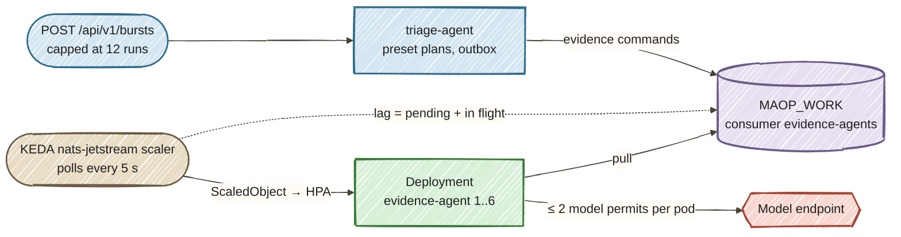

# 06 · Scaling with KEDA

## Goal

Understand how evidence agents are meant to scale on real backlog. A KEDA `ScaledObject` reads the
lag of the JetStream consumer `evidence-agents`, and a bounded burst fills that queue. Model rate
limits and per-pod permits put a deliberate ceiling on the scale-out.

> Verified on Kubernetes (Red Hat OpenShift) with upstream KEDA 2.21.0 and the live model: during `./demo.sh verify` the
> burst took the evidence-agent Deployment from 1 to 5 desired replicas about 18 s after the burst
> started, and to the ceiling of 6 within about 29 s (ready replicas follow as pods start). Your timings
> depend on the cluster and image pulls. The local stack proves only the queue part: the burst raises
> queue depth and all 12 runs drain to `EVIDENCE_ONLY`; replica tiles read **Unavailable** locally.

## The scaling loop



## The ScaledObject

[`deploy/base/scaling/scaledobject.yaml`](https://github.com/danieloh30/many-agents-one-platform/blob/main/deploy/base/scaling/scaledobject.yaml)
(abridged):

```yaml
apiVersion: keda.sh/v1alpha1
kind: ScaledObject
metadata:
  name: evidence-agent
spec:
  scaleTargetRef:
    name: evidence-agent
  minReplicaCount: 1
  maxReplicaCount: 6          # demo.sh sets this from MAOP_EVIDENCE_MAX_REPLICAS
  pollingInterval: 5
  cooldownPeriod: 60
  advanced:
    horizontalPodAutoscalerConfig:
      behavior:
        scaleUp:   { stabilizationWindowSeconds: 0,  policies: [{ type: Pods, value: 4, periodSeconds: 15 }] }
        scaleDown: { stabilizationWindowSeconds: 60, policies: [{ type: Pods, value: 2, periodSeconds: 30 }] }
  triggers:
    - type: nats-jetstream
      metadata:
        natsServerMonitoringEndpoint: nats.maop.svc.cluster.local:8222
        account: $G
        stream: MAOP_WORK
        consumer: evidence-agents
        lagThreshold: "4"
        activationLagThreshold: "0"
```

Lag counts both pending and in-flight messages, so work that has been pulled but not yet
acknowledged keeps the replicas up. Only `evidence-agent` is autoscaled. If an OpenShift cluster
already runs the Custom Metrics Autoscaler (CMA), which does not list the `nats-jetstream` trigger,
the `openshift-cma` overlay uses a `prometheus` trigger instead:
`sum(maop_queue_pending{consumer="evidence-agents"}) + sum(maop_queue_ack_pending{consumer="evidence-agents"})`
with threshold 4. Upstream KEDA and CMA cannot coexist on one cluster.

## Why the ceiling is deliberate

Every evidence agent can call the model. Each pod holds a fair semaphore of model permits
(`maop.model.max-concurrent`: 2 for evidence-agent and triage-agent, 1 for recommendation-agent).
A task that cannot get a permit within 10 s is negatively acknowledged with a delay rather than
piling onto the provider. The cluster-wide ceiling for evidence is therefore `2 × maxReplicaCount`:
12 concurrent calls at the default maximum of 6. Choose `MAOP_EVIDENCE_MAX_REPLICAS` with your
provider's rate limit in mind. A rate-limit response is not retried in-process: the message is
nak'ed with a delay. The `maop_model_permits_in_use` gauge shows permits in use per pod.

Burst runs skip the triage model call (their plan is a visible preset, `planSource: PRESET`) and stop
after evidence (`outcome: EVIDENCE_ONLY`). The evidence work itself is real: real model calls, real
tool calls, real policy checks. Admission control caps a burst at `maop.burst.max-runs` (12), and only
one burst can be active at a time.

## Steps

### 1. Inspect the rendered ScaledObject offline

No cluster access is needed:

```bash
./demo.sh render --platform openshift | grep -A40 'kind: ScaledObject'
```

```bash
./demo.sh render --platform openshift --scaler cma | grep -A25 'kind: ScaledObject'
```

### 2. On a cluster, watch the scaler and the pods

After [tutorial 07](07-deploy-to-kubernetes.md), in one terminal:

```bash
kubectl get scaledobject,hpa -n maop
kubectl get pods -n maop -l app.kubernetes.io/name=evidence-agent -w
```

On OpenShift, `oc` accepts the same arguments.

### 3. Start the burst

In the console, run the **Burst** preset (`Shift+3` in presenter mode). It shows the exact run count
and the `planSource: PRESET` tag. Or call the API:

```bash
CONSOLE_URL=https://<your-console-host>
TOKEN="$(./demo.sh token)"
curl -s -X POST "$CONSOLE_URL/api/v1/bursts" -H "Authorization: Bearer $TOKEN" \
  -H 'Content-Type: application/json' -d '{"runs":12}'
```

### 4. Collect evidence

```bash
./demo.sh verify
```

Check 5 of `verify` starts a burst, records the evidence-agent replica timeline to
`artifacts/verify-<timestamp>/05-scale-out.tsv`, and passes only if replicas rose above the minimum.

## What you should see

On the local stack (verified):

- Queue depth and queue age in the operations strip rise immediately after the burst starts, then
  drain. The *Queue and scaling* dashboard shows the same curve from Prometheus.
- All 12 burst runs complete with `EVIDENCE_ONLY`.

On a cluster (observed on Red Hat OpenShift):

- The desired replicas step up from 1 toward 6, and new pod pills appear in the topology's evidence
  node as `Pending`, `Running`, then `Ready`.
- After the queue drains and the 60 s scale-down stabilization window passes, replicas return to 1.
  The design estimate is one to two minutes after the queue drains. Replace it with your measured
  value.
- If KEDA is not installed or unhealthy, the console shows the scaler tile as **Unavailable**. It
  does not invent replica counts.

## Key takeaways

- Agent workers scale on **real consumer lag**, like any other queue-driven workload.
- The upper bound is a **cost and rate-limit control**, enforced together with per-pod permits and
  run budgets.
- Graceful scale-in: on `SIGTERM`, a worker stops pulling, finishes or naks its in-flight tasks within
  60 s, and anything cut off is redelivered safely ([tutorial 03](03-messaging-and-redelivery.md)).
- `./demo.sh verify` check 5 is the proof on your own cluster: it passes only if replicas actually rose.

## Learn more

- [Deployment §2.2: Scaling](../deployment.md#22-scaling) · [§5.1: KEDA on OpenShift](../deployment.md#51-keda)
- [Architecture §7: Model usage and concurrency limits](../architecture.md#7-model-usage-and-concurrency-limits) · [§9: Scaling](../architecture.md#9-scaling)
- [ADR-0009: KEDA JetStream scaling](../decisions/0009-keda-jetstream-scaling.md)
- Source: [`ModelGateway.java`](https://github.com/danieloh30/many-agents-one-platform/blob/main/maop-common/src/main/java/io/github/danieloh30/maop/common/agentic/ModelGateway.java), [`openshift-cma` overlay](https://github.com/danieloh30/many-agents-one-platform/blob/main/deploy/overlays/openshift-cma/kustomization.yaml), [`scripts/deploy/verify.sh`](https://github.com/danieloh30/many-agents-one-platform/blob/main/scripts/deploy/verify.sh)
