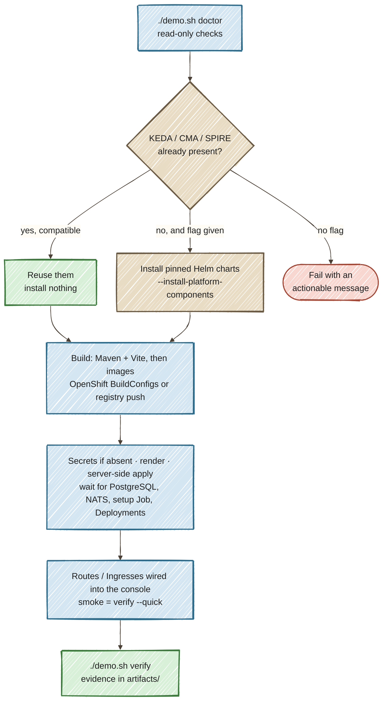

# 07 · Deploy to Kubernetes

## Goal

Deploy the whole platform to OpenShift (the recommended path) or to any other Kubernetes cluster with
one CLI, `demo.sh`. You will learn what `doctor`, `up`, `verify`, `open`, `reset` and `down` do, how
existing KEDA and SPIRE installations are reused, and what evidence `verify` collects.

> Verified end to end on OpenShift 4.22 (as cluster admin, with `--install-platform-components`):
> in-cluster binary builds, Routes, `restricted-v2` pods with the SPIFFE CSI volume, SPIRE-issued SVIDs,
> upstream KEDA scale-out, and all six `./demo.sh verify` checks. On kind, `scripts/local/kind.sh up` and
> `verify` pass all six checks with NetworkPolicies switched off (`MAOP_NETWORK_POLICIES=false`, see the README). Treat `./demo.sh verify` as the acceptance
> step on your own cluster.

## The `up` flow



## Steps

### 1. Configure

```bash
cp .env.example .env.local
```

Set at least the model variables in `.env.local` (git-ignored). If `MAOP_MODEL_API_KEY` is empty, an
exported `OPENAI_API_KEY` is used. The key is stored only in the Kubernetes Secret `model-credentials`
and is never printed. For `--platform kubernetes`, also set `MAOP_REGISTRY` (a registry the cluster can
pull from) and `MAOP_INGRESS_DOMAIN` (hosts become `console.<domain>`, `jaeger.<domain>` and
`grafana.<domain>`).

### 2. Check prerequisites (read-only)

```bash
./demo.sh doctor
```

`doctor` checks your local tools (JDK, Node.js, `oc` or `kubectl`, `helm`, each at its minimum version), your cluster login and
permissions, the KEDA/CMA and SPIRE state, a default StorageClass, ownership of the `maop` namespace
(it refuses to touch a namespace it does not own), and the model configuration with one minimal
request (skip it with `--skip-model-probe`).

### 3. Deploy

**OpenShift (recommended).** Images are built inside the cluster with binary Docker BuildConfigs into
ImageStreams, so no external registry or pull secret is needed. Exposure is through Routes.

```bash
./demo.sh up --platform openshift --install-platform-components
```

**Any other Kubernetes cluster.** Images are built with podman or docker, pushed to `MAOP_REGISTRY`,
and exposed through Ingresses on `MAOP_INGRESS_DOMAIN`.

```bash
./demo.sh up --platform kubernetes --install-platform-components
```

Leave out `--install-platform-components` to only **reuse** what the cluster already has:

| Cluster state | What `up` does |
| --- | --- |
| No KEDA and no CMA | Installs upstream KEDA from its pinned Helm chart, but only with the flag |
| Upstream KEDA already present | Reuses it |
| OpenShift Custom Metrics Autoscaler present | Does not install KEDA; deploys the `openshift-cma` overlay with a `prometheus` trigger |
| No SPIRE | Installs the pinned upstream SPIRE charts (`spire-crds`, `spire`), but only with the flag |
| SPIRE already present (chart or Zero Trust Workload Identity Manager) | Applies only the `ClusterSPIFFEID`. Set `MAOP_SPIRE_TRUST_DOMAIN` if the trust domain cannot be detected |
| Missing and no flag | Fails with an actionable message |

Whatever `up` installs is recorded in the ConfigMap `maop-installed-components`, so `down` can remove
exactly that and nothing else. Every command that changes the cluster prints the target context and
asks for confirmation unless you pass `--yes`.

### 4. Verify

```bash
./demo.sh verify
```

`verify` writes raw JSON and a PASS/FAIL summary to `artifacts/verify-<timestamp>/`. A check passes only
on observed data:

| # | Check | Evidence |
| --- | --- | --- |
| 1 | Success run | The run reaches `AWAITING_APPROVAL` (and the model mode is recorded) |
| 2 | Connected trace | The run's Jaeger trace and the services in it |
| 3 | Policy denial | A `DENIED` `remediation.*` invocation with reason `approval_required` and `sideEffect: null` |
| 4 | Identity enforcement | The TLS refusal of a certificate-less client from inside the cluster, plus verified SPIFFE IDs in the audit |
| 5 | Scale-out | The evidence-worker replica timeline under a burst |
| 6 | Redelivery dedup | A task with `deliveries >= 2` and an invocation with `requests >= 2`, `executions = 1` |

`./demo.sh verify --quick` runs checks 1 to 4, which is the smoke test `up` ends with.

### 5. Open, operate, reset

```bash
./demo.sh open      # prints (and on macOS opens) the console, Jaeger and Grafana URLs
./demo.sh token     # prints the presenter token (the only command that does)
./demo.sh status    # workloads, replicas, ScaledObject/HPA, routes, platform state, last runs
./demo.sh logs evidence-worker
./demo.sh reset     # clears demonstration state only: runs, audit, simulated actions, queued messages
```

### 6. Tear down

```bash
./demo.sh down
```

`down` removes the demo's application resources and keeps PVCs and Secrets. Add `--delete-data` to
delete those too, `--delete-namespace` to delete the namespace, and `--uninstall-platform-components`
to remove KEDA or SPIRE, but only if this project installed them.

## What you should see

- `doctor` lists every check with a clear result and points to the fix for anything that fails.
- `up` ends with the URLs and a passing smoke test. In the console's presenter preflight panel, every
  component should read `OK`, the model badge `LIVE <model>`, and the stream status `Live`. Identity
  mode is `SPIFFE` (not `DEV_STATIC`).
- `verify` prints six lines, PASS or FAIL, each with its detail. Keep the `artifacts/verify-*`
  directory as your record.

These are the expected results by design. Report your own `verify` output rather than this page.

## Key takeaways

- One CLI, idempotent, with an explicit confirmation before any cluster change. Tracked files are
  never edited: manifests render into the git-ignored `.maop/render/<namespace>/`.
- Platform components are **reused by default**. Installing cluster-scoped KEDA or SPIRE is an explicit
  opt-in, and only what the project installed is ever uninstalled.
- Pods run under the restricted pod security profile: non-root, no privilege escalation, all
  capabilities dropped, read-only root filesystem. No application workload requests a custom SCC on
  OpenShift.
- `verify` turns every claim on these pages into an artifact you can inspect.

## Learn more

- [Deployment](../deployment.md): layout, workloads, OpenShift profile, setup flow
- [README: Kubernetes](../../README.md#kubernetes-recommended-openshift) · [Configuration](../../README.md#configuration)
- [ADR-0011: Kustomize, Helm and OpenShift builds](../decisions/0011-kustomize-helm-openshift-builds.md)
- Source: [`demo.sh`](https://github.com/danieloh30/many-agents-one-platform/blob/main/demo.sh), [`scripts/deploy/`](https://github.com/danieloh30/many-agents-one-platform/tree/main/scripts/deploy), [`deploy/`](https://github.com/danieloh30/many-agents-one-platform/tree/main/deploy), [`deploy/platform/versions.env`](https://github.com/danieloh30/many-agents-one-platform/blob/main/deploy/platform/versions.env)
