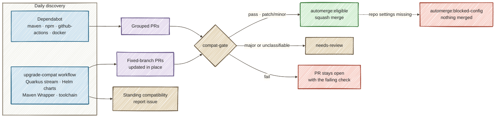

# 08 · Dependency automation

## Goal

See how the project stays current without manual upgrades and without breaking a working setup.
Dependabot and the `upgrade-compat` workflow discover updates every day, the `compat-gate` check proves
each one, and auto-merge applies only patch and minor updates that pass, labelling everything else.

## One mechanism, two engines, disjoint ownership

Every version in the repository has exactly one owner, which is what prevents duplicate pull requests.



| Owner | Owns |
| --- | --- |
| **Dependabot** ([`.github/dependabot.yml`](https://github.com/danieloh30/many-agents-one-platform/blob/main/.github/dependabot.yml)) | Maven dependencies and plugins, including Quarkus **patch** releases within the current stream; npm; GitHub Actions; image tags in Dockerfiles and Kubernetes manifests |
| **`upgrade-compat`** ([`.github/workflows/upgrade-compat.yml`](https://github.com/danieloh30/many-agents-one-platform/blob/main/.github/workflows/upgrade-compat.yml)) | Quarkus **stream** changes (to a newer LTS stream only), Helm chart pins in `deploy/platform/versions.env`, the Maven Wrapper, and JDK/Node consistency across files |

Ownership is enforced, not just documented. `.github/upgrade-ownership.yml` lists what the workflow
owns, each item has a matching `ignore` rule in `dependabot.yml`, and the CI job `ownership-check`
fails if the two disagree.

## Steps

### 1. Read the schedules

Every Dependabot ecosystem uses `interval: "cron"` with a daily `cronjob`, because `interval: daily`
means weekdays only:

```bash
grep -nE 'package-ecosystem|cronjob' .github/dependabot.yml
grep -n 'cron:' .github/workflows/upgrade-compat.yml
```

A short `cooldown` (maven and npm: 1 day for patch, 3 for minor, 7 for major) acts as a supply-chain
delay, so a release is not adopted on the day it is published. The Quarkus BOM, the platform member
BOM (including Quarkus LangChain4j) and the Maven plugin share **one** property,
`quarkus.platform.version`, so they always move together.

### 2. Look at what `compat-gate` aggregates

`compat-gate` in [`ci.yml`](https://github.com/danieloh30/many-agents-one-platform/blob/main/.github/workflows/ci.yml)
is the single required status. It needs these jobs:

| Job | Proves |
| --- | --- |
| `backend` | `./mvnw -B verify` on JDK 25 with real PostgreSQL, NATS and OPA containers |
| `frontend` | `npm ci`, typecheck, lint, unit tests, production build |
| `policy` | `opa fmt`, `opa check --strict`, `opa test` with coverage |
| `manifests` | Every overlay renders and validates with kubeconform; the pinned KEDA and SPIRE charts template with the project values |
| `shell`, `java-version-guard`, `ownership-check`, `images`, `security` | Script lint, Java ≥ 25, ownership invariants, image builds, security checks |

The gate is green on GitHub CI. The `e2e-kind` job runs nightly or on PRs labelled `run-e2e`, and is
**not** part of the gate yet. Live-model behaviour is checked separately (`live-model-check.yml`) and
is never a merge gate, because it depends on an external service.

You can run the same checks locally:

```bash
./mvnw -B verify
(cd web && npm ci && npm run typecheck && npm run lint && npm test && npm run build)
```

### 3. Follow a Dependabot PR through classification

[`dependabot-automerge.yml`](https://github.com/danieloh30/many-agents-one-platform/blob/main/.github/workflows/dependabot-automerge.yml)
runs on `pull_request`, never `pull_request_target`, and never executes PR code. It reads
`dependabot/fetch-metadata`, runs the classifier `scripts/maintenance/classify-update.sh` **from the
base commit**, and applies exactly one outcome:

| Label | When | What happens |
| --- | --- | --- |
| `automerge:eligible` | The highest bump is patch or minor. A Quarkus platform update qualifies only if its `major.minor` stream is unchanged | Native auto-merge is queued with `gh pr merge --auto --squash --match-head-commit <sha>`. GitHub merges once `compat-gate` passes |
| `needs-review` | A major update, or one that cannot be classified | A comment explains why. A human decides |
| `automerge:blocked-config` | Eligible, but the repository lacks "Allow auto-merge" or a ruleset/branch protection that requires `compat-gate` | Nothing is merged. A comment lists the missing settings |

The repository's first Dependabot PRs carry exactly these labels.

**Without branch protection** (for example, a private repository on the free plan), set the repository
variable `MAOP_AUTOMERGE_FALLBACK=true`.
[`automerge-fallback.yml`](https://github.com/danieloh30/many-agents-one-platform/blob/main/.github/workflows/automerge-fallback.yml)
then merges after CI. It acts only on `dependabot[bot]` PRs labelled `automerge:eligible`, re-checks
through the Checks API that the gate jobs succeeded on the exact head SHA, and merges with
`--match-head-commit`.

### 4. Understand the `upgrade-compat` workflow

Every day at 05:30 UTC, and on demand, it:

- reads the Quarkus registry. If a newer **LTS** stream exists, it runs the Quarkus update tooling,
  builds and tests, and opens or updates a PR on the fixed branch `upgrade/quarkus-stream`. A same-major
  change is labelled `automerge:eligible`, and a new major is labelled `needs-review`;
- checks the KEDA and SPIRE chart pins, the Maven Wrapper, and toolchain consistency, each on its own
  fixed branch, so a second run updates the same PR instead of opening a new one;
- writes a standing "Dependency compatibility report" issue, updated in place.

PRs from this workflow need a dedicated token (`UPGRADE_BOT_TOKEN`), because PRs created with the
default `GITHUB_TOKEN` do not trigger CI. Without it, the workflow runs in report-only mode.

## What you should see

- Dependabot PRs every day the ecosystems have updates, grouped (for example `quarkus-platform`,
  `maven-minor-patch`, `web-production`, `web-development`, `actions`, `images`).
- Each PR carries one of `automerge:eligible`, `needs-review` or `automerge:blocked-config`, plus a
  bot comment that states the reason.
- Eligible PRs merge as a squash commit by their real bot identity, only after `compat-gate` passes
  on that exact commit.

## Key takeaways

- **Patch and minor updates merge themselves, majors wait for a human.** The gate, not hope, decides.
- Ownership is **disjoint and enforced**, so the two engines never open competing PRs.
- Auto-merge **fails safe**: missing repository settings produce a label and a comment, never an
  unverified merge.
- An auto-merged upgrade is proven by CI, not on a cluster. Before relying on a cluster, run
  `./demo.sh doctor`, `up` and `verify` again ([tutorial 07](07-deploy-to-kubernetes.md)).

## Learn more

- [Dependency maintenance](../dependency-maintenance.md)
- [ADR-0014: Dependency ownership](../decisions/0014-dependency-ownership.md)
- [Versions](../versions.md)
- Source: [`scripts/maintenance/`](https://github.com/danieloh30/many-agents-one-platform/tree/main/scripts/maintenance), [`.github/upgrade-ownership.yml`](https://github.com/danieloh30/many-agents-one-platform/blob/main/.github/upgrade-ownership.yml)
