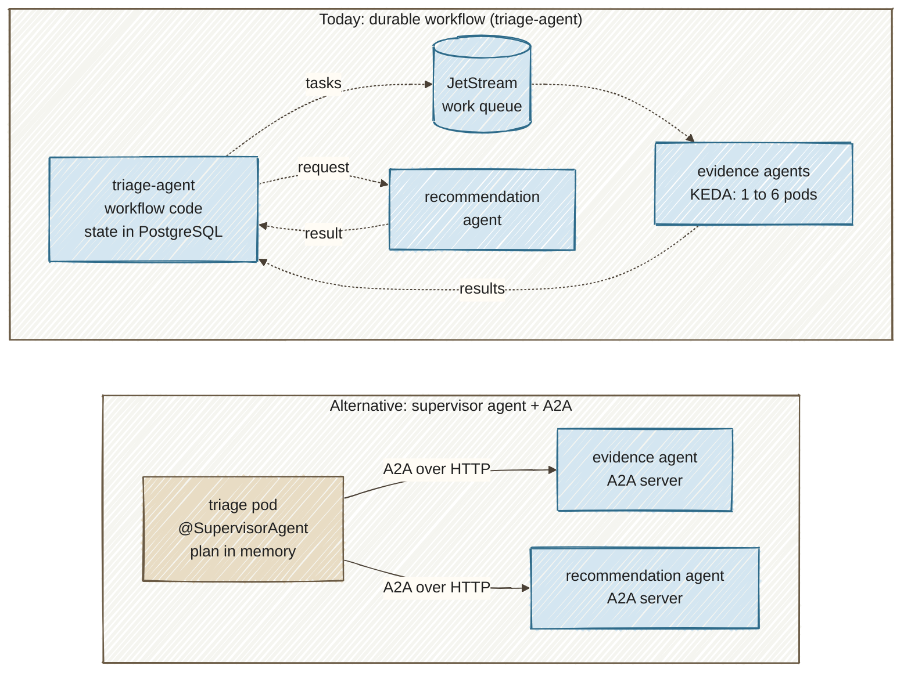

# 09 · Orchestration choices: workflow or supervisor agent

## Goal

Understand who decides the order of work between the three agents, and why this project uses a durable
workflow instead of a LangChain4j `@SupervisorAgent`, even though a supervisor *can* coordinate agents that run in
separate pods. This page is background reading: it has no hands-on steps and is not part of the demo flow.

## Two ways to coordinate the same three agents

Both designs use the same agents: triage, evidence and recommendation, each its own Quarkus application and pod.
What differs is who decides the next step, and where that decision lives.

**Today (durable workflow).** `triage-agent` is plain workflow code. It asks its `@Agent` for a plan, dispatches
the evidence tasks to a JetStream work queue, folds the results into the run as they arrive, then requests the
recommendation. Every step is a state transition in PostgreSQL, published through the outbox. The model decides
*what* to investigate and *what* to propose; code decides the order.

**Alternative (supervisor agent).** LangChain4j's agentic module has a `@SupervisorAgent`: a model that, given the
request and a set of sub-agents, decides which sub-agent to call next and with what input, up to
`maxAgentsInvocations` calls (default 10). Sub-agents do not have to be in the same JVM: with the
`langchain4j-agentic-a2a` module (managed by the Quarkus platform BOM this project uses), a sub-agent can be a remote
agent reached over the **A2A (Agent2Agent) protocol**, declared with `@A2AServerUrlSupplier`. So the evidence and
recommendation pods could expose A2A servers, and a supervisor in the triage pod could call them.

## What changes if the supervisor decides

| Concern | Durable workflow (this project) | Supervisor agent + A2A |
| --- | --- | --- |
| Who decides the order | Code: plan, dispatch, collect, recommend | The supervisor's model, at run time |
| A pod restart mid-run | The run continues: state in PostgreSQL, messages redelivered ([tutorial 02](02-durable-workflow.md), [03](03-messaging-and-redelivery.md)) | The plan lives in the supervisor's memory; the run is lost |
| Scaling on demand | KEDA scales evidence agents on queue lag ([tutorial 06](06-scaling-with-keda.md)) | Calls are synchronous HTTP: no queue to scale on, so scale on CPU or concurrency instead |
| Redelivery without a duplicate effect | JetStream redelivery plus tool idempotency keys | Retries and de-duplication must be rebuilt around HTTP calls |
| Budgets and deadlines | Enforced per task by the model gateway | Also possible, but the supervisor's own planning calls spend tokens too |
| Identity and policy | Agents never call each other; only the tool service is called, with SPIFFE mTLS and OPA ([tutorial 04](04-identity-and-policy.md)) | Agent-to-agent calls need their own mTLS identity and policy rules |
| Explaining a run | A fixed state machine and one connected trace | A different path per run, chosen by the model |

## When each fits

- **A durable workflow** fits when the sequence is known, runs must survive restarts, work should queue and scale on
  demand, and every step must be auditable. An incident response flow is exactly that.
- **A supervisor agent** fits when the next step genuinely depends on what was learned so far and the model should
  choose among specialists: open-ended research, an interactive assistant, or agents owned by different teams or
  vendors where A2A is the shared contract. Losing an in-flight run on a restart must be acceptable.
- **Both** can be combined: keep the durable workflow between pods, and let a supervisor (or `@SequenceAgent`,
  `@ParallelAgent`, `@LoopAgent`, `@ConditionalAgent`) organise model calls *inside* one pod, where losing a step is
  cheap. For example, the evidence agent could let a supervisor pick among several local analysts for one task,
  while the task itself stays a durable JetStream message.

## Read it in the code

- [`Workflow.java`](https://github.com/danieloh30/many-agents-one-platform/blob/main/triage-agent/src/main/java/io/github/danieloh30/maop/triage/service/Workflow.java)
  decides the next step and dispatches commands, with the per-task budgets.
- [`ResultFolder.java`](https://github.com/danieloh30/many-agents-one-platform/blob/main/triage-agent/src/main/java/io/github/danieloh30/maop/triage/service/ResultFolder.java)
  folds each task result into the run and moves it to `RECOMMENDING` or `AWAITING_APPROVAL`.
- [`IncidentTriageAgent.java`](https://github.com/danieloh30/many-agents-one-platform/blob/main/triage-agent/src/main/java/io/github/danieloh30/maop/triage/agentic/IncidentTriageAgent.java)
  is the model-facing part: an `@Agent` that returns a typed plan. It never calls another agent.

## Key takeaways

- A supervisor agent *can* coordinate agents in separate pods, through A2A.
- This project keeps orchestration in a durable workflow because the incident flow must survive restarts, scale
  on queue lag, avoid duplicate effects and stay auditable. The model chooses what to investigate and propose;
  code chooses the order.
- LangChain4j is still used where it shines: the declarative, typed `@Agent` inside each service.

## Learn more

- [ADR-0003: Explicit durable orchestration](../decisions/0003-explicit-durable-orchestration.md) ·
  [ADR-0017: LangChain4j agent interfaces](../decisions/0017-langchain4j-agent-interfaces.md)
- [Architecture §4: Durable run state machine](../architecture.md#4-durable-run-state-machine)
- [Tutorial 02: Durable workflow state](02-durable-workflow.md)
