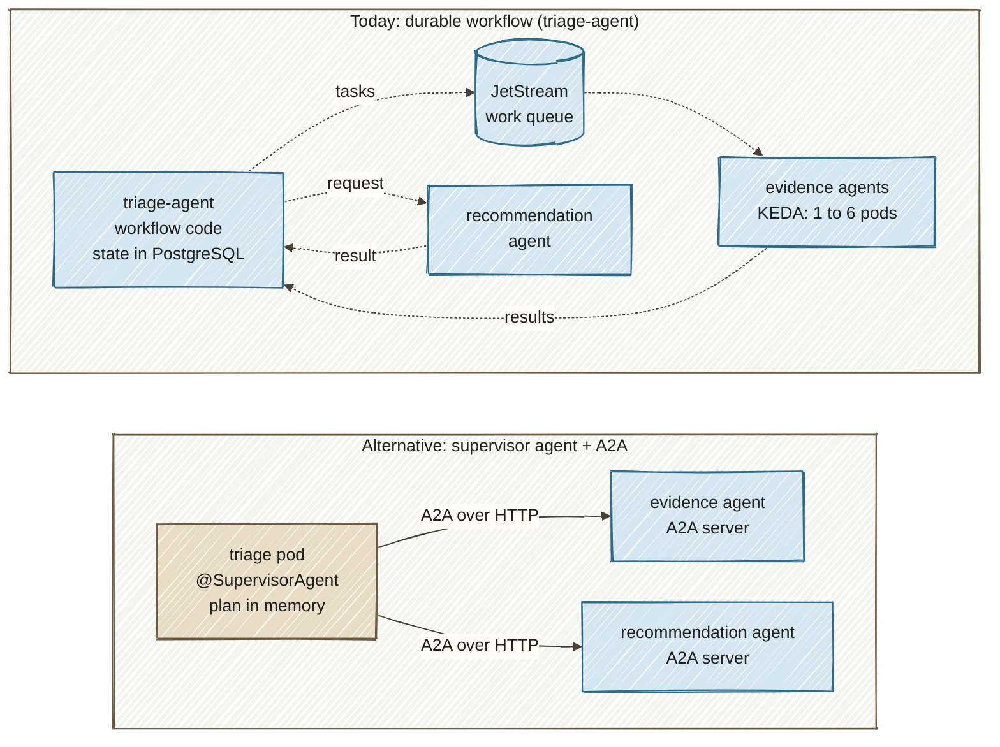

# 09 · Orchestration choices: workflow or supervisor agent

## Goal

Understand who decides the order of work between the three agents, and why this project uses a durable
workflow instead of a LangChain4j `@SupervisorAgent`, even though a supervisor *can* coordinate agents that run in
separate pods. The same question comes up one level down, inside an agent: who decides which tools to call. This
page is background reading: it has no hands-on steps and is not part of the demo flow.

## Two ways to coordinate the same three agents

Both designs use the same agents: triage, evidence and recommendation, each its own Quarkus application and pod.
What differs is who decides the next step, and where that decision lives.

**Today (durable workflow).** `triage-agent` is plain workflow code. It asks its `@Agent` for a plan, dispatches
the evidence tasks to a JetStream work queue, folds the results into the run as they arrive, then requests the
recommendation. Every step is a state transition in PostgreSQL, published through the outbox. The model decides
*what* to investigate and *what* to propose; code decides the order.

**Alternative (supervisor agent).** LangChain4j's agentic module has a `@SupervisorAgent`: a model that, given the
request and a set of sub-agents, decides which sub-agent to call next and with what input, up to
`maxAgentsInvocations` calls (default 10). Sub-agents do not have to be in the same JVM: with the
`langchain4j-agentic-a2a` module (managed by the Quarkus platform BOM this project uses), a sub-agent can be a remote
agent reached over the **A2A (Agent2Agent) protocol**, declared with `@A2AServerUrlSupplier`. So the evidence and
recommendation pods could expose A2A servers, and a supervisor in the triage pod could call them.

## What changes if the supervisor decides

| Concern | Durable workflow (this project) | Supervisor agent + A2A |
| --- | --- | --- |
| Who decides the order | Code: plan, dispatch, collect, recommend | The supervisor's model, at run time |
| A pod restart mid-run | The run continues: state in PostgreSQL, messages redelivered ([tutorial 02](02-durable-workflow.md), [03](03-messaging-and-redelivery.md)) | The plan lives in the supervisor's memory; the run is lost |
| Scaling on demand | KEDA scales evidence agents on queue lag ([tutorial 06](06-scaling-with-keda.md)) | Calls are synchronous HTTP: no queue to scale on, so scale on CPU or concurrency instead |
| Redelivery without a duplicate effect | JetStream redelivery plus tool idempotency keys | Retries and de-duplication must be rebuilt around HTTP calls |
| Budgets and deadlines | Enforced per task by the model gateway | Also possible, but the supervisor's own planning calls spend tokens too |
| Identity and policy | Agents never call each other; only the tool service is called, with SPIFFE mTLS and OPA ([tutorial 04](04-identity-and-policy.md)) | Agent-to-agent calls need their own mTLS identity and policy rules |
| Explaining a run | A fixed state machine and one connected trace | A different path per run, chosen by the model |

## When each fits

- **A durable workflow** fits when the sequence is known, runs must survive restarts, work should queue and scale on
  demand, and every step must be auditable. An incident response flow is exactly that.
- **A supervisor agent** fits when the next step genuinely depends on what was learned so far and the model should
  choose among specialists: open-ended research, an interactive assistant, or agents owned by different teams or
  vendors where A2A is the shared contract. Losing an in-flight run on a restart must be acceptable.
- **Both** can be combined: keep the durable workflow between pods, and let a supervisor (or `@SequenceAgent`,
  `@ParallelAgent`, `@LoopAgent`, `@ConditionalAgent`) organise model calls *inside* one pod, where losing a step is
  cheap. For example, the evidence agent could let a supervisor pick among several local analysts for one task,
  while the task itself stays a durable JetStream message.

## Inside an agent: who picks the tools

The same choice exists inside the evidence agent. A model with tool access could decide for itself which tools to
call. Here it does not: each evidence topic has a fixed set of starting tool calls, written in Java, and the model
only reads their results and writes the finding.

| Evidence topic | Tool calls, in order |
| --- | --- |
| Deployment history | `deployment.get_history` (last 5) |
| Error summary | `telemetry.get_error_summary` (last 30 minutes) |
| Config diff | `deployment.get_history` (last 2), then `deployment.get_diff` from the older to the newer version |
| Service catalog | `catalog.get_service`, then `catalog.get_dependencies` |
| Log analysis (scenario 5 only) | `analysis.run_script` with a fixed script, through the sandboxed tool class |

Log analysis is the one topic the model cannot plan: triage adds it in code for runs that ask for it
([tutorial 10](10-production-blueprint-agent-substrate.md#try-it-scenario-5)).

Config diff needs two calls because `deployment.get_diff` takes a *from* and a *to* version, which the agent only
learns from the history. If the service has fewer than two deployments, the diff call is skipped. This is why the
*Tool audit* tab shows `deployment.get_history` twice in most runs: once for the Deployment history task and once
for the Config diff task.

The model's answer is then checked in code. Each fact must cite the invocation ID of a tool call made for this
task; a fact that cites anything else makes the output invalid, and the agent asks the model once to repair it.
That is how every fact on an evidence card links to a recorded, policy-checked tool call.

The recommendation agent's answer is checked the same way. Its citations must name evidence collected for the run,
and every version number it writes, in the explanation or in the rollback target, must appear in that evidence. A
model that writes "roll back to 2.13.0" when the evidence only names 2.13.2 gets one repair attempt with that
feedback; the approver never sees an invented version.

What this buys, and what it costs:

- **Predictable runs.** An evidence topic makes the same tool calls every time, so a demo and a test behave alike.
  With a live model, the triage plan can still pick or order topics differently, and the findings' wording varies.
- **Bounded cost.** The number of tool calls per task is known before the model is called; it never loops on tools.
- **Evidence never depends on the model choosing to look.** A live model that skipped a tool would leave a gap in
  the evidence; here the calls happen regardless.
- **Facts are traceable.** Every claim points to an audited call with its caller identity and policy decision
  ([tutorial 04](04-identity-and-policy.md)).
- **The cost:** the agent cannot follow a lead it finds, such as fetching a dependency's errors after spotting a
  timeout. Supporting that would mean letting the model request follow-up calls within the remaining tool-call
  budget, with the same policy checks and idempotency keys.

## Read it in the code

- [`Workflow.java`](https://github.com/danieloh30/many-agents-one-platform/blob/main/triage-agent/src/main/java/io/github/danieloh30/maop/triage/service/Workflow.java)
  decides the next step and dispatches commands, with the per-task budgets.
- [`ResultFolder.java`](https://github.com/danieloh30/many-agents-one-platform/blob/main/triage-agent/src/main/java/io/github/danieloh30/maop/triage/service/ResultFolder.java)
  folds each task result into the run and moves it to `RECOMMENDING` or `AWAITING_APPROVAL`.
- [`IncidentTriageAgent.java`](https://github.com/danieloh30/many-agents-one-platform/blob/main/triage-agent/src/main/java/io/github/danieloh30/maop/triage/agentic/IncidentTriageAgent.java)
  is the model-facing part: an `@Agent` that returns a typed plan. It never calls another agent.
- [`EvidenceAgent.java`](https://github.com/danieloh30/many-agents-one-platform/blob/main/evidence-agent/src/main/java/io/github/danieloh30/maop/evidence/agentic/EvidenceAgent.java)
  makes the fixed tool calls per topic (`baseline`) and rejects facts that cite a call this task did not make
  (`parse`).

## Key takeaways

- A supervisor agent *can* coordinate agents in separate pods, through A2A.
- This project keeps orchestration in a durable workflow because the incident flow must survive restarts, scale
  on queue lag, avoid duplicate effects and stay auditable. The model chooses what to investigate and propose;
  code chooses the order.
- Inside the evidence agent, code also picks the tool calls; the model interprets the results, and every fact
  must cite one of those calls.
- LangChain4j is still used where it shines: the declarative, typed `@Agent` inside each service.

## Learn more

- [ADR-0003: Explicit durable orchestration](../decisions/0003-explicit-durable-orchestration.md) ·
  [ADR-0016: Implementation adjustments](../decisions/0016-implementation-adjustments.md) (row 9: fixed tool calls) ·
  [ADR-0017: LangChain4j agent interfaces](../decisions/0017-langchain4j-agent-interfaces.md)
- [Architecture §4: Durable run state machine](../architecture.md#4-durable-run-state-machine)
- [Tutorial 02: Durable workflow state](02-durable-workflow.md)
