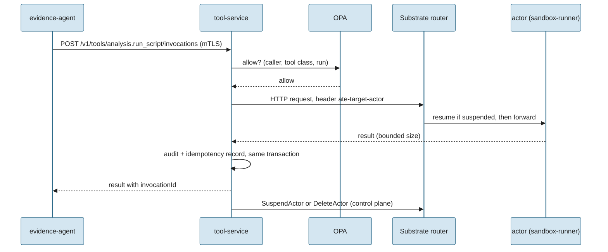

# 10 · Production blueprint: where Agent Substrate fits

## Goal

Understand what Agent Substrate would add to this architecture, what it would cost, and which code you would
write to integrate it. This page is background reading: Agent Substrate is **not** installed by this project and
nothing in the demo depends on it ([ADR-0012](../decisions/0012-agent-substrate-optional-future.md)).

The facts about Agent Substrate on this page were checked against its documentation on 2026-11-23. The project is
young and moves fast, so check them again before you repeat them.

## The blueprint in one picture

The demo follows one investigation. The blueprint is the set of controls around that path, and each control has
one owner:

| Control | Owner in this project | Tutorial |
| --- | --- | --- |
| The run record | `triage-agent`, in PostgreSQL | [02](02-durable-workflow.md) |
| Asynchronous work | NATS JetStream | [03](03-messaging-and-redelivery.md) |
| Caller identity and policy | `tool-service` with SPIFFE mTLS and OPA | [04](04-identity-and-policy.md) |
| Connected telemetry | OpenTelemetry | [05](05-observability.md) |
| Capacity for queued work | KEDA, scaling the `evidence-agent` Deployment | [06](06-scaling-with-keda.md) |
| Isolated, suspendable execution (optional) | Agent Substrate | this page |

```mermaid
%%{init: {"look":"handDrawn","theme":"base","themeVariables":{"darkMode":false,"background":"#FFFCF5","primaryColor":"#D4E6F1","primaryBorderColor":"#2E6B8A","primaryTextColor":"#1F1F1F","secondaryColor":"#D8F0D8","secondaryTextColor":"#1F1F1F","tertiaryColor":"#E8DCC4","tertiaryTextColor":"#1F1F1F","textColor":"#1F1F1F","lineColor":"#4A4035","edgeLabelBackground":"#FFFCF5","clusterBkg":"#F5F5F0","clusterBorder":"#6B5B45","fontSize":"16px"},"flowchart":{"nodeSpacing":35,"rankSpacing":55,"padding":18,"curve":"basis"}}}%%
flowchart LR
    TRIAGE[triage-agent<br/>owns the run record] --> PG[(PostgreSQL<br/>runs · audit · outbox)]
    TRIAGE <-->|CloudEvents| NATS[(NATS JetStream)]
    NATS <--> EVIDENCE[evidence-agent x N]
    NATS <--> RECO[recommendation-agent]
    KEDA([KEDA]) -.->|replicas from queue lag| EVIDENCE
    EVIDENCE -->|mTLS · SPIFFE ID| TOOLS
    RECO -->|mTLS · SPIFFE ID| TOOLS

    subgraph BOUNDARY[Protected tool boundary]
        TOOLS[tool-service<br/>enforces] -->|allow / deny| OPA[OPA<br/>decides]
    end

    subgraph SUBSTRATE["Optional: Agent Substrate"]
        ROUTER[router<br/>resumes on request] --> WORKERS[WorkerPool<br/>warm sandboxed workers]
        WORKERS <-->|snapshot / restore| SNAP[(object storage<br/>actor snapshots)]
    end

    TOOLS -.->|approved execution only| ROUTER

    style TRIAGE fill:#D4E6F1,stroke:#2E6B8A,color:#1F1F1F,stroke-width:2px
    style EVIDENCE fill:#D4E6F1,stroke:#2E6B8A,color:#1F1F1F,stroke-width:2px
    style RECO fill:#D4E6F1,stroke:#2E6B8A,color:#1F1F1F,stroke-width:2px
    style NATS fill:#E8DCC4,stroke:#6B5B45,color:#1F1F1F,stroke-width:2px
    style PG fill:#E8DCC4,stroke:#6B5B45,color:#1F1F1F,stroke-width:2px
    style KEDA fill:#E8DCC4,stroke:#6B5B45,color:#1F1F1F,stroke-width:2px
    style BOUNDARY fill:#F5F5F0,stroke:#8B8070,color:#1F1F1F,stroke-width:2px
    style TOOLS fill:#D8F0D8,stroke:#3D7A3D,color:#1F1F1F,stroke-width:2px
    style OPA fill:#F8D7D0,stroke:#A34736,color:#1F1F1F,stroke-width:2px
    style SUBSTRATE fill:#F3EEF8,stroke:#6B5B8A,color:#1F1F1F,stroke-width:2px,stroke-dasharray: 6 4
    style ROUTER fill:#E8E0F0,stroke:#6B5B8A,color:#1F1F1F,stroke-width:2px
    style WORKERS fill:#E8E0F0,stroke:#6B5B8A,color:#1F1F1F,stroke-width:2px
    style SNAP fill:#E8E0F0,stroke:#6B5B8A,color:#1F1F1F,stroke-width:2px
```

Everything outside the dashed box is what the demo runs today. The dashed box is the optional layer.

## What Agent Substrate is

[Agent Substrate](https://github.com/agent-substrate/substrate) is a runtime, on top of Kubernetes, for sandboxed
workloads that are idle most of the time. Its vote for the CNCF Sandbox passed, and it has published a 1.0 release
with a compatibility commitment. It is a runtime, not an agent framework: it runs ordinary container images.

- **Actors and workers.** An *actor* is one stateful instance, for example one agent session. A *worker* is a
  pre-started pod with an empty sandbox. A `WorkerPool` is a fixed number of workers. Many actors share few
  workers, because most actors are idle at any moment.
- **Suspend and resume.** Suspending an actor snapshots its memory and files and frees its worker. The next request
  for that actor goes through Substrate's router, which restores the snapshot onto any free worker and then
  forwards the request. The project states a resume time under 500 ms. Suspend is an explicit API call
  (`SuspendActor`); the caller decides when an actor is idle.
- **Always sandboxed.** Every actor runs in a gVisor sandbox or a microVM. Plain containers are not supported.
- **Identity and egress.** Each running actor gets a short-lived SPIFFE certificate. Outbound traffic is denied by
  default and passes through an egress gateway, which can add credentials to approved requests, so the code in the
  sandbox never holds a key.
- **Its own control plane.** Actors and actor templates are records in Substrate's API server, stored in
  PostgreSQL. They are not Kubernetes objects, so `kubectl get` does not list them. Only the infrastructure
  (`WorkerPool`, `SandboxConfig`) is a Kubernetes resource.

## Two different scaling problems

KEDA and Agent Substrate both save compute, but they answer different questions.

| | KEDA in this project | Agent Substrate |
| --- | --- | --- |
| Question it answers | How many identical workers does the queue need right now? | Which of many idle, stateful instances needs a worker right now? |
| Unit that is scaled | Replicas of the `evidence-agent` Deployment | Actors placed onto a pool of workers |
| Signal | JetStream consumer lag | A request arriving for a suspended actor |
| State in the unit | None: an evidence agent is stateless, so any replica takes any task | Memory and files, kept across suspend and resume |
| Typical time to add capacity | Tens of seconds: poll, HPA sync, pod start | Under a second for a resume, if a worker is free |
| What "scale to zero" means | Zero pods for a Deployment | One actor uses no worker; the pool itself stays warm |

They can run in the same cluster, each for its own workloads. They do not manage each other:

- KEDA's `ScaledObject` here targets a Deployment. A workload that moves into Substrate is no longer that
  Deployment's pods, so the existing `ScaledObject` stops applying to it.
- A `WorkerPool` has a fixed `replicas` value. Substrate's documentation describes no autoscaler for it and no
  KEDA integration. When more actors want to run than the pool has workers, the router *parks* the requests and
  retries until a worker is free or a time budget runs out.

So for every workload you move, decide on purpose how its pool is sized: a fixed size for the expected peak, or
your own controller that changes `replicas`. Do not assume the queue-lag rule still protects it.

## Does this demo need it today?

Mostly no, and it is worth saying why.

Think of an investigation that waits for a person in `AWAITING_APPROVAL`. In this design the waiting run is one row
in PostgreSQL. No pod belongs to that run: the three agent services are shared, stateless workers, and they are
already free to take other work. There is no idle compute to release, so suspending something would save nothing.

Agent Substrate starts to pay off when an instance holds state in memory or on disk between events. Two cases
would bring that into this design:

1. **A tool that runs untrusted or model-written code**, for example a log-analysis script that the
   recommendation agent writes. Such code needs strong isolation, no credentials, and no network by default.
2. **One long-lived agent per investigation**, which keeps its conversation memory and working files while it
   waits hours for a person, and continues from where it stopped.

ADR-0012 names the first case as the candidate. The second would replace part of the durable workflow, so it needs
its own decision record first.

## Architecture benefits

- **Density.** Thousands of idle instances share a small pool of warm workers. You pay for a worker only while an
  actor is working. The project states 10 to 30 times oversubscription in its own demo; measure your own.
- **Fast resume with state intact.** A resumed actor continues with its memory and files. With plain pods you
  choose between keeping the pod (and paying for it) or losing the state.
- **Isolation by default.** A sandbox per actor limits what a prompt-injected or faulty agent can reach. Today the
  demo gets its safety from the fact that tools are synthetic. A real code-running tool could not rely on that.
- **No secrets in untrusted code.** Credentials are added at the egress gateway, outside the sandbox.
- **Less load on the Kubernetes API.** Creating, suspending and resuming actors does not create Pod objects, so a
  burst of activity does not become a burst of writes to the cluster's API server.
- **The same contracts.** If Substrate sits behind `tool-service`, agents still call
  `POST /v1/tools/{toolName}/invocations`, and policy, idempotency and audit work unchanged.

## Considerations

- **Two sources of truth, unless you forbid it.** A snapshot holds an actor's memory. The run record holds the
  business state. Keep the rule from ADR-0012: the run record in PostgreSQL is the truth, and a snapshot is a
  cache you can lose. Substrate's default suspend returns before the snapshot is uploaded to object storage, so a
  node failure at that moment can lose it. The workflow must be able to rebuild or retry the work.
- **Prerequisites.** A recent Kubernetes (the latest release and the one before), the feature gates
  `ClusterTrustBundle`, `ClusterTrustBundleProjection` and `PodCertificateRequest`, PostgreSQL, S3- or
  GCS-compatible object storage, and a sandbox runtime. MicroVMs need `/dev/kvm` on the nodes. It installs with
  its own installer (`ate-setup`), not a Helm chart.
- **OpenShift.** Substrate's documentation does not cover OpenShift, and the feature gates above are not enabled
  by default there. Workers keep the `SYS_ADMIN` and `NET_ADMIN` capabilities, which the restricted security
  context this project uses does not allow. Plan a spike on kind first.
- **A second identity system.** The demo issues SPIFFE IDs with SPIRE. Substrate issues its own SPIFFE
  certificates to actors and admits callers to its router by SPIFFE ID. Decide how the two trust domains relate
  before an actor calls `tool-service`, or `tool-service` calls an actor.
- **A second policy point.** Substrate's API server authorizes its own calls, and its egress gateway enforces
  outbound rules. OPA at `tool-service` still decides who may ask for an execution. Write down which decision
  lives where, so the same rule is not half in each.
- **Observability.** Substrate emits OpenTelemetry metrics, logs and lifecycle events. Propagate the W3C trace
  context on the call into the actor, or the connected trace from [tutorial 05](05-observability.md) ends at
  `tool-service`.
- **Capacity planning moves.** You size a pool, not a Deployment. A full pool shows up as parked requests and
  added latency, not as queue lag, so it needs its own dashboard panel and alert.
- **More to operate.** A control plane, a node agent, a router, an egress gateway, a database and a bucket, all of
  which need upgrades and backups.

## Trade-offs

| You gain | You pay |
| --- | --- |
| Idle instances cost almost nothing | The warm pool costs something even when every actor is idle |
| State survives suspend | Snapshot storage, and a small window where an unfinished upload can be lost |
| Sub-second resume | Latency moves from "pod start" to "worker free?": a full pool parks requests |
| Strong isolation per instance | Sandbox overhead, node requirements, privileged node components |
| No Pod churn in the Kubernetes API | Actors are invisible to `kubectl`, `HorizontalPodAutoscaler` and KEDA |
| A purpose-built runtime | A young project and a second control plane to learn and run |

A simple test: if an instance is stateless, or a queue already holds its work, KEDA and a Deployment are enough.
If an instance must keep memory or files across long idle periods, or must run code you do not trust, look at
Agent Substrate.

## What you would add to the demo app

Nothing below exists in the repository. The names of new classes, tools and properties are suggestions. The
Substrate names (`WorkerPool`, `ActorTemplate`, `CreateActor`, `SuspendActor`, `DeleteActor`, the
`ate-target-actor` header) come from its documentation; confirm them for the version you install.

### Option A: a sandboxed executor behind `tool-service`

This is the shape ADR-0012 allows. The agents and the workflow do not change. One new tool runs inside an actor.

| Where | What to add | Why |
| --- | --- | --- |
| New module `sandbox-runner` | A small container image that accepts one script and bounded input over HTTP, runs it, and returns bounded output. No model call, no credentials, no outbound network. | This is the image an `ActorTemplate` points at. It runs inside the sandbox. |
| `tool-service`, package `service` | A `SandboxExecutor` interface with two implementations: `SyntheticSandboxExecutor` (returns canned output, the default) and `SubstrateSandboxExecutor`. | Keeps the demo runnable without Substrate, like the live and deterministic model modes. |
| `tool-service`, `SubstrateSandboxExecutor` | Two clients. A gRPC client for Substrate's control plane (`CreateActor`, `SuspendActor`, `DeleteActor`), generated from its `ateapi.proto`. An HTTP client that calls the actor through the router with the `ate-target-actor` header. | The control plane manages the actor's life; the router carries the request and resumes the actor. |
| `tool-service`, `ToolInvocationService` | Route the new tool to the executor **after** the OPA decision and inside the existing idempotency and audit path. Use the `idempotencyKey` as the actor name. | A redelivered task then finds the same actor and does not run the script twice. |
| `tool-service`, `application.properties` | `maop.sandbox.mode=SYNTHETIC\|SUBSTRATE`, the control plane and router addresses, a timeout, and output size limits. | Explicit and labelled, never a silent fallback. |
| `policy/maop/tools.rego`, `data.json`, `tools_test.rego` | A new tool class (for example `SANDBOXED`) and a permission (for example `tool.sandbox`), granted only to the agent that may use it. Add allow and deny tests. | The policy decision stays at `tool-service`, before anything executes. |
| `docs/contracts.md` and the OpenAPI document | The new tool, its arguments, its result and its limits; the new tool class; a field on the audit record for where it ran. | Contracts change together with code. |
| `evidence-agent`, `EvidenceAgent` | A new evidence topic whose fixed tool calls include the new tool, or a follow-up call inside the tool-call budget. | Code, not the model, still picks the tool calls ([tutorial 09](09-orchestration-choices.md)). |
| `deploy/components/substrate/` | A Kustomize component with a `WorkerPool` and a `SandboxConfig`, a NetworkPolicy from `tool-service` to the router, and the `maop.sandbox.*` settings. A script step that registers the `ActorTemplate` through `kubectl ate`. | Opt-in, like `deploy/components/spiffe`. The base and the OpenShift overlay stay unchanged. |
| `ops-console` and the SPA | Show the pool on the workload strip (workers ready, actors running, requests parked) and label sandboxed calls on the *Tool audit* tab. Unknown values are `null` and `UNAVAILABLE`. | The audience should see where the code ran. |
| `docs/decisions/` | A new ADR that supersedes 0012, and an update to rule 5 in `CLAUDE.md`. | `tool-service` would gain a client to an execution runtime. The rule exists so that no path can change a real cluster; the new record must show that an actor with default-deny egress keeps that true. |
| Tests | Unit tests with the synthetic executor. An integration test against a real Substrate on kind, in its own CI job, because of the prerequisites. | The core build must not depend on Substrate. |

Sizing for Option A: the pool is a fixed `replicas`. Start from the highest number of scripts you expect to run at
once, and watch parked requests. KEDA keeps scaling `evidence-agent` exactly as before.

### Option B: one actor per investigation

This is the picture of an investigation that suspends while it waits for a person. It is a larger change, and it is
not decided.

- **What moves.** The recommendation step, and perhaps evidence gathering, become one long-lived agent session
  per run, packaged as an `ActorTemplate`. The session keeps its chat memory and working files.
- **`triage-agent`.** It still owns the run record. On entering `AWAITING_APPROVAL` it calls `SuspendActor`
  through a new `SubstrateClient`, and the approval request goes to the actor through the router, which resumes
  it. Store the actor name on the run row with a Flyway migration.
- **Messaging.** Work for an actor arrives as a request through the router, not as a JetStream message pulled by a
  shared consumer. Either keep JetStream and add a small dispatcher that turns a message into a routed request, or
  give up queue redelivery for that step and rebuild retries around the call.
- **Scaling.** The `ScaledObject` on `evidence-agent` no longer covers what moved. Size the `WorkerPool` for the
  number of investigations that are *active* at once, not the number that are open.
- **Identity.** An actor that calls `tool-service` presents a Substrate-issued SPIFFE ID. `CallerFilter` and the
  OPA data must trust and map that identity, and the trust domains must be federated.
- **Durability rule.** Every state change the business cares about is still written to the run record before the
  actor is suspended. If a snapshot is lost, the run restarts the step from the record.

## Adopt it in steps

1. Keep the contracts as they are. Nothing in steps 2 to 4 changes an agent's API.
2. Run Substrate's own counter demo on kind to learn the lifecycle and check the prerequisites.
3. Build Option A with the synthetic executor as the default, and the Substrate executor behind a setting.
4. Add pool metrics to Grafana and an alert on parked requests before you rely on it.
5. Consider Option B only if sessions really hold state while they wait, and write the decision record first.

## Key takeaways

- The blueprint gives each control one owner: the application keeps the run record, the broker carries work, the
  tool boundary authenticates and authorizes, telemetry connects the events.
- Agent Substrate is an optional execution layer for sandboxed, stateful, mostly idle instances. KEDA scales
  stateless replicas against a queue. They solve different problems and can coexist.
- In this demo a waiting investigation is a database row, so there is no idle compute to release today. Substrate
  becomes useful with untrusted code or with per-investigation sessions that hold state.
- A workload that moves into Substrate leaves KEDA's reach. Decide how its worker pool is sized.
- The run record stays the source of truth. A snapshot is a runtime artefact, never business state.

## Learn more

- [ADR-0012: Agent Substrate as an optional future execution integration](../decisions/0012-agent-substrate-optional-future.md) ·
  [ADR-0009: KEDA scaling](../decisions/0009-keda-jetstream-scaling.md) ·
  [ADR-0007: OPA at the tool service](../decisions/0007-opa-pep-at-tool-service.md)
- [Tutorial 06: Scaling with KEDA](06-scaling-with-keda.md) ·
  [Tutorial 09: Orchestration choices](09-orchestration-choices.md)
- Agent Substrate: [repository](https://github.com/agent-substrate/substrate) ·
  [architecture](https://ate.dev/docs/concepts/architecture/) ·
  [request parking](https://ate.dev/docs/concepts/request-parking/) ·
  [API guide](https://ate.dev/docs/reference/api-guide/) ·
  [CNCF Sandbox application](https://github.com/cncf/sandbox/issues/523)
- [CNCF landscape](https://landscape.cncf.io/): check a project's current maturity level before you state it
