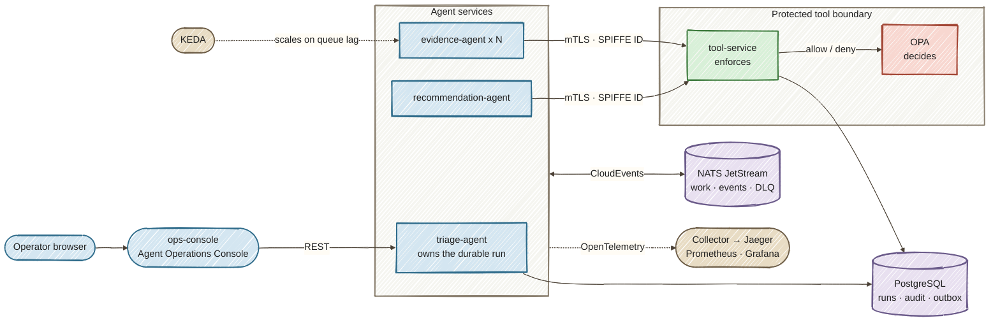

# Many Agents, One Platform

A hands-on path through an **operable Java multi-agent system** built from CNCF building blocks.
An incident assistant investigates increased checkout errors after a release. The model calls are
the least interesting part: these tutorials are about everything around them that lets you run
agents like any other production workload. That means durable workflow state, asynchronous work
with bounded retries, verified workload identity, runtime policy enforcement, connected telemetry,
and scaling driven by demand.

[](https://github.com/danieloh30/many-agents-one-platform/actions/workflows/ci.yml) [](https://github.com/danieloh30/many-agents-one-platform/actions/workflows/pages.yml)

> **Where it has been tested.** The badges above show the current build. Beyond CI, the project has been
> run end to end on a local stack (`scripts/local/stack.sh e2e`), on Kubernetes (Red Hat OpenShift) and on a local kind
> cluster (`./demo.sh verify`, six checks). The cluster results, and what has not been exercised yet, are
> recorded in [deployment.md §8](../deployment.md#8-items-that-require-cluster-verification-summary). Run
> `./demo.sh verify` to check your own cluster. This is a demonstration, not a production system.

## What the application demonstrates

Five services, each a separate Java application on Quarkus with its own identity, work together on one
durable *run*. Three of them are agentic AI Java apps: each calls the model through a LangChain4j `@Agent`
interface that returns a typed result (`IncidentTriageAgent`, `EvidenceAnalystAgent` and
`RemediationAdvisorAgent`).

| Service | Type | Role |
| --- | --- | --- |
| `ops-console` | Java app (web UI + API) | Serves the React **Agent Operations Console** and its API. It proxies run commands and holds no durable state. |
| `triage-agent` | **Agentic AI Java app** (`@Agent`) | Owns the run. It is the only writer of run state: it classifies the incident, dispatches work, folds results, and enforces deadlines and budgets. |
| `evidence-agent` | **Agentic AI Java app** (`@Agent`) | A stateless worker, scaled horizontally. It gathers facts through read tools and publishes a structured `EvidenceItem`. |
| `recommendation-agent` | **Agentic AI Java app** (`@Agent`) | Proposes a remediation, grounded in the evidence and cited. It can try to execute the proposal only through the tool service. |
| `tool-service` | Java app (policy enforcement point, no model) | The protected boundary. It verifies the caller's SPIFFE ID over mTLS, asks OPA for a decision, audits it, and runs only synthetic or simulated tools. |

### The four scenarios

Demo them in this order: each one builds on what the audience saw in the previous one. The console's presenter
checklist follows the same order, and the [demo runbook](../demo-runbook.md#3-script-800) has the timed script
(about 8 minutes).

| # | Scenario | What you see | End it with | Tutorial |
| --- | --- | --- | --- | --- |
| 1 | **Successful run** | Triage, evidence and recommendation agents complete a durable run, and one trace connects every hop. | **Approve (simulate)**: the action runs as a simulation, `REMEDIATION_SIMULATED` | [01](01-run-it-locally.md), [02](02-durable-workflow.md), [05](05-observability.md) |
| 2 | **Policy denial** | The recommendation agent tries a simulated rollback without approval. The tool service verifies its identity, and policy denies the call before anything executes. | **Approve (simulate)**: the same action, denied without approval, is allowed with it, `REMEDIATION_SIMULATED` | [04](04-identity-and-policy.md) |
| 3 | **Queue burst** | A bounded burst of evidence work raises queue depth and age. On a cluster, KEDA scales the evidence agents out and back in (verified on Red Hat OpenShift: 1 → 6 replicas); locally, one agent drains the queue slowly. | Nothing to decide: burst runs stop after evidence, `EVIDENCE_ONLY` | [06](06-scaling-with-keda.md) |
| 4 | **Redelivery** (optional) | An evidence agent abandons a task after its tool call commits. The task is redelivered, and the effect is still recorded only once. | **Approve (simulate)**, or leave it to expire after 10 minutes | [03](03-messaging-and-redelivery.md) |

A run that proposes an action waits in `AWAITING_APPROVAL` for a person. Decide on the run's **Timeline** tab, in
the recommendation card, so no run is left waiting. Use **Reset** in the top bar to start the demo over.

Tool data is synthetic and remediation is simulated: no code path can change a real cluster.

## Architecture overview



| Building block | Role |
| --- | --- |
| Java, Quarkus, Quarkus LangChain4j | Agent services; the OpenAI-compatible model is configured through `quarkus.langchain4j.openai.*` |
| React, TypeScript, Vite | The Agent Operations Console |
| PostgreSQL | Durable run records, audit, outbox and inbox |
| NATS JetStream + CloudEvents | Durable asynchronous work and events |
| OpenTelemetry, Collector, Jaeger, Prometheus, Grafana | Traces, metrics, dashboards |
| SPIFFE/SPIRE | Workload identity on the mTLS connection to the tool service |
| Open Policy Agent | Runtime authorization at the tool service |
| KEDA | Scaling evidence agents on queue lag |
| Kubernetes, OpenShift | Deployment targets |

## How to read the tutorials

Each tutorial follows the same pattern:

1. **Goal.** What you will understand by the end.
2. **Diagram.** The slice of the architecture it covers.
3. **Steps.** Numbered commands you can copy with the button on each code block.
4. **What you should see.** Observable results in the console, Jaeger, Grafana or the terminal.
5. **Key takeaways** and links to the design documents and source code.

Tutorial 01 starts the local stack, and tutorials 02 to 05 use it. Tutorials 06 and 07 need a
Kubernetes or OpenShift cluster (a local kind cluster works) and show the results observed on OpenShift.
Tutorial 08 covers how the project stays current without manual upgrades. Tutorial 09 is background reading,
not a hands-on step: why a durable workflow, not a supervisor agent, orchestrates the three agents, and why
code, not the model, picks each evidence agent's tool calls. Tutorial 10 is also background reading: the
production blueprint around the demo, and where the optional Agent Substrate runtime would fit next to KEDA.

| # | Tutorial | Needs |
| --- | --- | --- |
| 01 | [Run it locally](01-run-it-locally.md) | Local stack |
| 02 | [Durable workflow state](02-durable-workflow.md) | Local stack |
| 03 | [Messaging and redelivery](03-messaging-and-redelivery.md) | Local stack |
| 04 | [Identity and policy](04-identity-and-policy.md) | Local stack |
| 05 | [Observability](05-observability.md) | Local stack |
| 06 | [Scaling with KEDA](06-scaling-with-keda.md) | Cluster (OpenShift or kind) |
| 07 | [Deploy to Kubernetes](07-deploy-to-kubernetes.md) | Cluster (OpenShift or kind) |
| 08 | [Dependency automation](08-dependency-automation.md) | GitHub repository |
| 09 | [Orchestration choices: workflow or supervisor agent](09-orchestration-choices.md) | Nothing (background reading) |
| 10 | [Production blueprint: where Agent Substrate fits](10-production-blueprint-agent-substrate.md) | Nothing (background reading) |

## Prerequisites

- JDK 25 or newer (the Maven Wrapper is included) and Node.js 26 LTS or newer.
- For the local stack: podman or docker, `openssl`, `jq` and `curl`.
- Optional, for a live model: an OpenAI-compatible endpoint and key. Without one, the local stack
  uses the deterministic model, which is labelled everywhere it appears.
- For a cluster: `oc` logged in as a cluster administrator with `helm` (OpenShift), or `kubectl`,
  `helm`, podman or docker and a registry the cluster can pull from (other Kubernetes).

```bash
git clone https://github.com/danieloh30/many-agents-one-platform.git
cd many-agents-one-platform
java -version
node --version
```

Start with [01 · Run it locally](01-run-it-locally.md).
